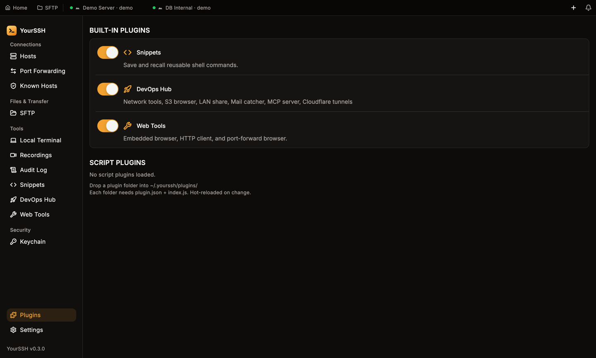

A script plugin is a folder with a `plugin.json` manifest and a JavaScript entry file. You drop it into `~/.yourssh/plugins/`. There is no build step and no app rebuild. For how the runtime loads plugins, enforces permissions and contains failures, see [Plugin system](/developer-guide/plugin-system).

Each plugin runs in its own isolated QuickJS runtime. The app injects a `plugin` object plus the `ui`, `ssh`, `storage` and `console` globals. You register handlers with `plugin.on(event, handler)`, and the app calls them when something happens: terminal output, a session connecting, a command running.

## Your first plugin

This plugin colors `ERROR` red in terminal output. It needs one permission, `terminal.transform`.

<Steps>
  <Step title="Create the folder">
    ```bash
    mkdir -p ~/.yourssh/plugins/log-highlighter
    ```
  </Step>
  <Step title="Write the manifest">
    Save this as `~/.yourssh/plugins/log-highlighter/plugin.json`:

    ```json
    {
      "id": "dev.example.log-highlighter",
      "name": "Log Highlighter",
      "version": "1.0.0",
      "entry": "index.js",
      "minAppVersion": "1.0.0",
      "permissions": ["terminal.transform"]
    }
    ```
  </Step>
  <Step title="Write the entry file">
    Save this as `~/.yourssh/plugins/log-highlighter/index.js`:

    ```js
    plugin.on("terminal.output", function (ctx) {
      return ctx.data.replace(/\bERROR\b/g, "\x1b[31;1mERROR\x1b[0m");
    });
    ```
  </Step>
  <Step title="Approve it">
    Open **Plugins** in the sidebar, or restart YourSSH. A dialog titled **Install "Log Highlighter"** lists the requested permissions. Click **Allow selected**.
  </Step>
  <Step title="See it work">
    Open a session and run `echo ERROR`. The word is red. Edit `index.js` and save: the plugin reloads on its own.
  </Step>
</Steps>

<Frame caption="Script plugins appear under Script plugins in the plugin manager. The built-in plugins are listed above them.">

</Frame>

<Note>
If you change any file in the plugin folder after approving it, the app asks for consent again. See [Consent](#consent).
</Note>

## Folder layout

```text
~/.yourssh/plugins/
  my-plugin/
    plugin.json      required: manifest
    index.js         required: entry file (named by "entry")
    lib/helpers.js   optional helper files
    panel/index.html optional: HTML for a panel
```

A plugin is a directory. The app identifies it by `plugin.json`. The `entry` path and a panel's `webviewEntry` must stay inside the plugin folder. Paths with `../`, absolute paths and symlinks that escape the folder are rejected.

## Manifest

| Field | Required | Description |
|---|---|---|
| `id` | Yes | Unique id, matching `^[a-z0-9][a-z0-9._\-]{0,63}$`. Use reverse-domain style, for example `dev.yourname.myplugin`. |
| `name` | Yes | Display name in the plugin manager and consent dialog. |
| `version` | Yes | Plugin version, `MAJOR.MINOR.PATCH`. |
| `entry` | Yes | JavaScript entry file, relative to the plugin folder. |
| `minAppVersion` | Yes | Minimum YourSSH version the plugin needs. |
| `permissions` | No | List of permissions the plugin asks for. Defaults to none. An unknown permission makes the manifest invalid. |

An invalid manifest means the plugin doesn't load.

<Warning>
The ids of the built-in plugins are reserved. A script plugin can't use `dev.yourssh.snippets` or any other built-in id; the loader skips it without prompting.
</Warning>

## Permissions

Declare only what you need. A plugin can call only the APIs whose permission the user approved.

| Permission | Grants |
|---|---|
| `terminal.read` | Observe `terminal.output` and `terminal.input`. The return value is ignored. |
| `terminal.transform` | Modify terminal output. |
| `terminal.intercept` | Cancel or modify keystrokes before they reach the SSH server. |
| `terminal.inject` | Type text into a session's shell with `ssh.inject()`. |
| `session.observe` | `session.connect` and `session.disconnect` events, and `ssh.sessions()`. |
| `session.control` | `session.connect.before`, which can cancel a connection. |
| `ssh.exec` | The `ssh-exec` panel message, and `ssh.sessions()`. |
| `sftp.read` | The `sftp-list` and `sftp-read` panel messages. |
| `sftp.write` | Reserved. No API uses it yet. |
| `command.intercept` | `command.before` and `command.after` hooks for commands run through SSH exec. |
| `ui.notify` | `ui.notify()`. |
| `ui.statusbar` | `ui.statusbar.*`, and `ui.addCommand()`. |
| `ui.panel` | `ui.panel.register()`, and `ui.addCommand()`. |
| `ui.clipboard` | `ui.clipboard.copy()`. |

`storage` and `console` need no permission.

### Consent

The first time a plugin loads, the app shows the consent dialog. You can untick individual permissions before you click **Allow selected**, and the plugin gets only the ticked ones. **Deny** keeps it from running.

- Consent is bound to a SHA-256 hash of every file in the plugin folder. Change any file and the app asks again.
- Stored grants are intersected with the manifest's current permissions, so editing the manifest can't add a permission silently.

## Hooks and events

Register a handler with `plugin.on(event, handler)`. The handler receives one `ctx` object.

| Event | Permission | Can cancel | Can transform |
|---|---|---|---|
| `terminal.output` | `terminal.transform` (or `terminal.read` to observe) | No | Yes |
| `terminal.input` | `terminal.intercept` (or `terminal.read` to observe) | Yes | Yes |
| `session.connect` | `session.observe` | No | No |
| `session.disconnect` | `session.observe` | No | No |
| `session.connect.before` | `session.control` | Yes | No |
| `command.before` | `command.intercept` | Yes | Yes |
| `command.after` | `command.intercept` | No | No |

Return values:

- Return a string to replace the data (or the command).
- Return `false` to cancel, where the event can be cancelled.
- Return nothing (`null` or `undefined`) to pass the data through unchanged.

### Terminal events

```js
plugin.on("terminal.output", function (ctx) {
  // ctx.sessionId: string
  // ctx.data: string, raw output, may contain ANSI escape codes
  return ctx.data.replace(/WARN/g, "\x1b[33mWARN\x1b[0m");
});

plugin.on("terminal.input", function (ctx) {
  // ctx.data: the keystrokes about to be sent
  if (ctx.data.trim() === "rm -rf /") return false; // block
});
```

`terminal.output` and `terminal.input` run for every chunk. Keep them synchronous and fast. Don't do heavy work in them.

### Session events

```js
plugin.on("session.connect", function (ctx) {
  // ctx.sessionId, ctx.host, ctx.username, ctx.port
  console.log("Connected to " + ctx.username + "@" + ctx.host);
});

plugin.on("session.disconnect", function (ctx) {
  ui.statusbar.remove("my-item-" + ctx.sessionId);
});

plugin.on("session.connect.before", function (ctx) {
  if (ctx.host === "blocked.example.com") return false; // cancel the connection
});
```

### Command events

`command.before` and `command.after` fire for commands run through SSH exec (for example by a panel's `ssh-exec` message). They don't fire for what you type in the terminal.

```js
plugin.on("command.before", function (ctx) {
  // ctx.sessionId, ctx.command
  if (/mkfs\./.test(ctx.command)) return false; // cancel
  return ctx.command;                            // or return a replacement
});

plugin.on("command.after", function (ctx) {
  // ctx.sessionId, ctx.command, ctx.stdout, ctx.stderr, ctx.exitCode
  if (ctx.exitCode !== 0) console.error("Failed: " + ctx.command);
});
```

## Globals

### `ssh`

| Call | Permission | Description |
|---|---|---|
| `ssh.sessions()` | `session.observe` or `ssh.exec` | Returns an array of `{ sessionId, host, username, port, connected }`. |
| `ssh.inject(sessionId, text)` | `terminal.inject` | Types `text` into the session's shell as if the user typed it. End with `\n` to run it. |

There is no JavaScript `ssh.exec`. To run a command and read its output, use the `ssh-exec` [panel message](#panels).

### `storage`

Persistent key-value store. It needs no permission and is namespaced per plugin id. Values are strings.

```js
storage.set("note", "hello");
var item = storage.get("note");   // { value: "hello" }, or null if the key is missing
if (item !== null) console.log(item.value);
storage.delete("note");
```

Top-level variables reset when the plugin reloads. Use `storage` for anything that must survive.

### `ui`

| Call | Permission | Description |
|---|---|---|
| `ui.notify(message, { type })` | `ui.notify` | `type` is `info` (default), `warning` or `error`. The app writes it to the plugin console. |
| `ui.statusbar.add(id, { label, tooltip })` | `ui.statusbar` | Adds a status bar item. |
| `ui.statusbar.update(id, { label, tooltip })` | `ui.statusbar` | Updates an item. |
| `ui.statusbar.remove(id)` | `ui.statusbar` | Removes an item. |
| `ui.panel.register(config)` | `ui.panel` | Registers a panel. See [Panels](#panels). |
| `ui.clipboard.copy(text)` | `ui.clipboard` | Copies text to the system clipboard. |
| `ui.addCommand({ id, label, keybinding })` | `ui.statusbar` or `ui.panel` | Adds a command palette entry. Its handler isn't invoked yet. |

### `console`

`console.log`, `console.warn` and `console.error` write to the plugin console. See [Debugging](#debugging).

<Note>
There is no `sftp` global in plugin JavaScript. A plugin with `sftp.read` can list and read remote files from panel HTML only. Writing, deleting and creating remote files isn't supported.
</Note>

## Panels

A panel is an HTML page your plugin shows inside the app. Register it from `index.js`:

```js
ui.panel.register({
  title: "My Panel",
  icon: "note",
  webviewEntry: "panel/index.html", // relative to the plugin folder
  onMessage: function (msg) {
    if (msg.type === "save-note") {
      storage.set("note-" + msg.host, msg.content);
      return { type: "saved" };
    }
  }
});
```

This needs `ui.panel`. The `onMessage` handler runs in the plugin's JavaScript, so it must be synchronous.

From the panel HTML, call `pluginBridge.send(message)`. It returns a promise with the reply. A panel's own messages go to `onMessage`. The four native message types below are handled by the app, so they can run async SSH and SFTP work:

| Message | Permission | Reply |
|---|---|---|
| `{ type: 'ssh-exec', sessionId, command }` | `ssh.exec` | `{ type: 'exec-result', stdout, stderr, exitCode }` |
| `{ type: 'ssh-sessions' }` | `session.observe` or `ssh.exec` | `{ type: 'sessions', data: [{ sessionId, host, username, port, connected }] }` |
| `{ type: 'sftp-list', sessionId, path }` | `sftp.read` | `{ type: 'sftp-entries', data: [{ name, isDir, size, modified }] }` |
| `{ type: 'sftp-read', sessionId, path }` | `sftp.read` | `{ type: 'sftp-content', content }` |

A failed call returns `{ type: 'error', message }`. A panel is plugin-controlled HTML, so the app checks the same permissions on these messages as on the JavaScript APIs. Declare the permission in `plugin.json`, or the call is refused.

```js
// panel/index.html
async function poll() {
  const s = await pluginBridge.send({ type: 'ssh-sessions' });
  if (!s.data.length) return;
  const r = await pluginBridge.send({
    type: 'ssh-exec',
    sessionId: s.data[0].sessionId,
    command: 'uname -a'
  });
  document.getElementById('out').textContent = r.exitCode === 0 ? r.stdout : r.stderr;
}
setInterval(poll, 10000); // timers exist in panel HTML
poll();
```

## Lifecycle and hot reload

On start, the app scans `~/.yourssh/plugins/`, validates each `plugin.json`, asks for consent if needed, then runs the entry file, where `plugin.on(...)` registers handlers.

The app watches the folder. When a `.js` file or `plugin.json` changes, it unloads the plugin and runs it again from scratch. No restart. A reload also resets the plugin's error count. You can also reload from the plugin manager.

## Limits

The runtime enforces these on every plugin.

| Limit | Value |
|---|---|
| Time per hook call or panel message | 250 ms |
| Time to load | 5 s |
| Memory | 64 MiB |
| Stack | 512 KiB |

A call that goes over its time limit is aborted.

### Circuit breaker

An error counts 1, a timeout counts 5, and a success resets the count. At 10 the app skips the plugin's hooks and unloads it. Save a file to reload it and reset the count.

## Debugging

Open **Plugins** in the sidebar and click **View logs** on your plugin. The console shows `console.log`, `console.warn` and `console.error` output, `ui.notify()` messages and JavaScript runtime errors.

Test a plugin by creating the folder, approving it once, then editing `index.js`. Each save reloads it.

### Common errors

| Message | Cause | Fix |
|---|---|---|
| `Permission denied: ui.panel not granted` | The permission is missing from the manifest, or you unticked it in the consent dialog. | Add it to `permissions` and approve again. |
| `ManifestException: plugin.json missing required field: name` | A required field is missing. | Add the field. |
| `ManifestException: Unknown permissions: ...` | A permission name isn't recognized. | Use a name from the [permissions table](#permissions). |
| `QuickJsException: SyntaxError` | Syntax error in the entry file. | Fix `index.js`. |
| Plugin doesn't load | `plugin.json` isn't valid JSON. | Validate the JSON. |

## Known limitations

| Limitation | Workaround |
|---|---|
| Hook handlers are synchronous. They can't run SSH commands or await a result. | Run async work from panel HTML with the native panel messages. |
| `setInterval` and `setTimeout` don't exist in the plugin context. | Trigger logic from hooks. Run timers in panel HTML, which has native timers. |
| The command palette handler for `ui.addCommand` isn't invoked. The entry appears but does nothing. | None yet. |
| No JavaScript `ssh.exec` and no `sftp` global. | Use the panel messages, or `ssh.inject(sessionId, "cmd\n")` to run a command in the user's shell. |
| `ui.notify` writes to the plugin console, not a toast. | Use `ui.statusbar` for visible status. |
| A panel loads from `file://`, so `fetch()` may be blocked. | Use the native panel messages instead of `fetch()`. |
| Plugins can't share state in a supported way. | None. |

## Before you share a plugin

- Request only the permissions you use.
- Keep `terminal.output` and `terminal.input` handlers synchronous and fast.
- Keep persistent state in `storage`, not in variables.
- Remove status bar items in `session.disconnect`.
- Test with no active sessions: `ssh.sessions()` returns an empty array.
- Remove noisy `console.log` calls.
- Add a `README.md` that says what the plugin does and why it needs each permission.

## Related pages

- [Plugin system](/developer-guide/plugin-system)
- [Architecture](/developer-guide/architecture)
