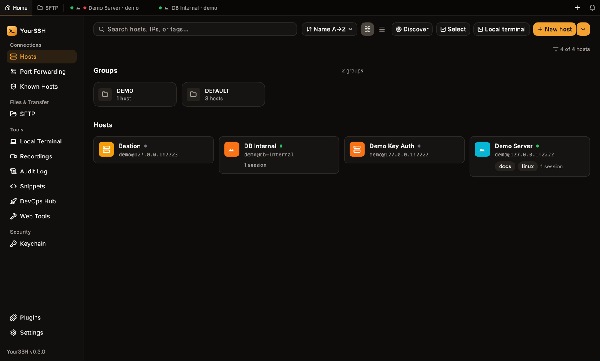

YourSSH is an open-source client for people who work on many servers: developers, sysadmins and DevOps engineers. It keeps your hosts, keys, files and remote desktops in one dark-themed app, with the secrets stored in your system credential store.

<Frame caption="The hosts dashboard: groups, host cards and live status dots.">

</Frame>

## Platforms

| Platform | Builds |
|---|---|
| macOS | Universal build (Apple Silicon and Intel), signed with a Developer ID and notarized |
| Windows | x64 and arm64 installer, plus portable `.zip` |
| Linux | x86_64 and arm64, as `.deb` (Debian, Ubuntu) or `.tar.gz` |
| Android | APK (development preview) |

See [Installation](/installation) for download links and first-launch notes.

## What you can do

<CardGroup cols={2}>
  <Card title="Hosts" icon="server" href="/user-guide/hosts">
    Save SSH, RDP and VNC hosts, group and search them, chain jump hosts.
  </Card>
  <Card title="Host keys" icon="shield-check" href="/user-guide/host-keys">
    Trust on first use, key-change warnings and the Known hosts screen.
  </Card>
  <Card title="Terminal" icon="square-terminal" href="/user-guide/terminal">
    Tabs, split view, search, shell integration and hotkeys.
  </Card>
  <Card title="Bulk actions" icon="layers" href="/user-guide/bulk-actions">
    Connect to, run a command on, or push files to many hosts at once.
  </Card>
  <Card title="Port forwarding" icon="arrow-left-right" href="/user-guide/port-forwarding">
    Local, remote and dynamic SOCKS5 tunnels.
  </Card>
  <Card title="SFTP" icon="folder-open" href="/user-guide/sftp">
    A dual-panel file manager with uploads and downloads.
  </Card>
  <Card title="RDP and VNC" icon="monitor" href="/user-guide/rdp">
    Remote desktops, direct or through an SSH tunnel.
  </Card>
  <Card title="Keychain" icon="key-round" href="/user-guide/keychain">
    Generate, import and deploy SSH keys.
  </Card>
  <Card title="Recording and audit log" icon="video" href="/user-guide/recording">
    Replay sessions and keep a secret-redacted local trail.
  </Card>
  <Card title="Sync" icon="refresh-cw" href="/user-guide/sync">
    Move your hosts between devices, encrypted.
  </Card>
</CardGroup>

## Where to start

<CardGroup cols={2}>
  <Card title="Install YourSSH" icon="download" href="/installation">
    Download the build for your operating system.
  </Card>
  <Card title="Quickstart" icon="rocket" href="/quickstart">
    Add a host, connect and open SFTP in a few minutes.
  </Card>
</CardGroup>

## Source and support

YourSSH is developed in the open at [github.com/YoursshLabs/yourssh](https://github.com/YoursshLabs/yourssh). Report bugs and request features in the [issue tracker](https://github.com/YoursshLabs/yourssh/issues). To build from source or write plugins, see the **Developer guide** tab.
