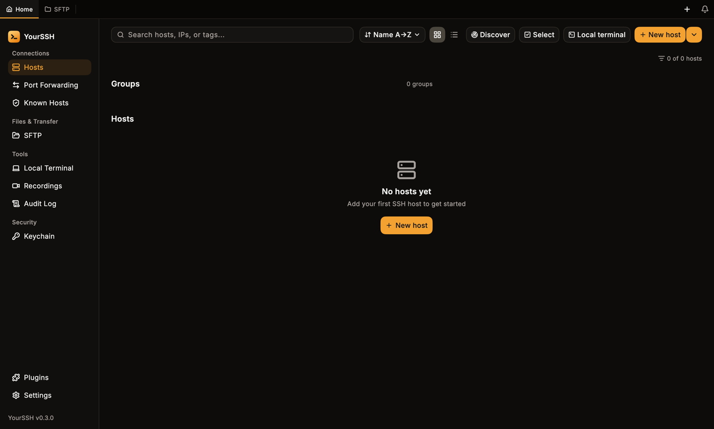

Download the latest build from the [releases page](https://github.com/YoursshLabs/yourssh/releases/latest). Replace `<version>` below with the version number, for example `0.4.0`.

<Tabs>
  <Tab title="macOS">
    1. Download `YourSSH-<version>-macOS-universal.dmg`. One build runs on Apple Silicon and Intel Macs.
    2. Open the `.dmg` and drag **YourSSH** to `/Applications`.
    3. Open YourSSH from Launchpad or Spotlight.

    Release builds are signed with a Developer ID and notarized by Apple, so Gatekeeper opens them without extra steps. If macOS still blocks a build (for example one you compiled or downloaded from a fork), right-click the app, choose **Open**, then confirm.

    A `YourSSH-<version>-macOS-universal.zip` is also published if you prefer an archive.
  </Tab>
  <Tab title="Windows">
    1. Download the installer for your CPU:
       - `YourSSH.Setup.<version>-Windows-x64.exe` for Intel and AMD PCs.
       - `YourSSH.Setup.<version>-Windows-arm64.exe` for Surface and Snapdragon devices.
    2. Run the installer and follow the wizard. YourSSH is added to the Start menu and the desktop.
    3. If Windows SmartScreen warns on first run, click **More info**, then **Run anyway**.

    Prefer no installer? Download `YourSSH-<version>-Windows-x64-portable.zip` (or `arm64`), extract it anywhere and run `yourssh.exe`.
  </Tab>
  <Tab title="Linux">
    Debian and Ubuntu (22.04 or later, Debian 12 or later):

    ```bash
    # x86_64
    sudo dpkg -i yourssh_<version>_amd64.deb

    # arm64 (Raspberry Pi 4/5, ARM servers)
    sudo dpkg -i yourssh_<version>_arm64.deb
    ```

    Then run `yourssh` or start it from your application menu. YourSSH needs GTK 3, which these distributions include.

    On other distributions, download `YourSSH-<version>-Linux-x86_64.tar.gz` or `YourSSH-<version>-Linux-arm64.tar.gz`, extract it and run the `yourssh` binary inside.
  </Tab>
  <Tab title="Android">
    Download `YourSSH-<version>-Android.apk` on your phone and open it. Android asks you to allow installs from your browser or file manager the first time.

    The Android app is a development preview. See [Mobile](/user-guide/mobile) for what it supports.
  </Tab>
</Tabs>

## First launch

YourSSH opens on the **Hosts** dashboard with a **No hosts yet** message. Continue with the [quickstart](/quickstart) to add your first host.

<Frame caption="First launch: an empty hosts dashboard.">

</Frame>

## macOS privacy prompts

YourSSH is not sandboxed, so macOS asks for access to protected folders the first time the app touches them, for example when you pick a file from **Desktop**, **Documents** or **Downloads** for an upload or an SSH key. Choose **Allow**. If you clicked **Don't Allow**, the app shows a hint instead of failing silently. Open **System Settings**, then **Privacy & Security**, then **Files and Folders**, and switch the folder on for YourSSH.

## Updates

YourSSH checks the latest stable release on GitHub at launch, then every six hours while it runs and when you return to the window. Automatic checks are skipped if the last one was less than 24 hours ago. When a newer version exists you see a **New version available** banner with **Details** and **Update** buttons, plus a notification in the bell. To check right away, open **Settings**, go to **Updates** and click **Check for updates**.

The in-app updater downloads the installer for your platform and opens it. On Windows it prefers the Setup installer over the portable build. On macOS it first verifies that the downloaded `.dmg` carries the YourSSH Developer ID signature. A file that is unsigned or signed by someone else is refused, and you are sent to the release page instead.

To update manually, install the new build over the old one. Your hosts and settings are kept.
