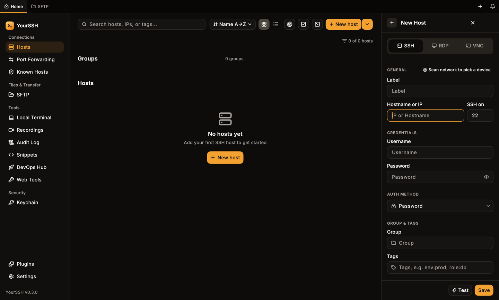
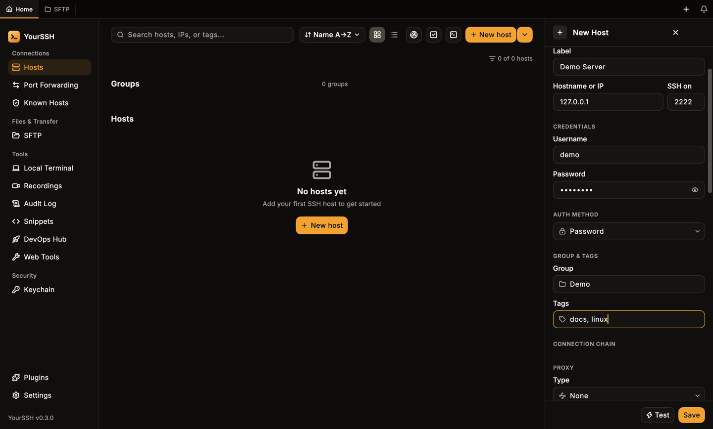
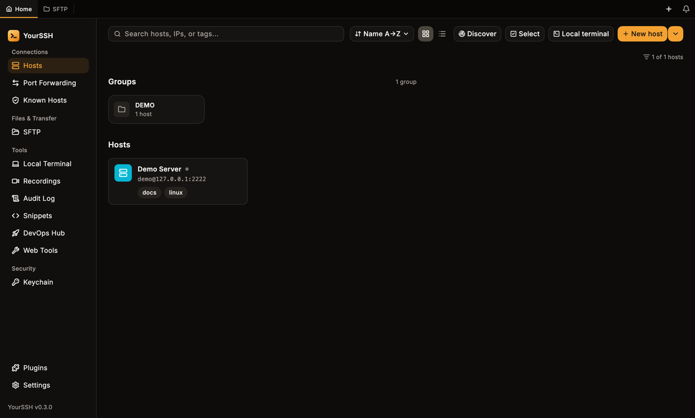
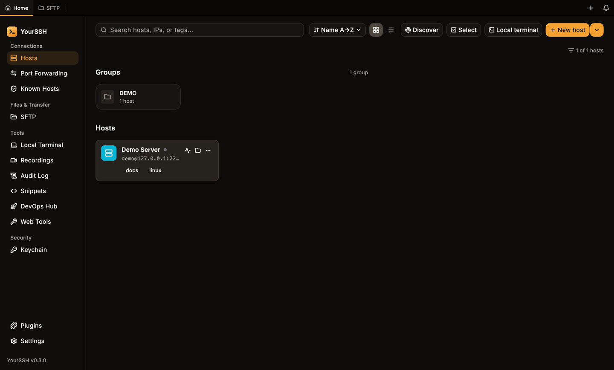
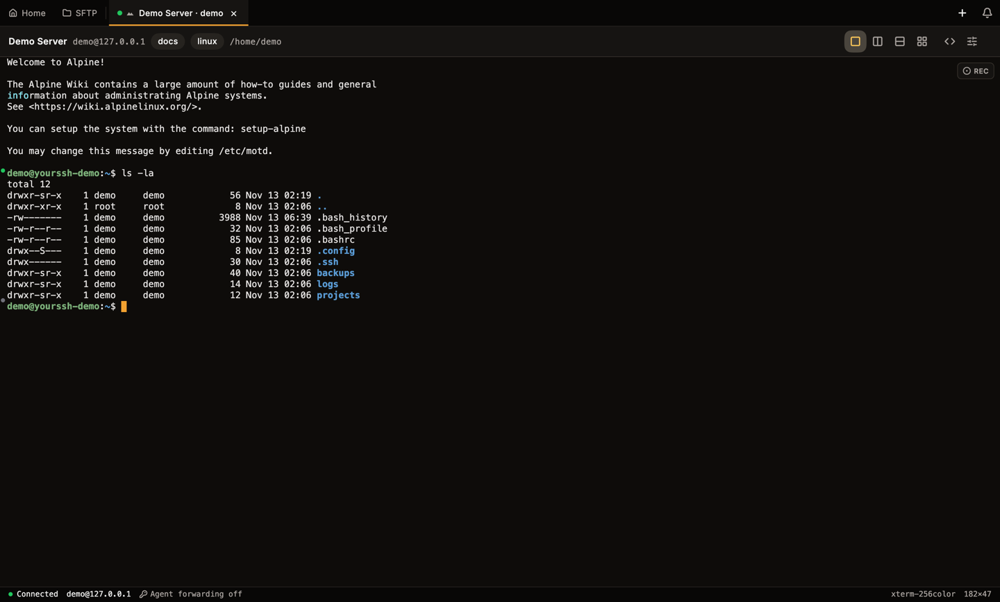
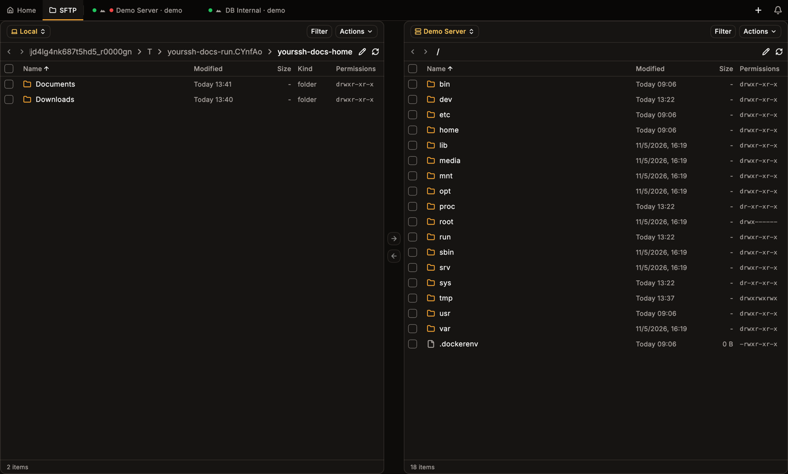

This walkthrough uses a demo host. Replace `demo`, `127.0.0.1` and port `2222` with your own server. You need [YourSSH installed](/installation) and an SSH server you can sign in to.

<Steps>
  <Step title="Open the host editor">
    On the **Hosts** dashboard, click **New host**. The host editor opens on the right. Keep **SSH** selected at the top.

    <Frame caption="The host editor, empty.">
    
    </Frame>
  </Step>

  <Step title="Fill in the host">
    Enter a **Label** (a name you will recognize), the **Hostname or IP**, the port (default `22`), your **Username** and **Password**. To use a key or your SSH agent instead, change **Auth method**. See [Hosts](/user-guide/hosts) for every option.

    <Frame caption="A filled-in host.">
    
    </Frame>
  </Step>

  <Step title="Test, then save">
    Click **Test** to check the address and credentials without opening a shell. A result such as **Connected** with a latency appears next to the button. Click **Save**. The host appears on the dashboard.

    <Frame caption="The saved host on the dashboard.">
    
    </Frame>
  </Step>

  <Step title="Connect">
    Double-click the host card to open a terminal tab (or open its three-dot menu and choose **Connect**). The first time you connect, YourSSH pins the server's host key. See [Host keys](/user-guide/host-keys) for what that means and when you get a warning.

    <Frame caption="Hover a card for quick actions: test, SFTP and the full menu.">
    
    </Frame>
  </Step>

  <Step title="Run a command">
    When the shell prompt appears, type a command and press Enter.

    <Frame caption="A connected terminal after running ls -la.">
    
    </Frame>
  </Step>

  <Step title="Open SFTP">
    Click the folder icon on the host card, or open the card's menu and choose **SFTP**. The dual-panel file manager shows your computer on the left and the server on the right.

    <Frame caption="Dual-panel SFTP.">
    
    </Frame>
  </Step>
</Steps>

## Next steps

<CardGroup cols={2}>
  <Card title="Hosts" icon="server" href="/user-guide/hosts">
    Groups, tags, keys, jump hosts and per-host options.
  </Card>
  <Card title="Terminal" icon="square-terminal" href="/user-guide/terminal">
    Tabs, split view, search and hotkeys.
  </Card>
  <Card title="SFTP" icon="folder-open" href="/user-guide/sftp">
    Transfer files in both directions.
  </Card>
  <Card title="Keychain" icon="key-round" href="/user-guide/keychain">
    Generate an SSH key and deploy it to a host.
  </Card>
</CardGroup>
