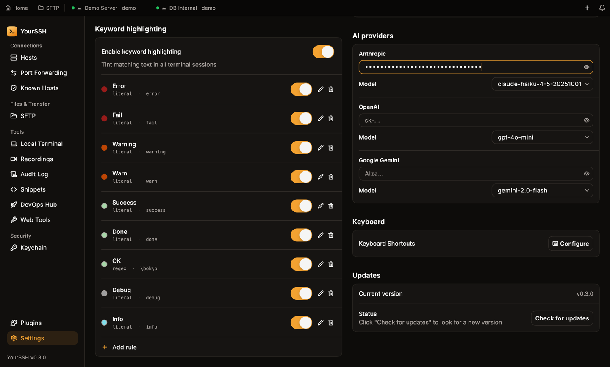
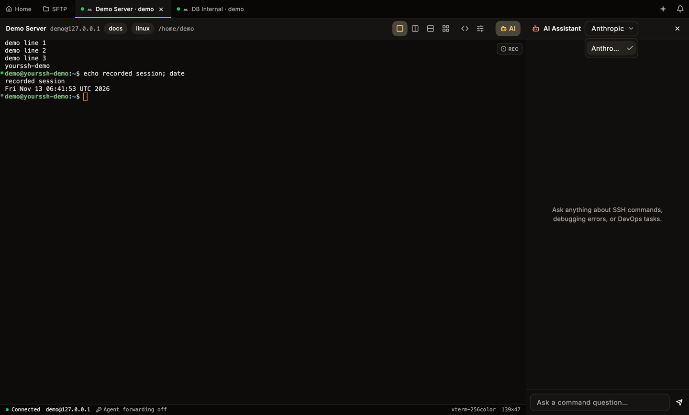
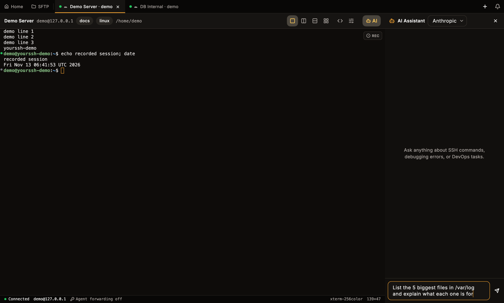

The AI assistant is a chat sidebar that opens beside your terminal. Use it to look up commands, explain error messages and get DevOps help. It talks to the AI provider you configure with your own API key.

## Set up a provider

The **AI** button stays hidden in the terminal header until at least one provider has a key.

<Steps>
  <Step title="Open the settings">
    Go to **Settings** and find the **AI providers** section.
  </Step>
  <Step title="Paste your API key">
    Paste the key into the field for **Anthropic**, **OpenAI** or **Google Gemini**. The key is hidden as you type. Click the eye icon to show it.
  </Step>
  <Step title="Pick a model">
    Choose a model from the **Model** list under the key. Each provider has its own list and default.
  </Step>
</Steps>

<Frame caption="AI providers in Settings. A saved key shows as configured, and each provider has its own model.">
  
</Frame>

| Provider | Models in the list |
|---|---|
| **Anthropic** | `claude-haiku-4-5-20251001`, `claude-sonnet-4-6`, `claude-opus-4-7` |
| **OpenAI** | `gpt-4o-mini`, `gpt-4o`, `o1-mini` |
| **Google Gemini** | `gemini-2.0-flash`, `gemini-1.5-flash`, `gemini-1.5-pro` |

To remove a key, click the clear button in its field.

### Where keys are stored

API keys are stored in the system credential store (macOS Keychain, Windows Credential Manager), not in a plain settings file. If the store can't be reached, YourSSH shows an error instead of saving the key somewhere less safe. Keys stay on this device. They aren't part of [sync](/user-guide/sync). See [Settings](/user-guide/settings) for other preferences.

## Chat in a terminal

<Steps>
  <Step title="Open the sidebar">
    In a terminal session, click **AI** in the terminal header. The sidebar titled **AI Assistant** opens on the right.
  </Step>
  <Step title="Choose a provider">
    If you configured more than one provider, pick one from the list at the top of the sidebar.
  </Step>
  <Step title="Ask a question">
    Type in **Ask a command question…** and press `Enter`. Press `Shift+Enter` for a new line.
  </Step>
</Steps>

<Frame caption="The AI Assistant sidebar beside a terminal, with the provider list open.">
  
</Frame>

Answers stream in and are formatted as Markdown, with code blocks for commands. The sidebar header has buttons to clear the chat and to close it.

<Frame caption="Shift+Enter adds a new line. Enter sends the message.">
  
</Frame>

## What is sent to the provider

- Your messages and the earlier messages of the current conversation.
- A short fixed instruction that tells the model to act as an SSH command assistant.

YourSSH does not send your terminal output, files or host details on its own. The assistant can't run commands on your host. If you want it to look at an error, paste the text into the chat. Don't paste secrets.

Your messages go to the provider you selected, under that provider's terms. Clearing the chat removes the conversation from the sidebar.

## Tips

- Paste an error and ask what it means.
- Ask for a command, then review it before you run it. Use [snippets](/user-guide/snippets) to keep the ones you reuse.
- Switch provider from the sidebar to compare answers.

## Related pages

<CardGroup cols={2}>
  <Card title="Settings" icon="settings" href="/user-guide/settings">
    Credential storage and other preferences.
  </Card>
  <Card title="Terminal" icon="terminal" href="/user-guide/terminal">
    The terminal header and sessions.
  </Card>
</CardGroup>
