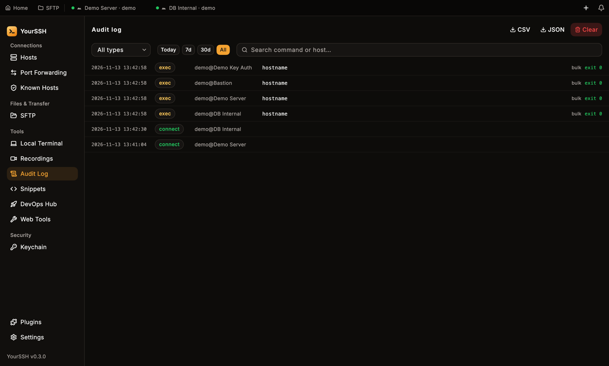
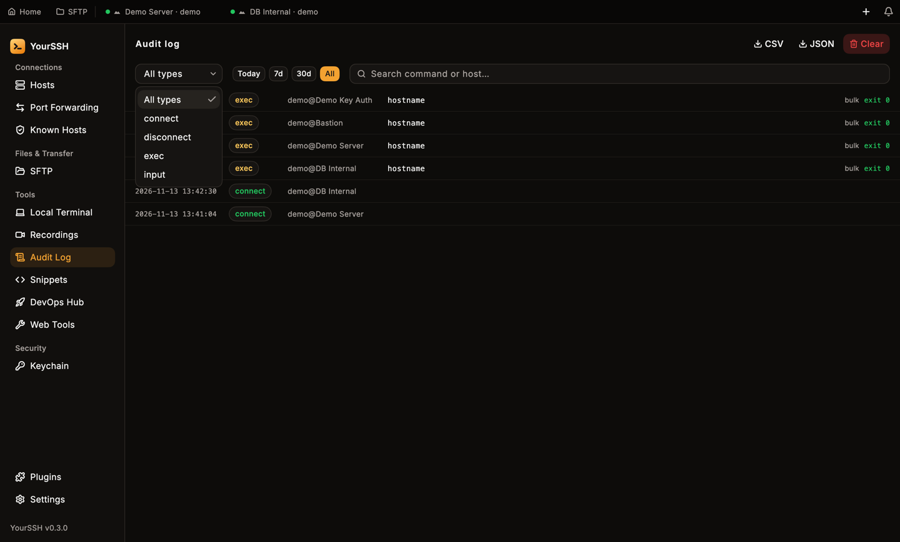
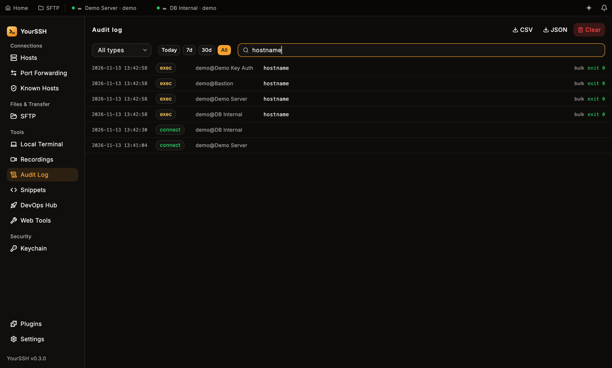
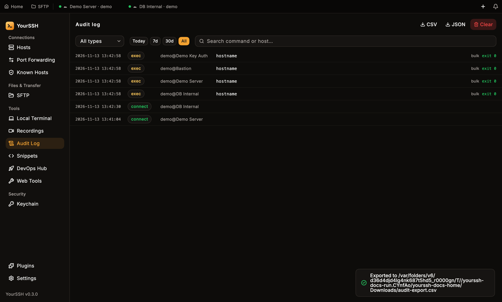
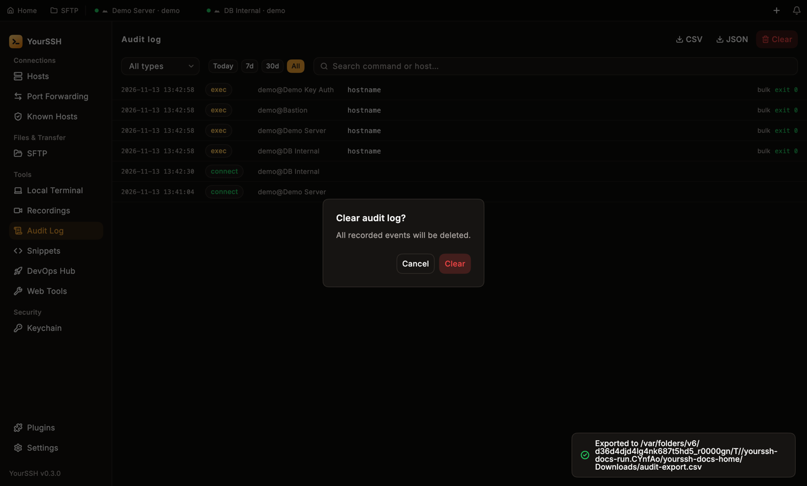

YourSSH keeps a local audit trail of what ran where: every connect and disconnect, and every command sent through an app feature such as a bulk run, DevOps tool, plugin or the input bar. Open it from **Audit Log** in the sidebar.

<Frame caption="The Audit log shows the newest events first.">
  
</Frame>

<Note>
The log records commands sent through app features. Keystrokes you type directly into a terminal aren't captured. For a full replay of a terminal, use [session recording](/user-guide/recording).
</Note>

## What gets recorded

| Type | When |
|---|---|
| `connect` | A session connects, or finally fails (with the error and number of attempts). |
| `disconnect` | You close a live tab, or a session drops, including drops that reconnect automatically. |
| `exec` | A command runs over SSH exec, with its source and exit code. |
| `input` | A command goes in through the terminal input bar, broadcast input or a plugin. |

Each row shows the time, a colored type chip, `user@host`, the command, its **source** and, for commands, the exit code. The source says which feature produced the event, for example `bulk` for [bulk actions](/user-guide/bulk-actions), `devops` for the [DevOps Hub](/user-guide/devops), `input-bar` for the input bar, `plugin:<id>` for a plugin, `cli` or `url` for connections started from the [command line](/user-guide/cli) or a `yourssh://` link, and `rdp` or `vnc` for remote desktop sessions.

YourSSH leaves out its own background probes, such as the network stats overlay and OS detection, so the log stays readable.

## Secret redaction

YourSSH scrubs commands before it writes them to disk. It masks:

- `password=`, `token=`, `secret=` and `api_key=` values, including quoted multi-word values and prefixed forms like `PGPASSWORD=`
- `Authorization: Bearer` tokens
- `sshpass -p`
- the attached `-p<password>` form of `mysql` and `mariadb`
- `redis-cli -a`
- passwords inside URLs

Error messages stored with failed events go through the same redaction.

<Warning>
Redaction is best-effort pattern matching. Avoid putting secrets on command lines where you can.
</Warning>

## Filter and search

- Pick an event type from the type menu, which starts at **All types**.
- Pick a time range with the **Today**, **7d**, **30d** and **All** chips.
- Type in **Search command or host…** to match the command or host name.
- Click **Load more** at the bottom to page through a long history.

<Frame caption="The event type menu lists All types, connect, disconnect, exec and input.">
  
</Frame>

<Frame caption="Searching for hostname narrows the list.">
  
</Frame>

## Export

Click **CSV** or **JSON** at the top to export what the current filter shows. A save dialog asks where to put the file, and a toast confirms the export.

<Frame caption="After you export, a toast confirms where the file went.">
  
</Frame>

## Retention and clearing

Open **Settings → Audit** to choose how long to keep events: `30 days`, `90 days` (the default), `365 days` or **Keep forever**. YourSSH deletes older events at launch.

Click **Clear** on the Audit log screen, or in **Settings → Audit**, to delete every event. YourSSH asks **Clear audit log?** and says all recorded events will be deleted.

<Frame caption="Clearing the audit log asks for confirmation.">
  
</Frame>

## Where it is stored

The log is a local SQLite database named `audit.db` in the app's support folder. Only your user can read it, and it never syncs anywhere.
