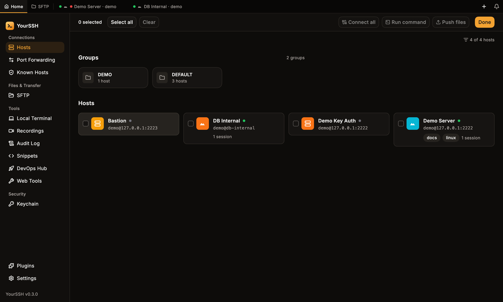
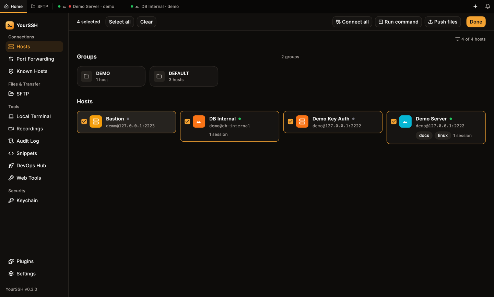
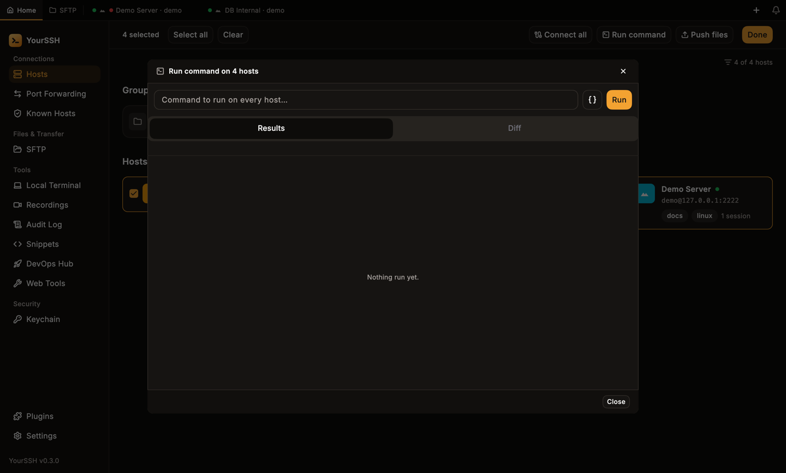
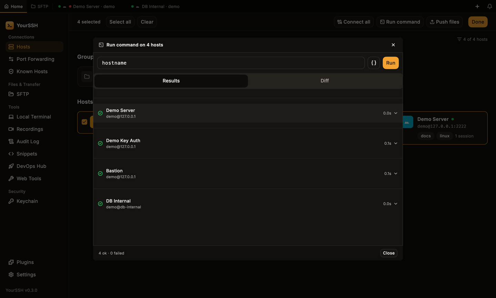
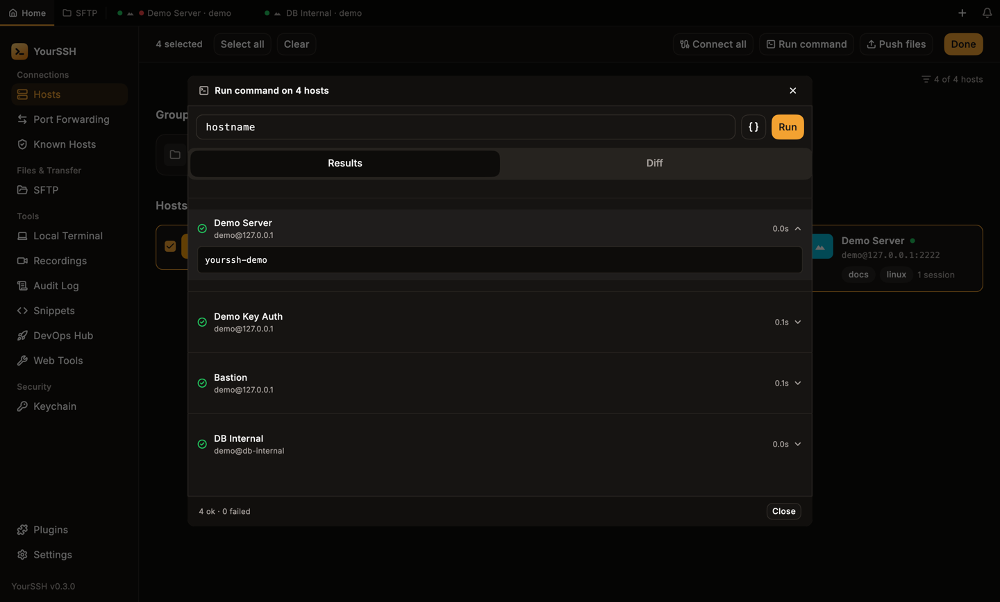
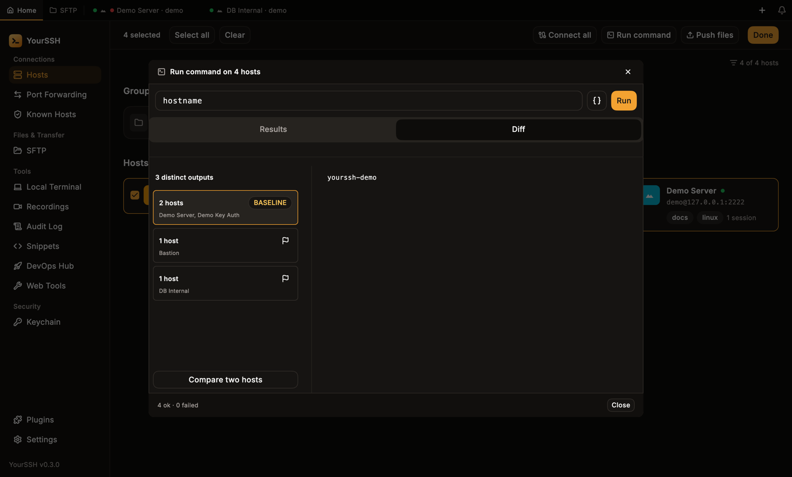
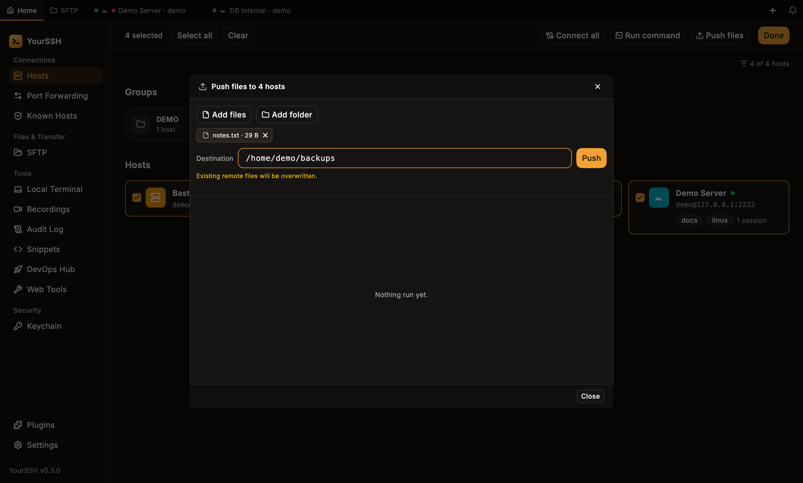

Bulk actions work on many hosts at once from the hosts dashboard. You can open a tab for each host, run one command on all of them, or upload files to the same path on each.

## Select hosts

<Steps>
  <Step title="Turn on select mode">
    On the hosts dashboard, click **Select**. Every host card gets a checkbox, and an action bar replaces the toolbar.

    <Frame caption="Select mode, with nothing selected yet.">
    
    </Frame>
  </Step>
  <Step title="Pick hosts">
    Tick the hosts you want, or click **Select all**. **Select all** respects the search and filter you have active, so filter first to select only matching hosts. **Clear** empties the selection.

    <Frame caption="Four hosts selected. The three actions are now available.">
    
    </Frame>
  </Step>
  <Step title="Choose an action">
    Click **Connect all**, **Run command** or **Push files**. Click **Done**, or press `Esc`, to leave select mode.
  </Step>
</Steps>

<Note>
  **Run command** and **Push files** work over SSH. RDP and VNC hosts in the selection are skipped, and YourSSH tells you how many.
</Note>

## Connect all

**Connect all** opens a tab for every selected host, whatever its protocol. Hosts that already have a connecting or connected session are skipped, and a notice tells you how many. If it would open more than five tabs, YourSSH asks **Open N tabs?** first: click **Open all** to continue.

## Run command

**Run command** runs one command on every selected host in parallel.

<Steps>
  <Step title="Enter the command">
    Type a command in the box, or click the `{}` button to insert a saved [snippet](/user-guide/snippets). Click **Run**.

    <Frame caption="The Run command dialog.">
    
    </Frame>
  </Step>
  <Step title="Read the results">
    The **Results** tab lists each host with its status and duration. Click a row to expand its output and exit code.

    <Frame caption="All four hosts finished.">
    
    </Frame>

    <Frame caption="An expanded row shows what that host printed.">
    
    </Frame>
  </Step>
</Steps>

Hosts run in parallel, at most six at a time. Each host has a 30-second timeout, and a failure on one host never stops the others.

### Exit codes and the footer

The footer summarizes the run, for example `3 ok · 1 non-zero exit · 0 failed`:

- **ok**: the command ran and returned exit code 0.
- **non-zero exit**: the command ran but returned a non-zero code, or the server sent no exit status. The row shows the real code, or marks it as unknown.
- **failed**: YourSSH could not run the command, for example the host was unreachable, authentication failed or it timed out.
- **cancelled**: shown only if you cancelled hosts that had not started.

### Diff

The **Diff** tab groups hosts that printed identical output. The biggest group is the **BASELINE**. Click the flag on another group to make it the baseline instead. Click **Compare two hosts** to see two hosts' output side by side. This is a quick way to find the one server whose config differs.

<Frame caption="Three distinct outputs: two hosts match the baseline.">

</Frame>

## Push files

**Push files** uploads files or folders to the same path on every selected host.

1. Click **Add files** or **Add folder**. Each item appears as a chip with its size, and the **x** removes it.
2. Enter an absolute **Destination**, for example `/home/demo/backups`. YourSSH creates the folder if it doesn't exist.
3. Click **Push**. Each host shows its own progress.

<Frame caption="A file and a destination, ready to push.">

</Frame>

<Warning>
  Existing remote files with the same name are overwritten without asking.
</Warning>

## Cancel a running job

If you close a bulk dialog while work is still running, YourSSH asks **Cancel run?** (or **Cancel push?**). Choose **Keep running** (or **Keep pushing**) to carry on. For a run, **Cancel run** stops the queue, and hosts already in flight finish with their real result. For a push, **Cancel push** stops transfers in flight at the next file boundary.

## Related

- [Hosts](/user-guide/hosts) covers groups, tags and search, which make selecting easier.
- [Terminal](/user-guide/terminal) covers broadcast, for typing into several open sessions at once.
