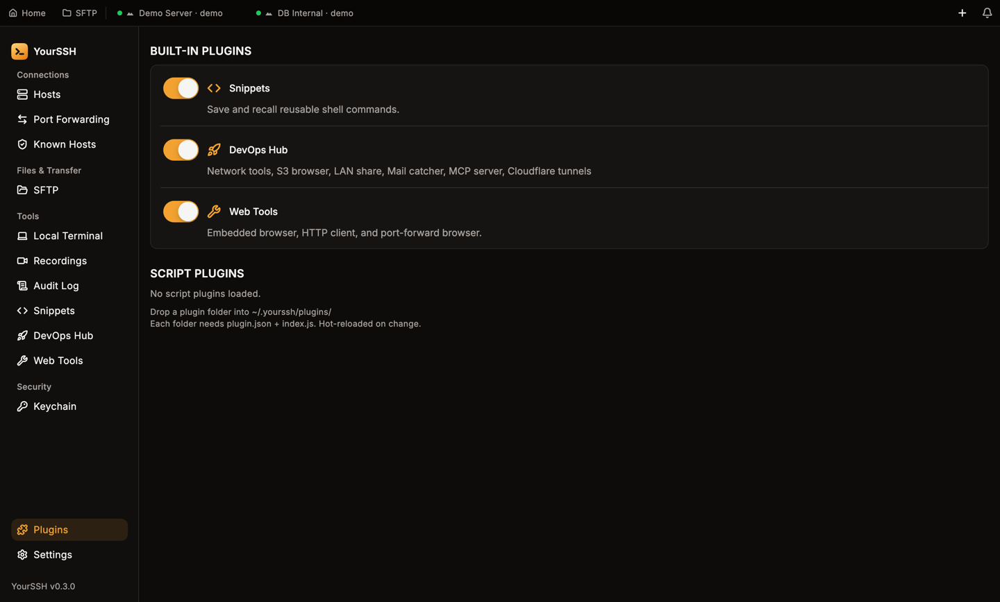
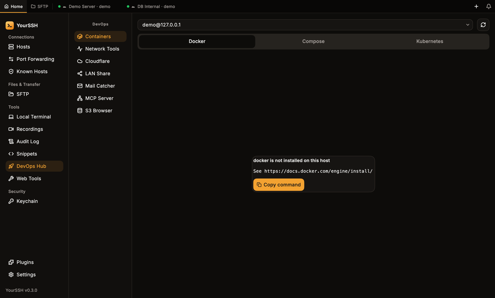
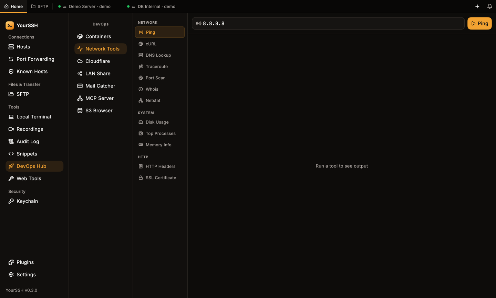
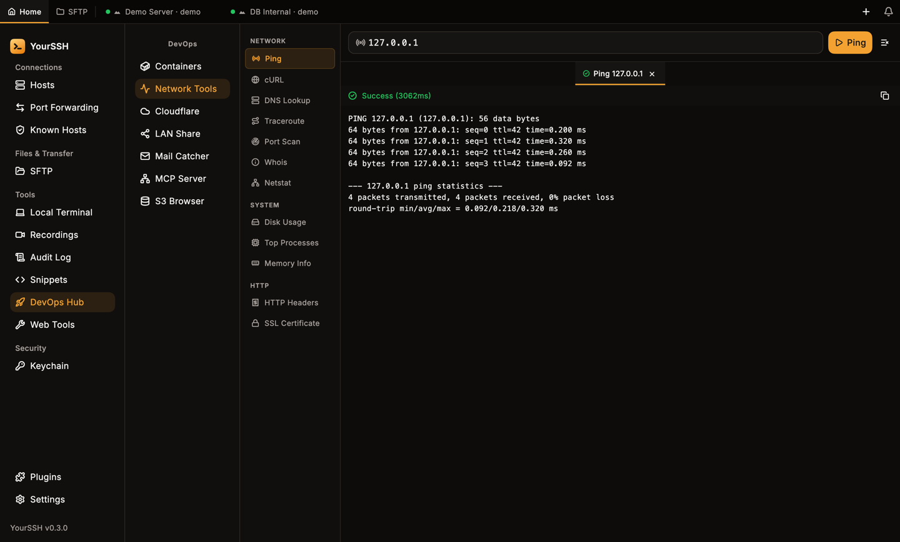
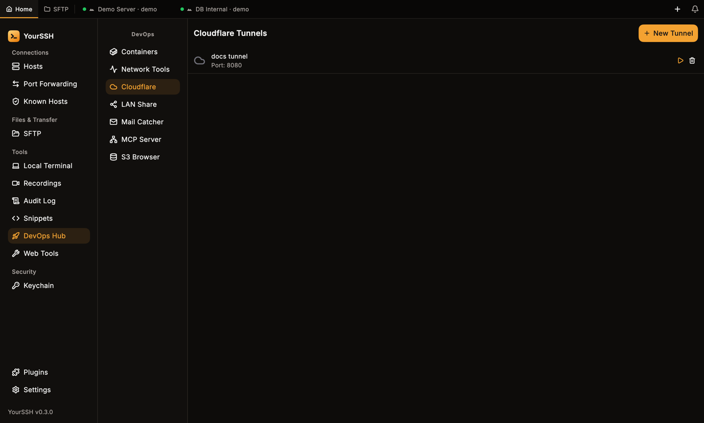
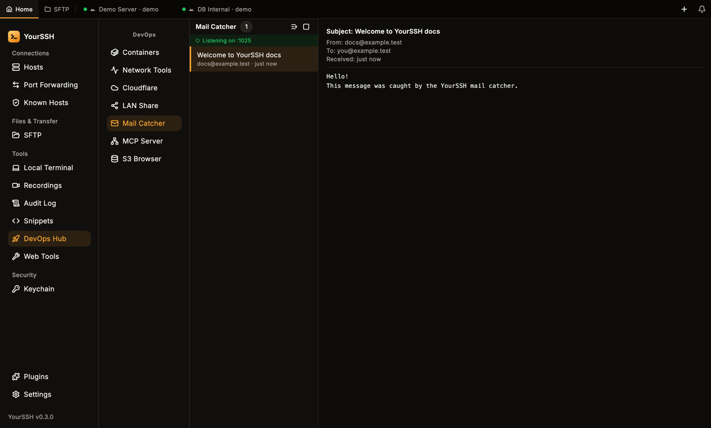
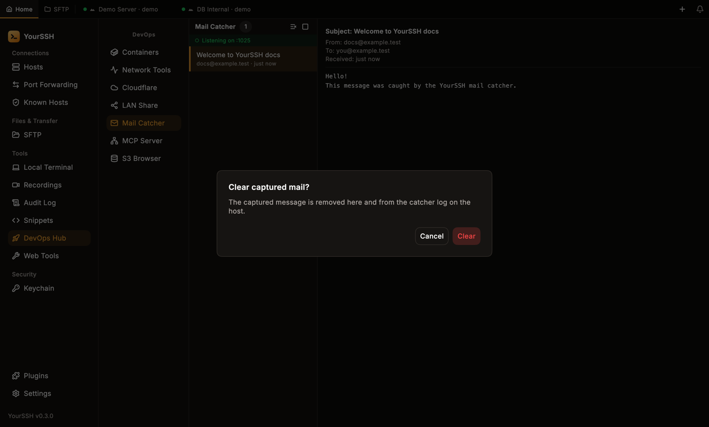
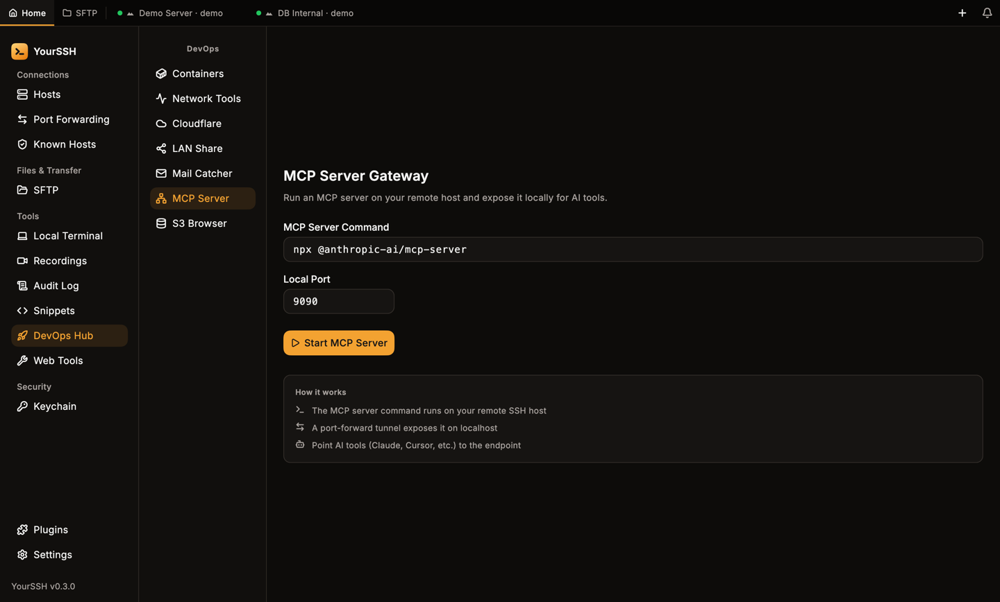
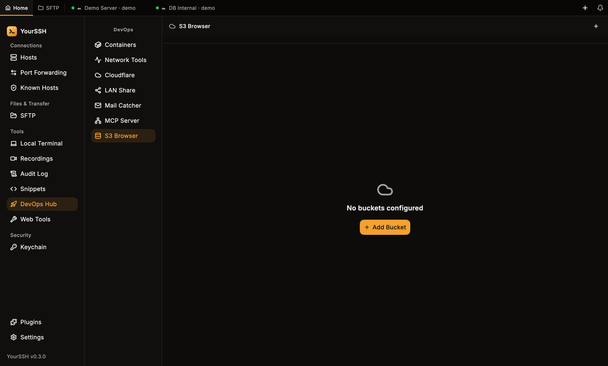

DevOps Hub is a built-in plugin with seven tools. Most of them run on the host of an open SSH session, so connect to a host first.

## Open the hub

Click **DevOps Hub** in the sidebar under **Tools**. The hub has its own list on the left: **Containers**, **Network Tools**, **Cloudflare**, **LAN Share**, **Mail Catcher**, **MCP Server** and **S3 Browser**. The hub opens on **Network Tools**.

If **DevOps Hub** is missing, turn it on in **Plugins** under **BUILT-IN PLUGINS**.

<Frame caption="The Plugins screen. DevOps Hub, Snippets and Web Tools can each be switched on or off.">
  
</Frame>

<Note>
Commands the hub runs on a host are recorded in the [audit log](/user-guide/audit-log) with the source `devops`.
</Note>

## Containers

**Containers** manages Docker, Docker Compose and Kubernetes on the remote host.

1. Pick a session from the list at the top. If no SSH session is open, the tool asks you to open one first.
2. Click the refresh button (**Rescan runtimes**), or **Scan**, to detect what is installed.
3. Switch between the **Docker**, **Compose** and **Kubernetes** tabs.

If a tool isn't installed on the host, the tab says so, for example **docker is not installed on this host**, and offers **Copy command** with the install hint.

<Frame caption="Docker is not installed on this host: the tab shows an install hint instead of an empty list.">
  
</Frame>

### Docker

The **Docker** tab lists all containers, running and stopped, with image and status. Each container has icon buttons. Hover one to see its name:

| Button | What it does |
|---|---|
| **Stop**, **Restart**, **Start** | Change the container state. Which one shows depends on the current state. |
| **Exec** | Opens a shell inside the container. |
| **Logs** | Shows the live log below the list. |

### Compose

The **Compose** tab lists Compose stacks found on the host. Use **Add path manually** to add a stack that isn't found. For each stack you can bring it **Up** or **Down** and select it to see its services. **Down** asks you to confirm first. For each service you can start, stop and open **Logs**. Docker Compose v2 is required.

### Kubernetes

The **Kubernetes** tab lists pods. Filter by **Namespace** or turn on **All namespaces**. For a pod you can **Exec** into a container, open **Logs** or use **Forward port** to forward a pod port to a local port. `kubectl` must be installed on the host.

## Network tools

**Network Tools** runs diagnostics on the host of the active session. Pick a tool from the list. Most tools ask for a target such as a host, URL or path. **Netstat**, **Top Processes** and **Memory Info** don't. Click the run button, which carries the tool's name. Without an open SSH session the tool shows **No active session — connect to a host first**.

| Group | Tools |
|---|---|
| **NETWORK** | **Ping**, **cURL**, **DNS Lookup**, **Traceroute**, **Port Scan**, **Whois**, **Netstat** |
| **SYSTEM** | **Disk Usage**, **Top Processes**, **Memory Info** |
| **HTTP** | **HTTP Headers**, **SSL Certificate** |

The commands run on the remote host, not on your computer. Each run opens a result tab. Use the copy button to copy the output and **Clear all tabs** to close them.

<Frame caption="Network Tools with the tool list. Most tools take a target such as a host, URL or path.">
  
</Frame>

<Frame caption="A ping result in its own tab, with the run time.">
  
</Frame>

## Cloudflare tunnels

**Cloudflare** starts a quick tunnel with `cloudflared` on the remote host and gives you a public HTTPS URL for a port on that host. Use it to share a dev server without changing firewall rules.

<Steps>
  <Step title="Connect to a host">
    The tool needs an active SSH session. `cloudflared` must be installed on that host.
  </Step>
  <Step title="Add a tunnel">
    Click **New Tunnel**. Enter a **Label** and the **Local Port** (1–65535), then click **Add Tunnel**. Empty or invalid fields show **Required** or **Invalid (1–65535)**.
  </Step>
  <Step title="Start it">
    Click the start button on the tunnel. When it is running, use **Copy URL** to copy the public address. The stop button ends it. **Remove** deletes the entry after you confirm **Remove tunnel**.
  </Step>
</Steps>

<Frame caption="A saved tunnel with its local port, start button and delete button.">
  
</Frame>

If `cloudflared` isn't installed on the host, starting a tunnel shows an error with the install command.

<Warning>
Anyone with the tunnel URL can reach that port while the tunnel runs. Stop the tunnel when you are done.
</Warning>

## LAN Share

**LAN Share** shares one file over HTTP on your local network.

1. Click **Pick File to Share** and choose a file on your computer.
2. YourSSH generates a local URL on port `8765` that contains a random token. Use **Copy URL** to copy it. The URL uses your Wi-Fi address, so the computer needs to be on Wi-Fi.
3. Anyone on the same network who has the URL can download the file with a browser. The link is plain HTTP.

Click **Stop Sharing** when you are done. Sharing also stops when you switch to another tool in the hub, and the link only works while YourSSH is running.

## Mail Catcher

**Mail Catcher** starts a small SMTP server on the remote host so you can test the mail your app sends, without delivering it. It needs `python3` on the host.

<Steps>
  <Step title="Start it">
    Click the start button (its tooltip reads **Start on port 1025**). The header then shows **Listening on :1025**.
  </Step>
  <Step title="Point your app at it">
    Configure the app on that host to send mail to SMTP port `1025`.
  </Step>
  <Step title="Read the mail">
    Captured messages appear in the list with the sender and time. Select one to see **Subject**, **From**, **To**, **Received** and the body.
  </Step>
</Steps>

<Frame caption="A captured message. The list is on the left and the detail on the right.">
  
</Frame>

Click **Clear all** (the clear button in the header) to remove every captured message. YourSSH asks **Clear captured mail?** first, because the messages are also removed from the catcher log on the host. Click **Stop** to shut the server down.

<Frame caption="Clear all asks for confirmation before it deletes anything.">
  
</Frame>

## MCP Server

**MCP Server** runs a Model Context Protocol server on the remote host and makes it available on a local port, so an AI client on your computer can use it.

1. Enter the **MCP Server Command** that starts the server on the host. The default is `npx @anthropic-ai/mcp-server`.
2. Set the **Local Port** (default `9090`).
3. Click **Start MCP Server**.

YourSSH forwards the port over SSH and shows the endpoint, with a button to copy it. Point your AI tool at that endpoint. Click **Stop MCP Server** to end it. The page explains the flow under **How it works**.

<Frame caption="The MCP Server Gateway form.">
  
</Frame>

## S3 Browser

**S3 Browser** browses S3-compatible storage such as AWS S3, MinIO and Cloudflare R2. It talks to the bucket directly from your computer, so it doesn't need an SSH session.

<Steps>
  <Step title="Add a bucket">
    Click **Add Bucket** and fill in **Display Name**, **Endpoint**, **Bucket**, **Region**, **Access Key** and **Secret Key**. Click **Save**.
  </Step>
  <Step title="Browse">
    Open the bucket to see its folders and objects. You can upload, create a folder with **New Folder**, rename or move an object, copy a download URL, download an object to your `Downloads` folder and delete objects.
  </Step>
</Steps>

Bucket settings, including the keys, are stored in the system credential store. Use **Edit Bucket** and **Remove Bucket** to change or delete a saved bucket.

<Frame caption="S3 Browser before any bucket is added.">
  
</Frame>

## Related pages

<CardGroup cols={2}>
  <Card title="Web Tools" icon="wrench" href="/user-guide/web-tools">
    HTTP client, utilities and an embedded browser.
  </Card>
  <Card title="Port forwarding" icon="arrow-left-right" href="/user-guide/port-forwarding">
    Tunnels behind the MCP server and browser.
  </Card>
</CardGroup>
