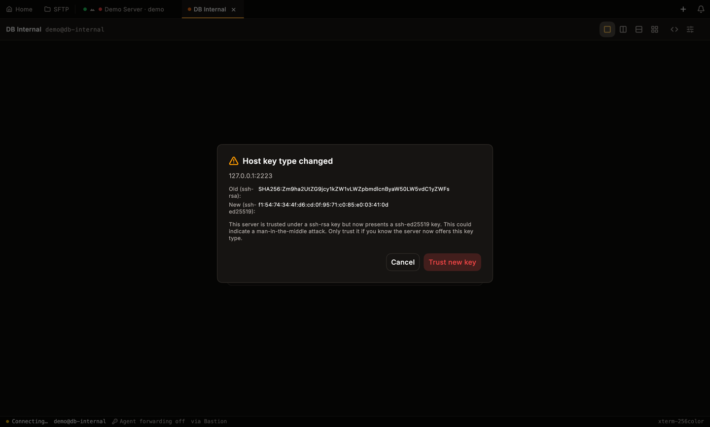
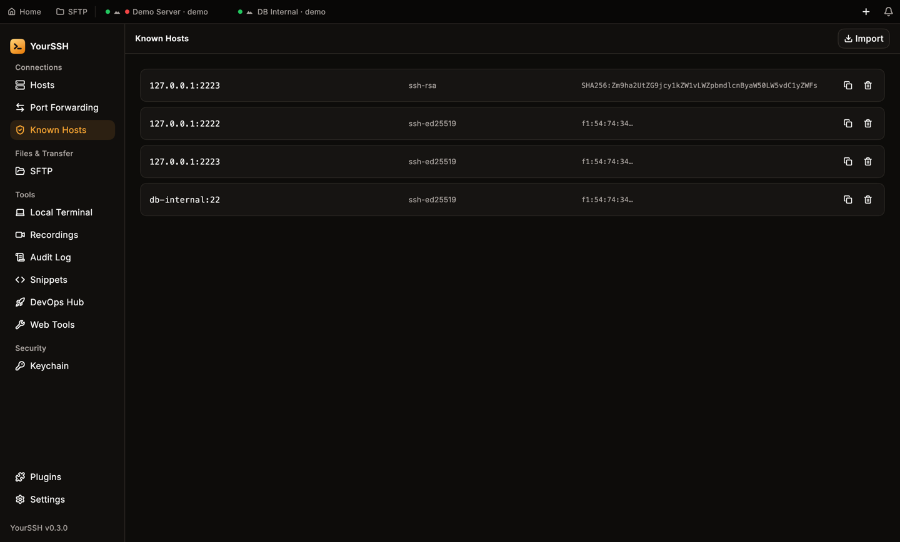
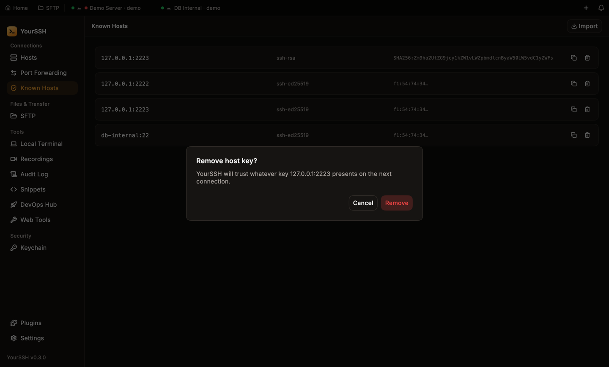

Every SSH server has a **host key**. YourSSH remembers it the first time you connect and checks it on every later connection. If the key is different, someone may be impersonating the server, so YourSSH stops and asks you.

## Trust on first use

When you connect to a host or port that YourSSH has never seen, it saves the server's host key without asking, then continues. This is trust on first use. The first connection is the only moment an attacker could slip in unnoticed, so connect to new servers from a network you trust.

The pin is stored per host, port and key type. The same check applies to every hop of a [connection chain](/user-guide/hosts#connection-chain), to **Test**, to [SFTP](/user-guide/sftp) and to [port forwarding](/user-guide/port-forwarding).

## When a key changes

If a pinned server presents a different key, the connection is blocked until you decide.

<Warning>
  A changed host key can mean a man-in-the-middle attack. Only choose **Trust new key** if you know why the key changed, for example after you reinstalled the server.
</Warning>

### Host key type changed

A server can offer several key types, such as `ssh-ed25519` and `ssh-rsa`. If you pinned one type and the server now presents another, YourSSH shows **Host key type changed** with the old and new SHA-256 fingerprints. A server or attacker that only changes the algorithm cannot get past the pin.

<Frame caption="The key type changed. Cancel is selected by default.">

</Frame>

### Host key changed

If the key type is the same but the key itself is different, YourSSH shows **Host key changed** with the old and new fingerprints.

In both cases:

- **Cancel** aborts the connection and keeps the old pin. It has the default focus.
- **Trust new key** replaces the pin and continues.

## Known hosts

Open **Known Hosts** in the sidebar to see every pinned key. Each row shows the host and port, the key type and the fingerprint.

<Frame caption="The Known Hosts screen.">

</Frame>

- **Copy fingerprint**: copies the fingerprint of the row (the copy icon).
- **Remove**: deletes the pin (the trash icon). YourSSH asks **Remove host key?** first, because it will then trust whatever key that host presents on the next connection. Cancel is selected by default.
- **Import**: reads `~/.ssh/known_hosts` and adds entries you don't have yet. YourSSH reports **Imported N entries**, or **No new entries found**. If the file doesn't exist, it says so.

<Frame caption="Removing a pin asks for confirmation.">

</Frame>

Use remove after you legitimately rebuild a server, then connect again to pin the new key.

## RDP certificates

Remote desktop hosts use a certificate instead of an SSH host key. The pin works similarly, is stored in the same Known Hosts list and is covered on the [RDP page](/user-guide/rdp).
