A **host** is a saved connection profile. You manage hosts on the **Hosts** dashboard (sidebar, **Hosts**) and edit them in the host editor.

## The hosts dashboard

<Frame caption="Grid view. Group cards sit above the host cards, and a dot shows whether a host has a live session.">
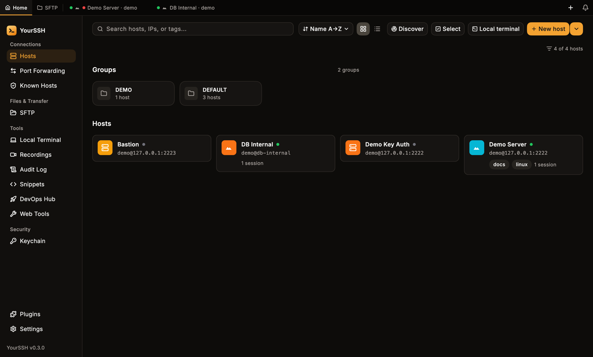
</Frame>

The toolbar has, from left to right:

| Control | What it does |
|---|---|
| Search box | Filters hosts as you type. See [Search and filter](#search-and-filter). |
| Sort | Orders hosts. |
| Grid and list buttons | Switch the layout. |
| **Discover** | Scans your network for devices. See [Discover devices](#discover-devices). |
| **Select** | Turns on select mode for [bulk actions](/user-guide/bulk-actions). |
| **Local terminal** | Opens a shell on your own computer. |
| **New host** | Opens the host editor. The arrow next to it adds **New group** and **Import**. |

When the window is narrower than 900 px, lower-priority controls collapse into icons or a menu.

### Grid and list

Grid view shows cards. List view shows one compact row per host. Your choice, and your sort order, are remembered between launches.

<Frame caption="List view.">
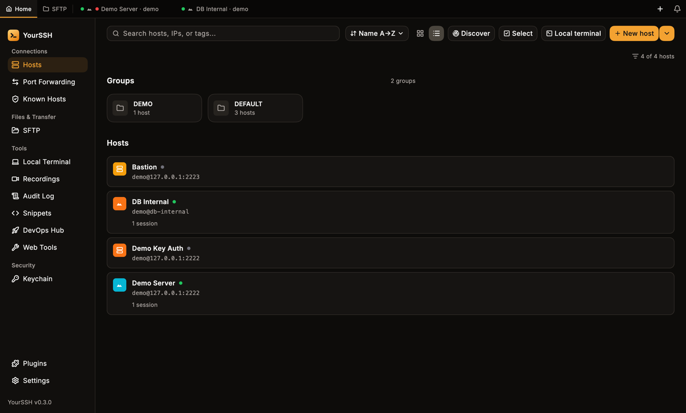
</Frame>

### Sort

Open the sort menu and pick **Name A→Z**, **Name Z→A**, **Host A→Z**, **Host Z→A**, **Newest first** or **Oldest first**. The default is **Name A→Z**.

<Frame caption="The sort menu.">
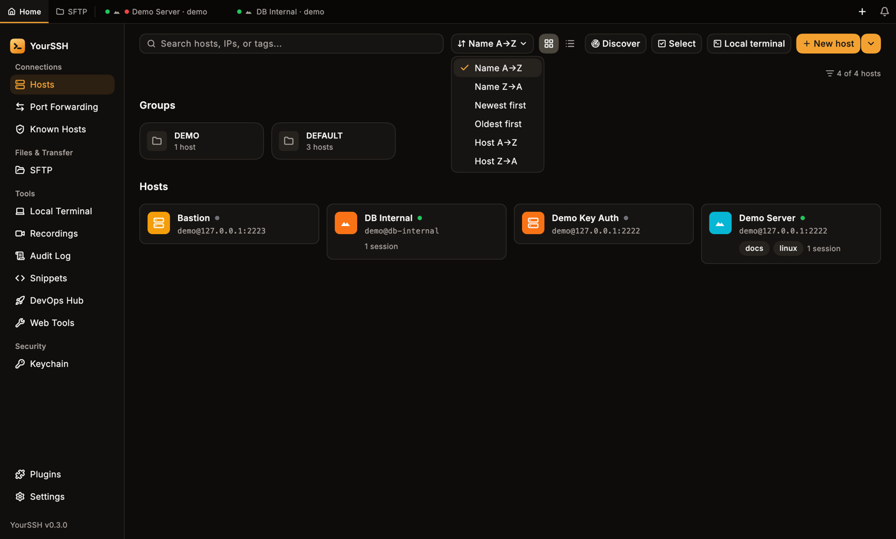
</Frame>

### Search and filter

Type in the search box to match labels, hostnames, IPs, usernames and tags. Tokens written as `key:value` match tags of the same form. Tag a host `env:prod` and search `env:prod` to find it. Values for the same key are ORed (`env:prod env:staging`), different keys are ANDed (`env:prod role:db`).

<Frame caption="Searching for bastion.">
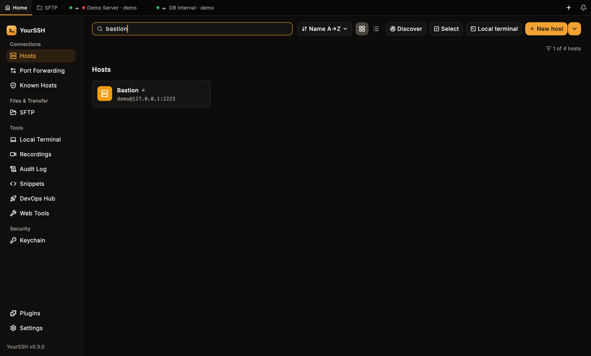
</Frame>

When any host has a `key:value` tag, a row of filter chips appears on the left of the **N of M hosts** counter, one chip per distinct tag. Click a chip to add or remove that tag from the search.

### Groups

Click **New host**'s arrow, then **New group**, to create a group. Set a host's **Group** in the editor, or choose **Move to group** from its card menu. Click a group card to see only its hosts. Use the group card's options menu to delete a group.

### Host card menu

Double-click a card to connect. Hover it to see quick actions: **Test connection** (the pulse icon), **SFTP** (the folder icon) and the three-dot **More** menu.

<Frame caption="The card menu.">
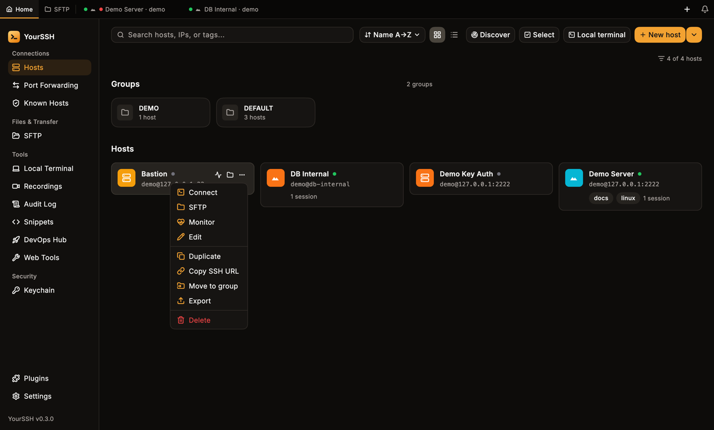
</Frame>

| Item | What it does |
|---|---|
| **Connect** | Opens a session. |
| **SFTP** | Opens the file manager on this host. SSH hosts only. |
| **Monitor** | Shows live server stats. SSH hosts only. |
| **Edit** | Opens the host editor. |
| **Duplicate** | Makes a copy of the host. |
| **Copy SSH URL** | Copies a connection URL such as `ssh://user@host:port`. The scheme follows the host's protocol, and the item reads **Copy RDP URL** or **Copy VNC URL** for those hosts. |
| **Move to group** | Changes the host's group. |
| **Export** | Shows the host as `.ssh/config` text or JSON, ready to copy. |
| **Delete** | Deletes the host after a confirmation. |

<Frame caption="Deleting a host asks first. Cancel is selected by default.">
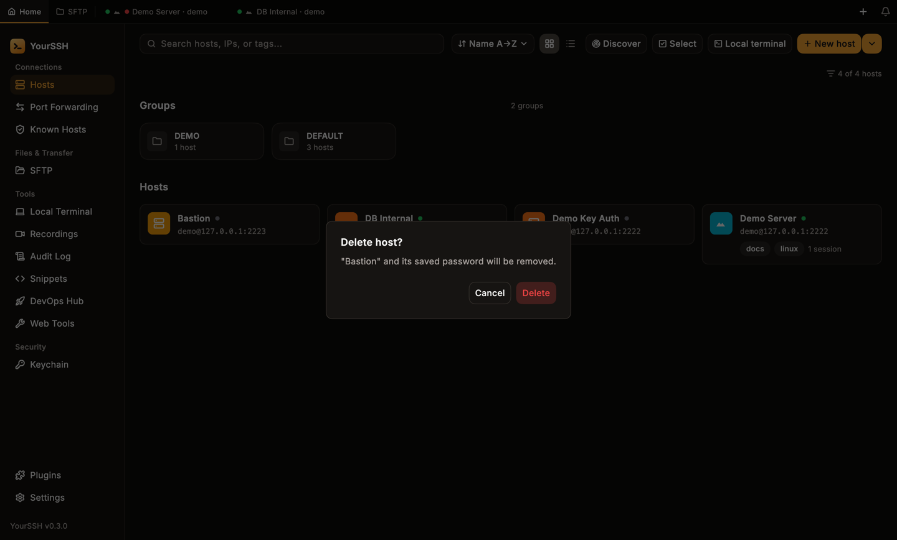
</Frame>

### Discover devices

**Discover** scans a local subnet for devices with SSH open. Pick a subnet (the app fills in your network's), click **Scan**, then click **Add** to save a result as a host or **Connect** to open a session. When you create a new host, the **Scan network to pick a device** link in the editor opens the same scan and fills the hostname with the device you pick.

### Import hosts

Open the arrow next to **New host** and choose **Import**. Pick a source tab, then choose a file or paste text, click **Parse** and review the hosts before importing. The sources are:

- **~/.ssh**: OpenSSH config text. JSON host lists, such as the YourSSH export, are also recognized here.
- **CSV** with columns `host, label, port, username, auth_type, group, tags`
- **PuTTY**, **MobaXterm**, **SecureCRT**, **WinSCP**, **Termius** exports and **Ansible** INI inventories
- **SSH URI**: one `ssh://user@host:port` per line

CSV rows that can't be parsed are listed as warnings, not silently dropped.

## The host editor

Click **New host**, or **Edit** on a card. The editor opens as a side panel. Press `Enter` in any single-line field to save.

<Frame caption="The host editor for an SSH host.">
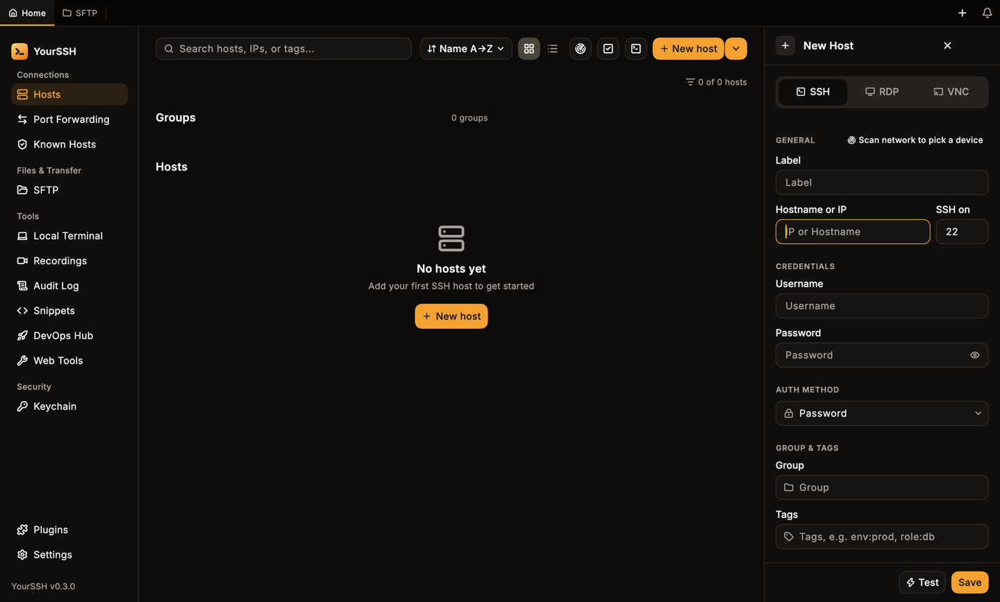
</Frame>

### Protocol

The switch at the top selects **SSH**, **RDP** or **VNC**. Changing it swaps the sections below. The port changes to the protocol's default (22, 3389, 5900) unless you already typed a custom port. RDP and VNC hosts hide the SSH-only sections. See [RDP](/user-guide/rdp) and [VNC](/user-guide/vnc).

### General

**Label** is the display name. **Hostname or IP** and the port sit side by side. Tab moves through label, hostname, port and username.

### Credentials and auth method

Set **Username** and **Password**, then choose an **Auth method**:

| Method | Use it when |
|---|---|
| **Password** | You sign in with a password. It is stored in the system credential store. |
| **Private Key** | You sign in with a key. Pick one under **Select key** from your [Keychain](/user-guide/keychain). A key can carry a passphrase and an SSH certificate there. |
| **SSH Agent** | Your local agent holds the key (`SSH_AUTH_SOCK` on macOS and Linux, the OpenSSH agent pipe on Windows). |

<Frame caption="Choosing the auth method.">
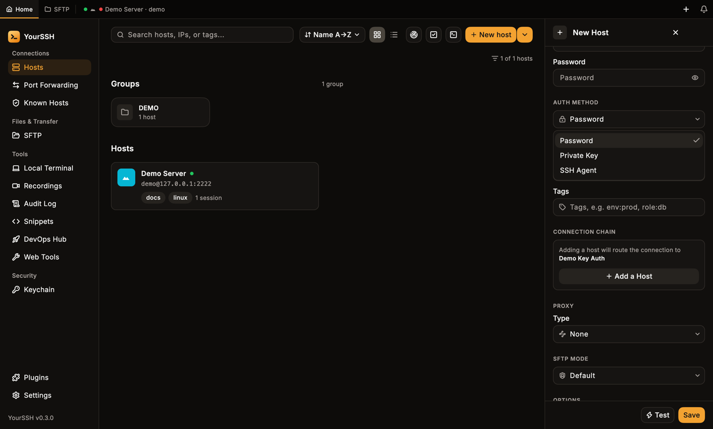
</Frame>

<Frame caption="A host that uses a key from the Keychain.">
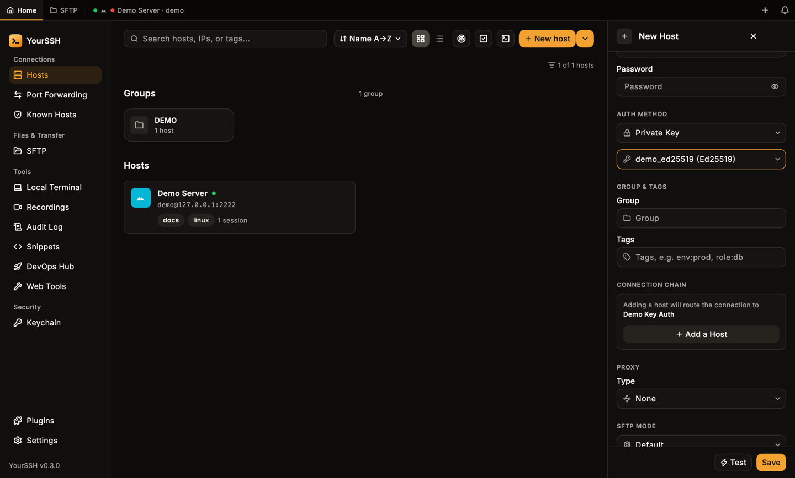
</Frame>

### Group and tags

Choose a **Group** and add **Tags**, comma separated. Use `key:value` tags such as `env:prod, role:db` to get the search facets above.

<Frame caption="Group and tags.">
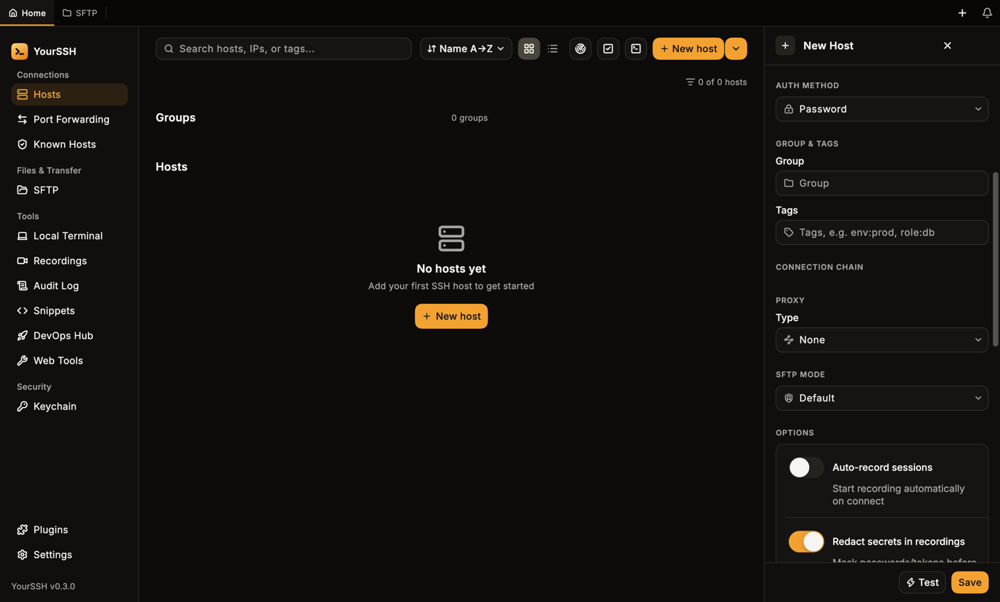
</Frame>

### Connection chain

The **CONNECTION CHAIN** section routes the connection through one or more jump hosts (bastions). Click **Add a Host** and pick a saved host. Repeat to add more hops. Each hop has a remove button, and **Clear** returns to a direct connection. Hosts already in the chain are not offered again, so you can't create a loop.

<Frame caption="Picking a jump host.">
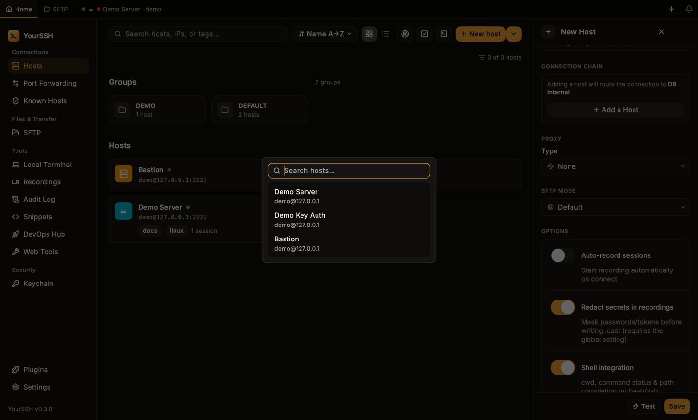
</Frame>

<Frame caption="A chain with Bastion in front of the destination.">
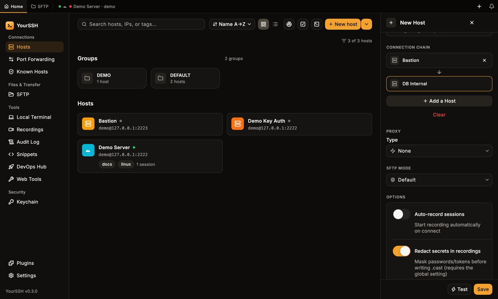
</Frame>

The terminal, SFTP, bulk actions and port forwarding all use the full chain. YourSSH verifies the [host key](/user-guide/host-keys) of every hop. The status bar shows `via` and the first hop.

<Frame caption="Connected through Bastion.">
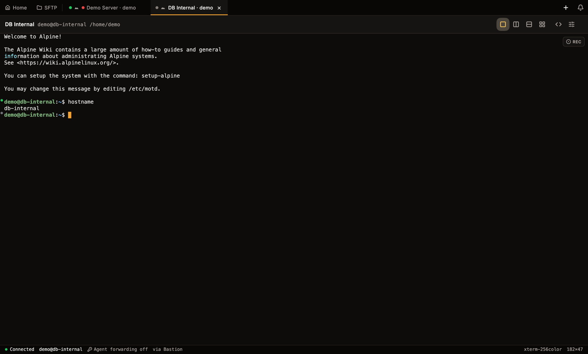
</Frame>

### Proxy

The **PROXY** section sends the connection through an **HTTP CONNECT** or **SOCKS5** proxy. Enter the proxy host, port and optional username and password. Leave it on **None** for a direct connection. The proxy password is stored in the system credential store.

### SFTP mode

**SFTP MODE** chooses how the file manager starts the SFTP server on the host:

- **Default**: the normal SFTP subsystem.
- **Sudo (root)**: runs the SFTP server with `sudo`, so you can browse files owned by root.
- **Custom command**: runs the command you enter, for example `sudo /usr/lib/openssh/sftp-server`.

### Options

<Frame caption="SFTP mode and per-host options.">
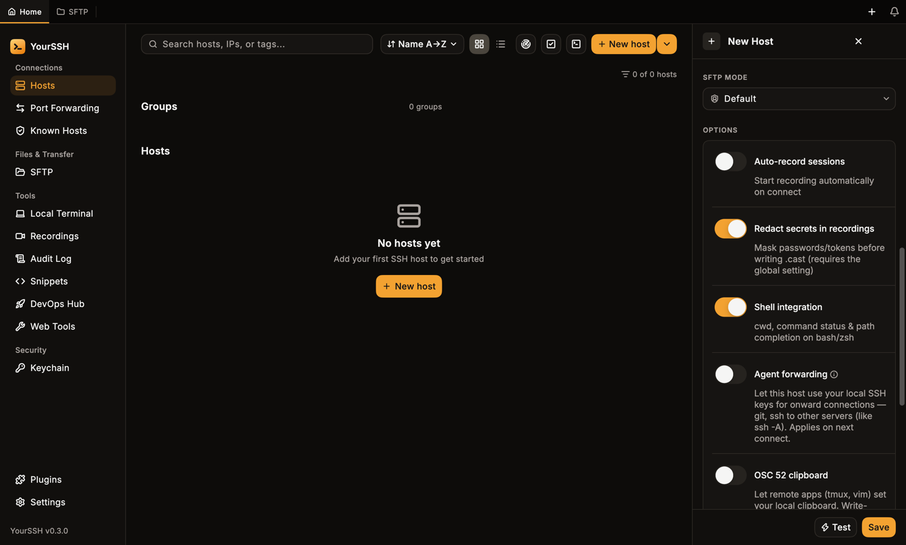
</Frame>

| Option | Effect |
|---|---|
| **Auto-record sessions** | Starts a [recording](/user-guide/recording) on every connect. |
| **Redact secrets in recordings** | Masks passwords and tokens in the recording. Needs the global setting too. |
| **Shell integration** | Reports the working directory and command status on bash and zsh. |
| **Agent forwarding** | Lets this host use your local SSH keys for onward hops, like `ssh -A`. Off by default. Only your agent signs. Private keys never leave your computer. |
| **OSC 52 clipboard** | Lets remote programs such as tmux and vim set your local clipboard. Write-only, off by default. |

<Warning>
  Turn on **Agent forwarding** only for hosts you trust. Anyone with root on that host can use your keys while the session is open, though they can't read them.
</Warning>

When agent forwarding is on, a status line tells you whether YourSSH will use your system agent or fall back to Keychain keys. During a session, a key icon on the tab shows whether the host has asked for a key.

### Session template

The **SESSION TEMPLATE** section sets up each new session on this host. All fields are optional, and an empty field follows your global [settings](/user-guide/settings).

<Frame caption="The session template.">
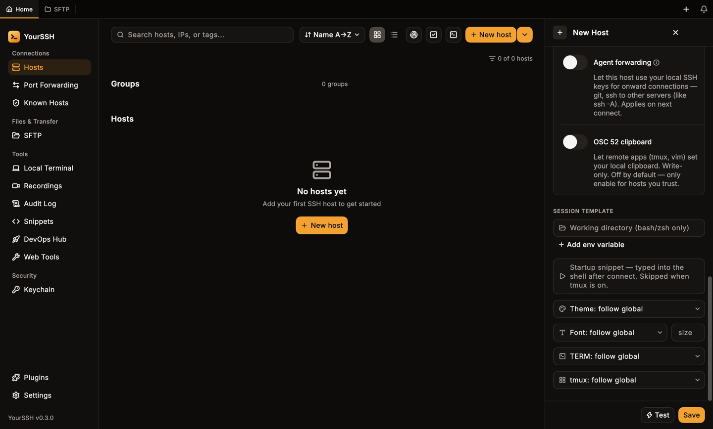
</Frame>

- **Working directory**: `cd` into this folder on connect, without echo. bash and zsh only.
- **Environment variables**: `NAME=value` pairs, exported invisibly. Names use `A–Z`, `0–9` and `_` only, and must be unique. bash and zsh only.
- **Startup snippet**: text typed visibly into the shell after setup, as if you typed it. It shows in recordings and the [audit log](/user-guide/audit-log).
- **Theme**, **font**, **size**, **TERM** and **tmux**: per-host overrides. A distinct theme is handy for marking production hosts.

If you start typing before setup finishes, YourSSH skips the template so you keep control of the session.

### Validate, test, save, delete

The footer is always visible. Required fields show **Required**, and an out-of-range port shows **Invalid (1–65535)**. The message disappears as soon as you fix the value.

<Frame caption="Saving with an empty hostname.">
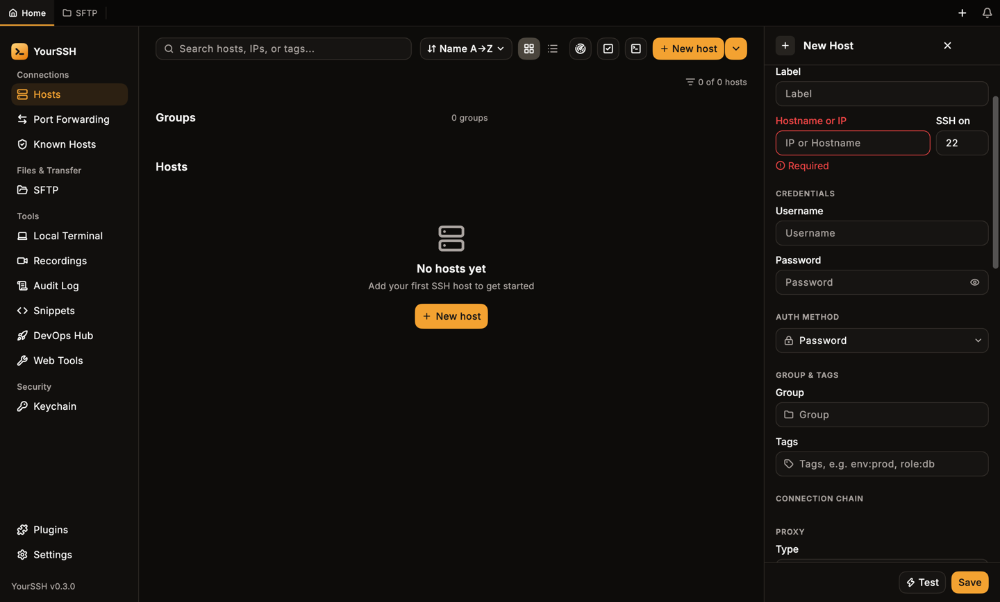
</Frame>

- **Test** (SSH only) connects and signs in without opening a shell. It shows **Connected** with the latency, or the error message.
- **Save** stores the host. For an existing host the button reads **Save changes**.
- **Delete** (existing hosts only) removes the host after a confirmation. Its stored password and proxy password are removed too.

<Frame caption="Test result.">
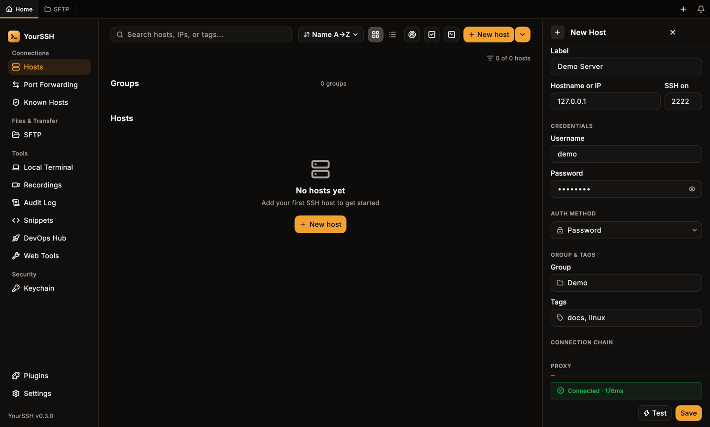
</Frame>

## Small windows

The editor, dashboard and terminal work down to the 800 by 600 minimum window size.

<Frame caption="The dashboard in a 900 by 600 window.">
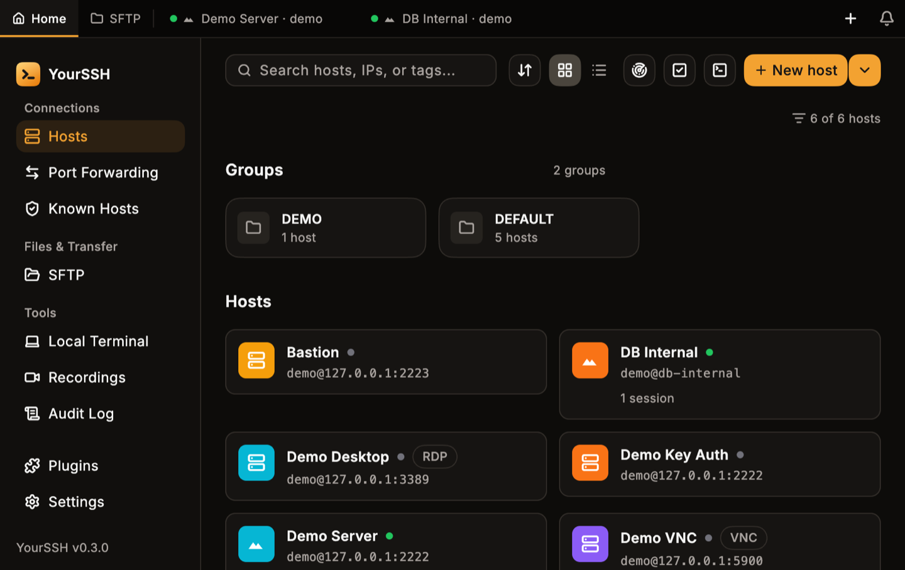
</Frame>
