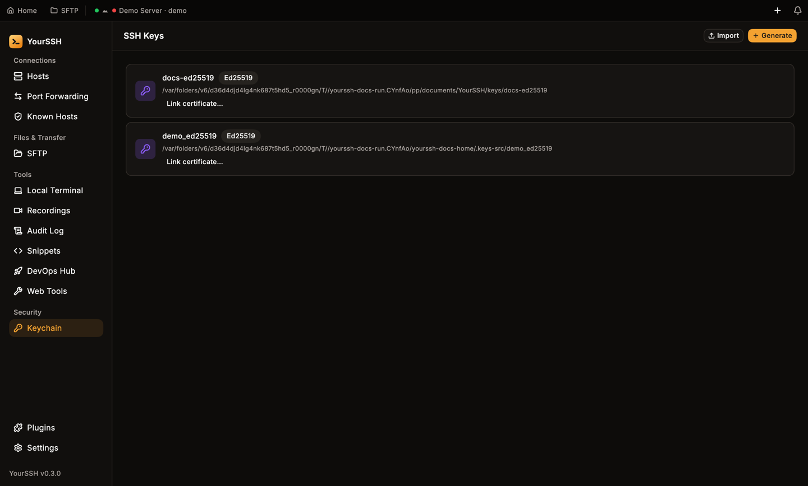
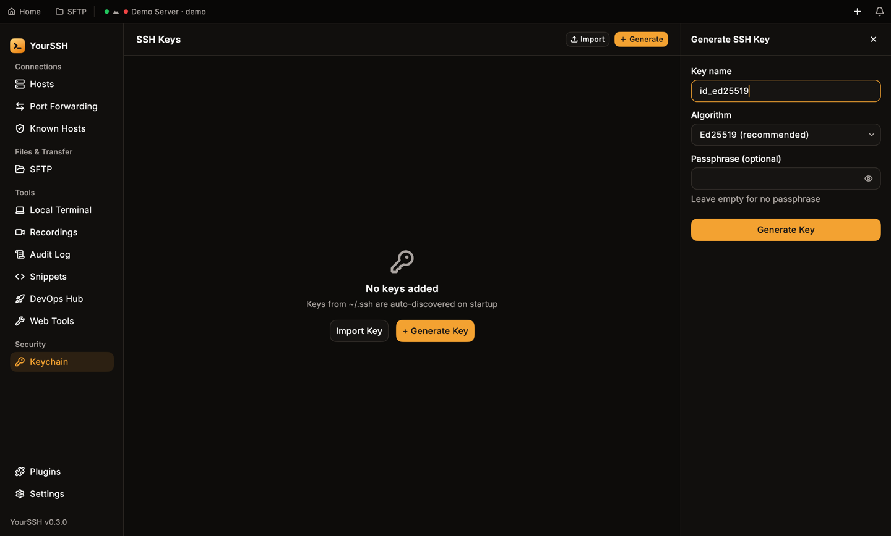
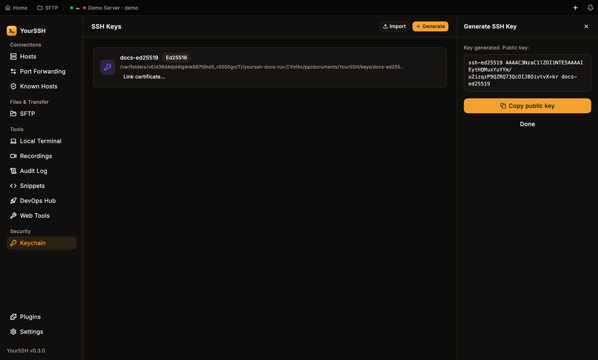
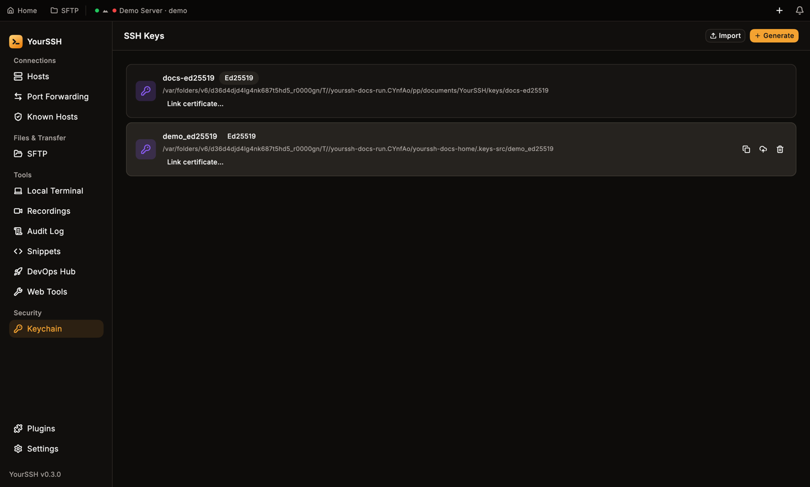
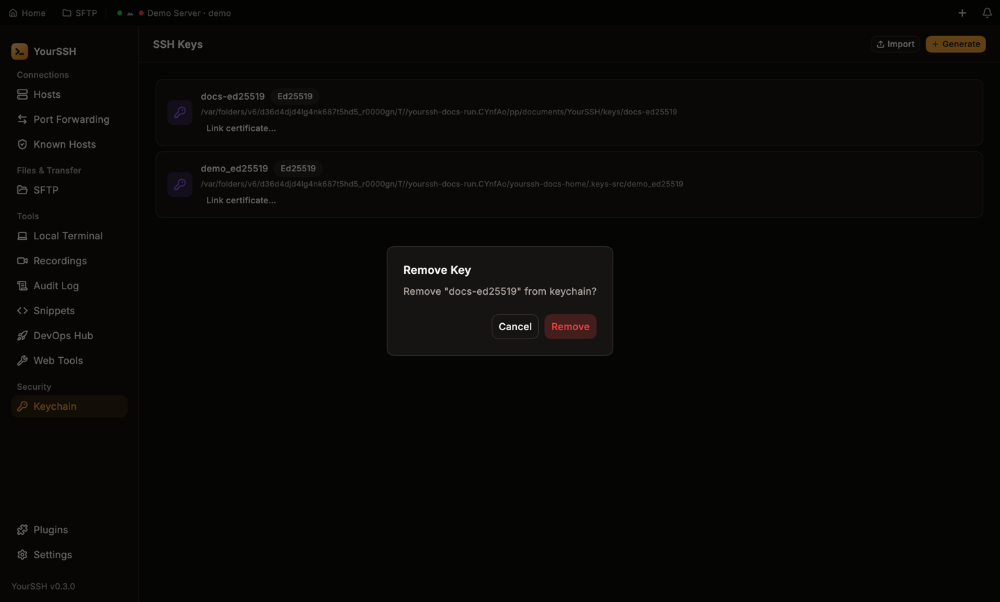

The **Keychain** screen is YourSSH's SSH key manager. Open it from **Keychain** in the sidebar, under **Security**. It lists every private key YourSSH knows about and lets you generate, import, link certificates to, deploy and remove keys.

<Frame caption="The Keychain screen, with keys shown as rows and the Import and Generate buttons at the top right.">
  
</Frame>

YourSSH keeps a reference to each private key file. It does not copy the file into the app or upload it anywhere.

## Keys found automatically

On startup YourSSH looks in `~/.ssh` for the default key names `id_ed25519`, `id_rsa`, `id_ecdsa` and `id_dsa` and lists any it finds, except keys you removed from the Keychain. If a matching `<name>.pub` file or `<name>-cert.pub` certificate sits next to the key, YourSSH reads it too.

When no keys are listed, the screen says **No keys added** and offers **Import Key** and **+ Generate Key**.

## Generate a key

<Steps>
  <Step title="Open the panel">
    In **Keychain**, click **+ Generate**. The **Generate SSH Key** panel opens on the right.
  </Step>
  <Step title="Name the key">
    Enter a **Key name**. The default is `id_ed25519`. YourSSH replaces any character other than letters, digits, `_` and `-` with `_` in the file name.
  </Step>
  <Step title="Pick an algorithm">
    Choose an **Algorithm**:

    | Option | Needs |
    |---|---|
    | **Ed25519 (recommended)** | Nothing. YourSSH generates it itself. |
    | **RSA 4096** | The OpenSSH client (`ssh-keygen`) on your computer. |
    | **ECDSA P-256** | The OpenSSH client (`ssh-keygen`) on your computer. |

    If `ssh-keygen` isn't installed, the RSA and ECDSA options are unavailable and the panel says **RSA/ECDSA require OpenSSH client (ssh-keygen)**.
  </Step>
  <Step title="Add a passphrase (optional)">
    Enter a **Passphrase (optional)**, or leave it empty for a key without one. When you set one, YourSSH saves it in your [system credential store](#how-credentials-are-stored) so the key works without prompting you each time.
  </Step>
  <Step title="Generate">
    Click **Generate Key**. The panel shows the new public key with **Copy public key** and **Done** buttons.
  </Step>
</Steps>

<Frame caption="The Generate SSH Key panel. Ed25519 is the default algorithm.">
  
</Frame>

<Frame caption="After generating, the public key is shown so you can copy it right away.">
  
</Frame>

YourSSH writes the key pair to a `YourSSH/keys` folder inside your Documents folder, as `<name>` (the private key) and `<name>.pub`. On macOS and Linux the private key file is created with mode `600` (readable only by you) before any key material is written. YourSSH refuses to overwrite an existing key with the same name and asks you to choose another.

## Import a key

Click **Import** (or **Import Key** on an empty screen), then pick your private key file in the **Select SSH Private Key** dialog. YourSSH adds it to the list, reads the matching `.pub` file if there is one, and links a `-cert.pub` certificate if it finds one next to the key.

## Link a certificate

If your hosts use SSH certificates, click **Link certificate…** on a key and choose the certificate file (`*-cert.pub`). A **CERT** badge appears on the key. Click the unlink button on that row to remove the link.

## Copy, deploy and remove

Hover a key row to show three actions on the right.

<Frame caption="Hover a key to reveal Copy public key, Deploy to host and Remove key.">
  
</Frame>

- **Copy public key** puts the public key on your clipboard.
- **Deploy to host…** opens a dialog that lists your saved hosts, with a search box. Pick a host and YourSSH connects to it and appends the public key to `~/.ssh/authorized_keys`, creating `~/.ssh` with mode `700` if needed. Deploying is idempotent: if the key is already there, YourSSH says **Key already deployed** and changes nothing. Otherwise it confirms **Public key added**.
- **Remove key** asks you to confirm with **Remove "name" from keychain?**. Removing takes the key out of YourSSH and deletes the passphrase YourSSH saved for it in the system credential store. The key file on disk is not deleted. A removed key from `~/.ssh` stays removed: the startup scan skips it. Import the same file again with **Import key** to bring it back.

<Frame caption="Deploy key to host: choose a saved host from the list.">
  
</Frame>

<Frame caption="Removing a key asks for confirmation first.">
  
</Frame>

To use a key for a host, pick it in the host editor. See [Hosts](/user-guide/hosts).

## How credentials are stored

YourSSH stores the secrets that unlock your hosts in your operating system's **system credential store**, not in its own files:

| Platform | Store |
|---|---|
| macOS | macOS Keychain |
| Windows | Windows Credential Manager |
| Linux | The system keyring (the secret service) |

This covers host passwords, sudo passwords and key passphrases. Everything else, such as the host list, settings and known hosts, is ordinary configuration.

YourSSH always tries the system credential store first. When a write succeeds, it also deletes any older plain-text copy of that secret. On every launch it moves any secret still sitting in plain-text preferences into the store: it writes the secret, reads it back to confirm, and only then removes the old copy, so a failed write never destroys your only copy.

On macOS, YourSSH uses the file-based login keychain. If you update to a build with a different signature, macOS may ask you again to allow access.

### When the store refuses a write

If the system credential store rejects a secret, YourSSH falls back to saving it as readable text in its preferences file, so you don't lose it. The fallback is never silent:

- A notification appears in the bell at the top of the window.
- **Settings → Security** shows **Plain text** instead of **Encrypted**, with the number of affected credentials.

Click **Retry** to move them into the store again. A credential that can't be moved stays where it is rather than being deleted, and YourSSH retries on the next launch. See [Settings](/user-guide/settings#security).

### What stays on your device

- Private key files stay where they are on disk. Only their paths are stored.
- Passwords and passphrases stay in the system credential store.
- Passwords of hosts you sync are the one exception. They travel with your host list, encrypted on your device first. See [Sync](/user-guide/sync).
