YourSSH has an Android app: a focused mobile SSH client that shares its core with the desktop app. It is available as a development preview from the [releases page](https://github.com/YoursshLabs/yourssh/releases) as `YourSSH-x.x.x-Android.apk`. There is no iOS version yet.

The Android app covers hosts, keys, snippets, an SSH terminal, file browsing and port forwarding. SSH only: RDP, VNC, plugins, session recording and the audit log are desktop features.

<Note>
The preview APK is signed with a debug key. It installs and runs, but it can't be upgraded in place from a differently signed build.
</Note>

The app has four tabs along the bottom: **Hosts**, **Snippets**, **Keys** and **Settings**.

## Lock the app

**Settings → Security → Biometric unlock** locks YourSSH behind your fingerprint, face or device credential. It is on by default. When it's on, the app locks when you open it and whenever it comes back from the background. It also locks before the app switcher takes a snapshot, so nothing shows there. A locked app shows **YourSSH is locked** and an **Unlock** button.

<Columns cols={3}>
  <Frame caption="The lock screen.">
    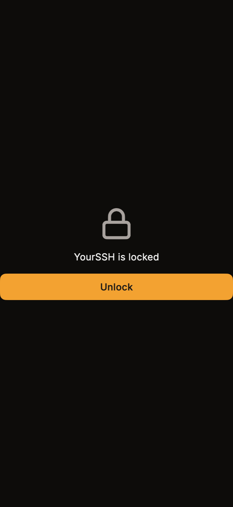
  </Frame>
  <Frame caption="Security settings.">
    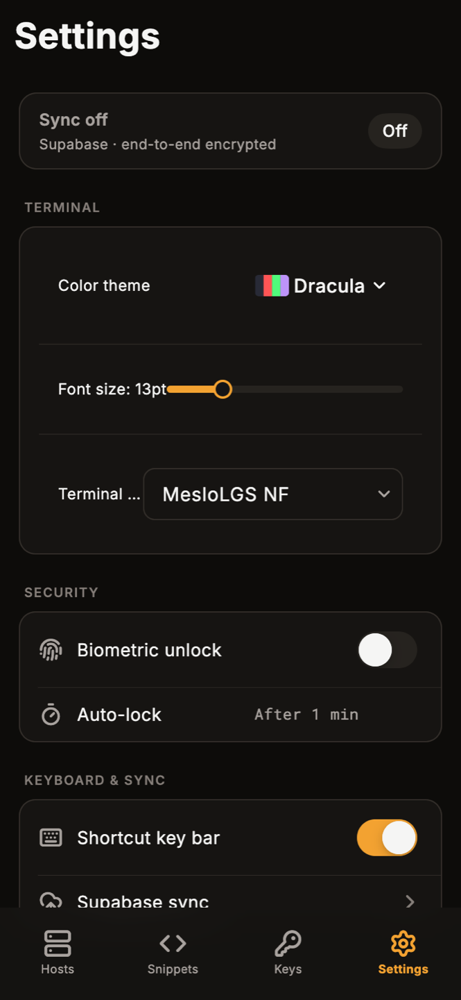
  </Frame>
</Columns>

If your phone has no biometrics or screen lock enrolled, the app doesn't lock, so you can't be locked out of a screen you can't unlock. The **Auto-lock** row reads **Immediately when you leave the app**: the app locks as soon as it goes to the background.

## Hosts

The **Hosts** tab lists your saved hosts in sections named after each host's first tag (hosts without tags go under **Other**), with their tags, a status dot and a reachability badge such as **offline**. Use the search box (**Search hosts, tags, IPs…**) or the tag chips under it to filter. Tap a host to connect.

Long-press a host to open its action sheet, where you can **Edit** or **Delete** it. Deleting asks for confirmation and removes the saved host and its credentials.

<Columns cols={3}>
  <Frame caption="Hosts, grouped, with tag filters.">
    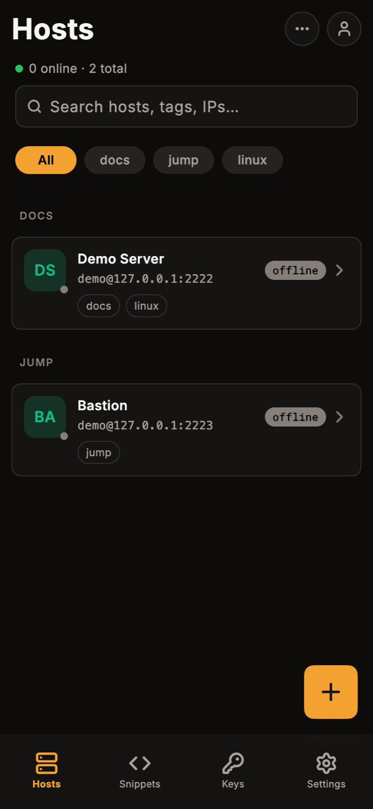
  </Frame>
  <Frame caption="Long-press for Edit and Delete.">
    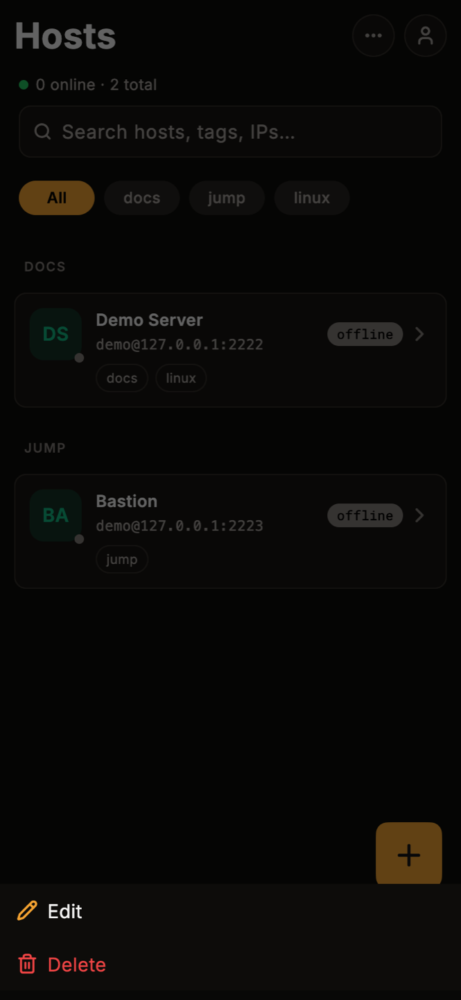
  </Frame>
</Columns>

### Add a host

Tap the **+** button on the **Hosts** tab to open **New host**.

1. Fill in **Nickname**, **Hostname** and **Port** (22 by default).
2. Enter the **Username**.
3. Choose a **Method**: **Password**, or **SSH key** and then pick one from your keys in **Key**.
4. Optional, under **Advanced**: set a **Group** (for example `Production`; it is stored as the host's first tag) and a **Run on connect** command (for example `tmux attach`).
5. Tap **Save**, or **Save & connect** to connect right away.

<Columns cols={3}>
  <Frame caption="The authentication and advanced options.">
    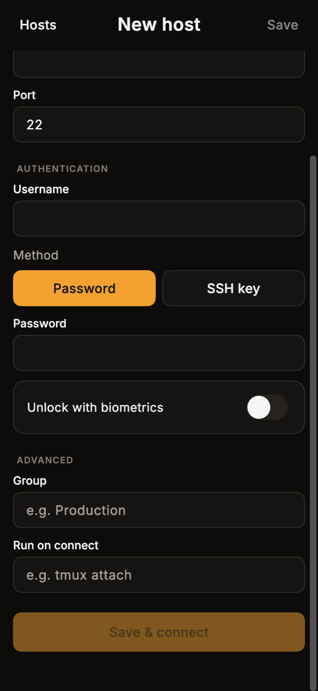
  </Frame>
</Columns>

Settings that you configured on desktop but that the mobile form doesn't edit, such as a connection chain, are kept unchanged when you edit a host here.

The first time you connect to a host, the app shows its host key and asks you to trust it, the same way the desktop app does. See [Host keys](/user-guide/host-keys).

## Snippets

The **Snippets** tab lists your command snippets, filtered by tag. When a session is open, tap a snippet to run it in that session. With no session, the tab shows **No active session**. See [Snippets](/user-guide/snippets) for what snippets are.

<Columns cols={3}>
  <Frame caption="Snippets with tag filters.">
    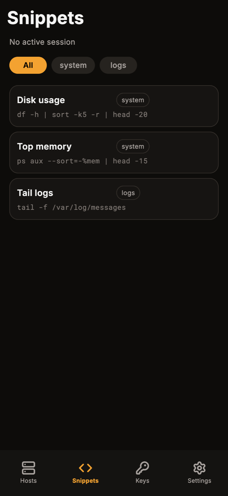
  </Frame>
</Columns>

## Keys

The **Keys** tab lists your SSH keys with their algorithm, whether a host uses them, and a short SHA-256 fingerprint. Use the **+** button to generate a key and the import button to bring one in.

- **Generate**: choose **Ed25519** (fast, modern, recommended), **RSA 4096** or **ECDSA P-256**, enter a **Key name** and an optional **Passphrase (optional)**, then tap **Generate**.
- **Import**: pick a private key file, enter its passphrase if it has one, and tap **Import**.
- **Remove**: tap or long-press a key and choose **Remove key**. This takes the key out of the app's key list. The key file on disk is kept, and YourSSH doesn't delete a passphrase saved for it.

<Columns cols={3}>
  <Frame caption="The Keys tab.">
    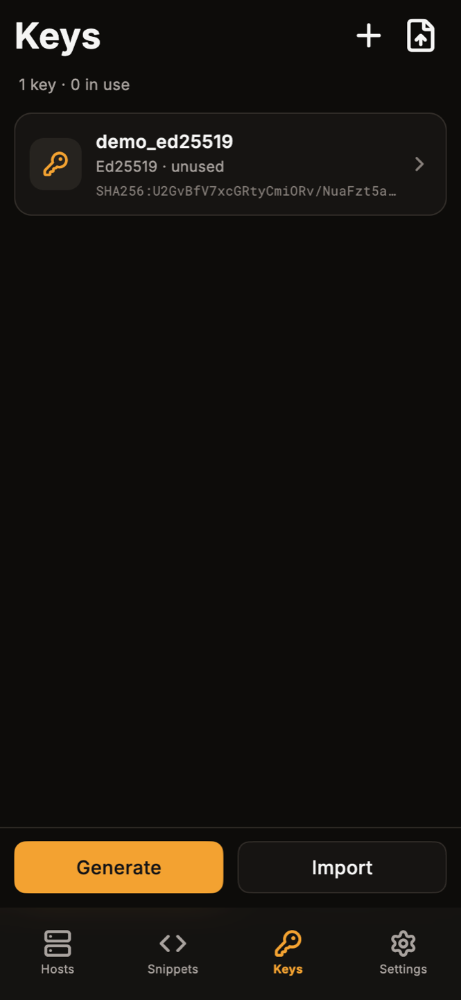
  </Frame>
  <Frame caption="Generate a key.">
    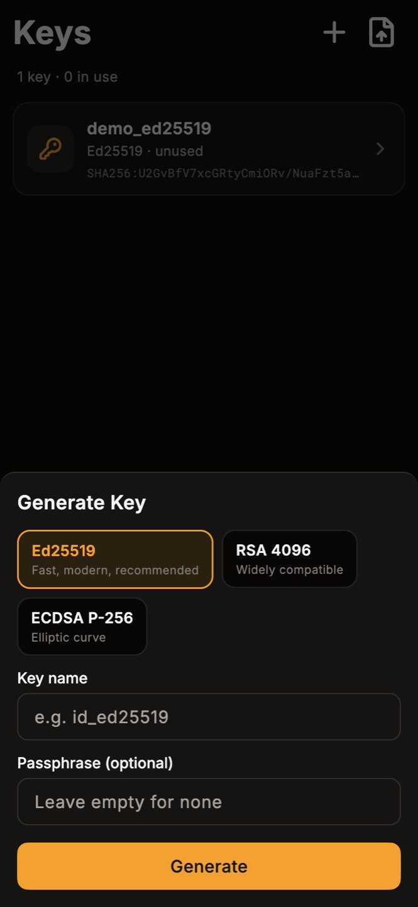
  </Frame>
</Columns>

Passphrases are kept in the Android system credential store. See [Keychain and credentials](/user-guide/keychain#how-credentials-are-stored).

## Settings

The **Settings** tab has these groups:

| Group | Options |
|---|---|
| **Terminal** | **Color theme**, **Font size** and **Terminal font**. |
| **Security** | **Biometric unlock** and **Auto-lock**. |
| **Keyboard & Sync** | **Shortcut key bar** (show or hide the extra key row), **Supabase sync** and **Pair new device**. |

The row at the top shows **Sync active** or **Sync off**, with `Supabase · end-to-end encrypted` under it.

## Sync and pair a device

**Supabase sync** and **Pair new device** both open the **Pair device** screen. There you can:

- Show a QR code for another device to scan. It's valid for 2 minutes, and **Refresh** restarts it.
- Tap **Scan QR code** to import hosts from a desktop that is showing **Export via QR**.
- Under **Cloud sync**, enter your Supabase project URL, anon key and 12-character sync code (**Edit credentials** reopens the form), tap **Save**, and then **Pull from cloud** to download your hosts.

<Columns cols={3}>
  <Frame caption="The Pair device screen. The QR code uses a documentation example address.">
    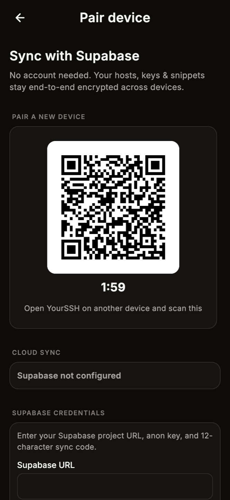
  </Frame>
</Columns>

Cloud sync uses the same Supabase project and sync code as the desktop app, and the same end-to-end encryption. Setup, the sync code and the QR transfer are covered in [Sync](/user-guide/sync).

<Warning>
Pulling from the cloud and scanning a QR code both **replace** the host list on this phone with the one you receive. Hosts that exist only on the phone are removed.
</Warning>

<Note>
Only your hosts and their saved passwords are synced or transferred, as the screen says. SSH keys, snippets, settings and AI keys stay on the device where you created them. Import the keys you need on the phone from the **Keys** tab.
</Note>

## Connect and use the terminal

Tap a host to connect. A connecting screen shows progress, then the terminal opens. Each session is a tab at the top of the terminal, with **+** to open another session and **x** to close one.

The terminal supports pinch-to-zoom, and a long-press lets you drag the cursor.

### Shortcut key bar

A row of keys above the on-screen keyboard gives you keys a phone keyboard lacks:

- **Esc**, **Tab**, **Ctrl** and **Alt**. Ctrl and Alt are sticky: tap once, then press a letter.
- **^C** and **^D** send those control characters directly.
- Arrow keys.
- `/`, `-`, `|`, `~`, `:` and `$`.

The keyboard icon at the left shows or hides the on-screen keyboard. Turn the bar off in **Settings → Keyboard & Sync → Shortcut key bar**.

<Columns cols={3}>
  <Frame caption="A terminal session with the shortcut key bar.">
    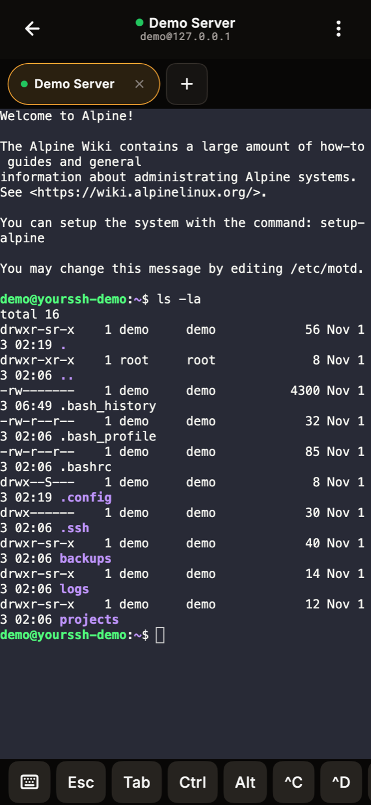
  </Frame>
  <Frame caption="The terminal menu.">
    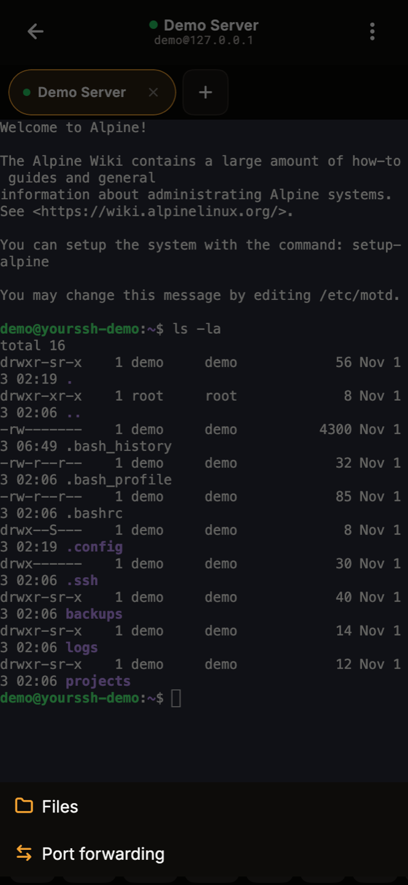
  </Frame>
</Columns>

### Terminal menu

Tap the three-dot button at the top right of the terminal for **Files** and **Port forwarding**.

## Files (SFTP)

**Files** opens a single-panel file browser for the connected host. Tap a folder to open it and the breadcrumb at the top to go back up. Tap the download icon beside a file to download it. Use the upload button at the top to send a file from your phone, and the three-dot menu for more actions such as **Refresh**. See [SFTP](/user-guide/sftp) for the desktop file manager.

<Columns cols={3}>
  <Frame caption="Browsing a host's files.">
    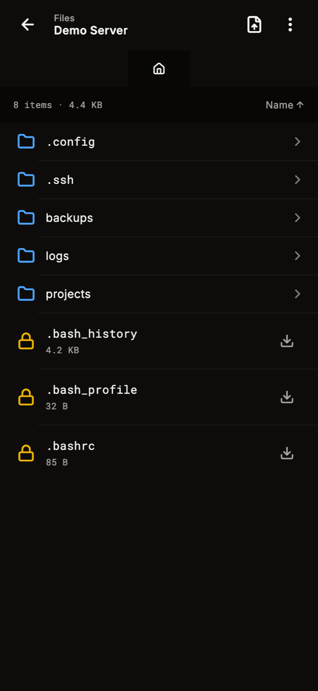
  </Frame>
</Columns>

## Port forwarding

**Port forwarding** lists the rules for the host you're connected to. Tap **Add forwarding rule** at the bottom of the list to open the **Add forwarding rule** sheet. Each rule in the list can then be started and stopped. In the sheet, choose a type:

- **Local** forwards a port on your phone to a host and port reachable from the server. Enter a **Local port**, a **Remote host** and a **Remote port**.
- **Remote** exposes a port on the server that points back to your device.
- **Dynamic** opens a SOCKS proxy on your phone.

Add an optional **Label**, then tap **Add rule**. Ports must be between 1 and 65535. See [Port forwarding](/user-guide/port-forwarding) for what each type does.

<Columns cols={3}>
  <Frame caption="Add a forwarding rule.">
    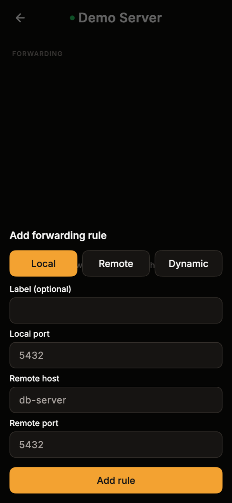
  </Frame>
</Columns>
