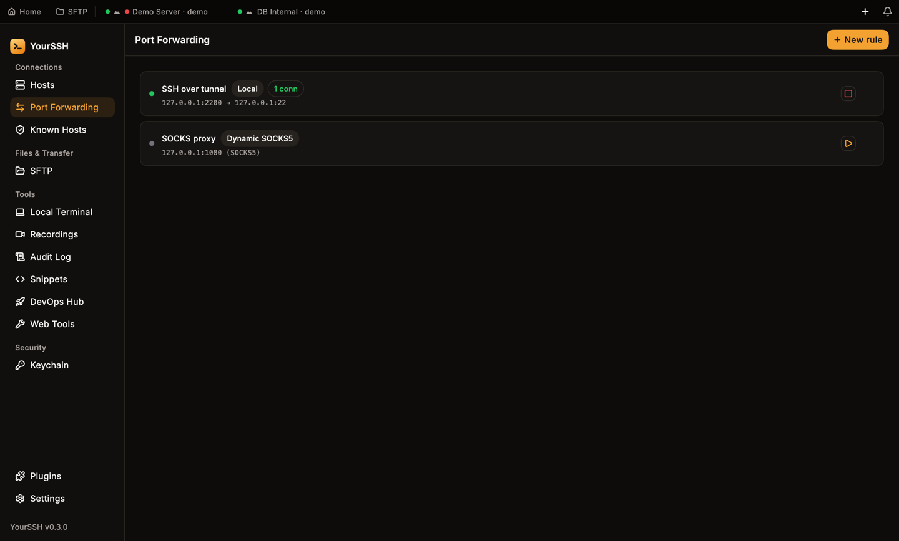
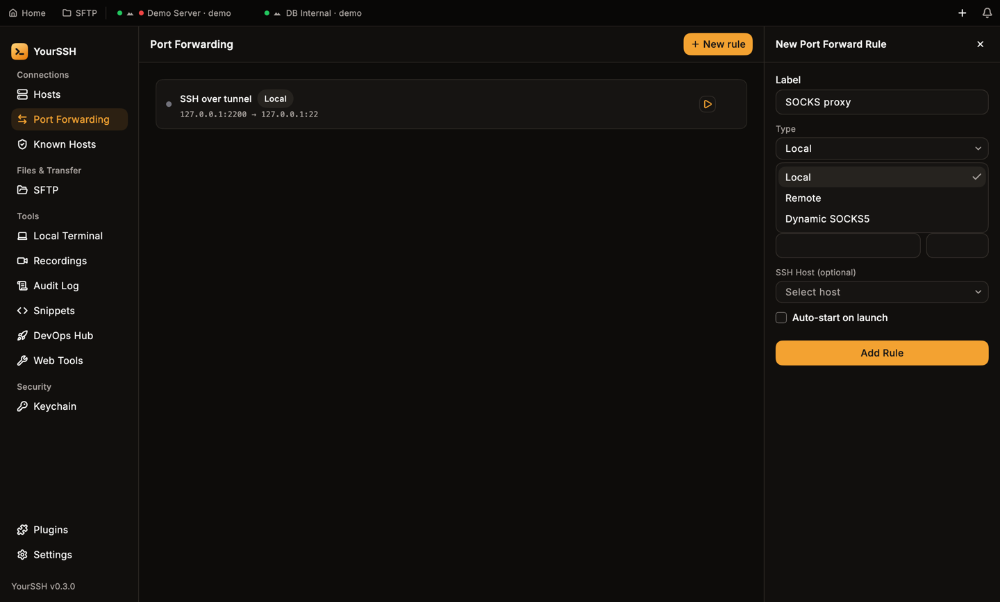
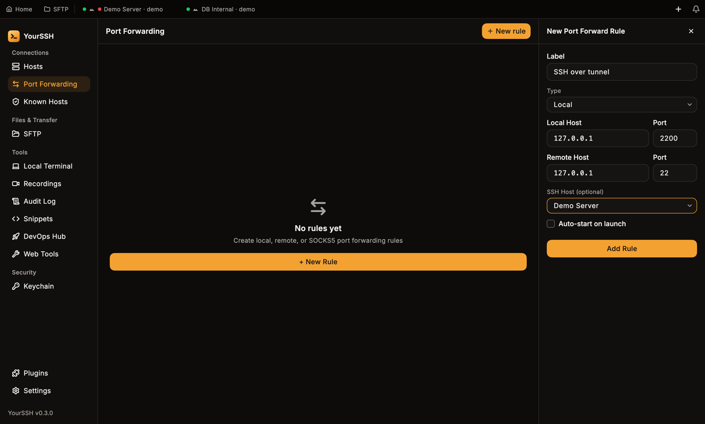
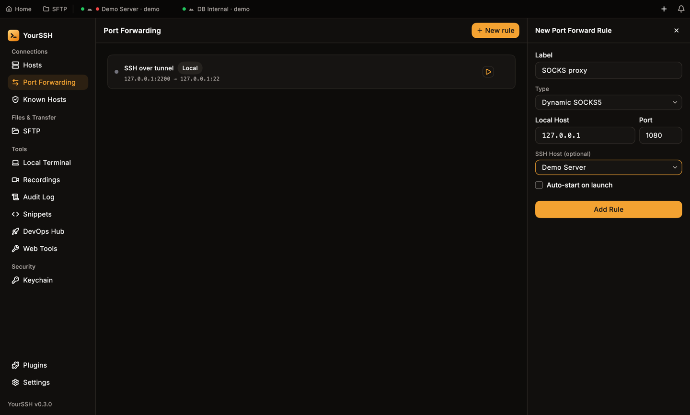
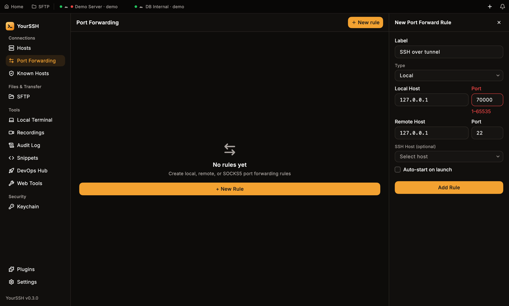
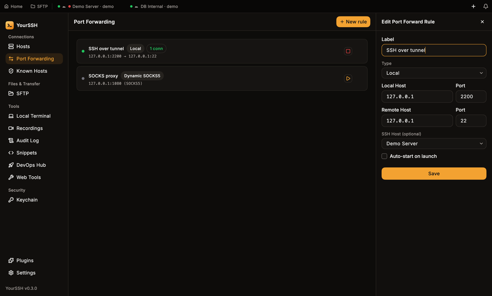

Port forwarding sends network traffic through an SSH connection. Open **Port Forwarding** in the sidebar to create saved rules, start and stop them, and see how many connections each one is carrying.

<Frame caption="A running local rule with one connection, and a stopped SOCKS5 rule.">

</Frame>

## Rule types

| Type | What it does | Example |
|---|---|---|
| **Local** | Listens on your machine and forwards to a destination reached from the SSH host | `127.0.0.1:2200` → `127.0.0.1:22` |
| **Remote** | Listens on the SSH host and forwards to a destination on your machine | Expose a local dev server on the remote host |
| **Dynamic SOCKS5** | Runs a SOCKS5 proxy on your machine and routes any TCP connection through the SSH host | `127.0.0.1:1080` |

A rule always goes through a saved host (the **SSH Host**), using that host's stored credentials. You don't need an open terminal tab: YourSSH connects to the host on its own, and through its [connection chain](/user-guide/hosts) if it has one.

## Create a rule

<Steps>
  <Step title="Open the editor">
    Go to **Port Forwarding** and click **New rule**. The **New Port Forward Rule** panel opens on the right.
  </Step>
  <Step title="Name the rule and pick a type">
    Enter a **Label**, then choose the **Type**: **Local**, **Remote** or **Dynamic SOCKS5**.

    <Frame caption="The type menu.">
    
    </Frame>
  </Step>
  <Step title="Set the addresses">
    Fill in **Local Host** and **Port** (the address that listens on your machine). For **Local** and **Remote** rules, also fill in **Remote Host** and **Port** for the destination. A **Dynamic SOCKS5** rule needs only the local address, so the remote fields disappear.
  </Step>
  <Step title="Choose the SSH host">
    Pick the **SSH Host** the tunnel runs through. The field is marked optional so you can save a draft, but a rule without a host can't start. It reports **Select an SSH host first**.
  </Step>
  <Step title="Optionally auto-start">
    Tick **Auto-start on launch** to bring the tunnel up each time YourSSH starts.
  </Step>
  <Step title="Save">
    Click **Add Rule**.
  </Step>
</Steps>

<Frame caption="A local rule filled in: localhost port 2200 to port 22 on the remote side, through Demo Server.">

</Frame>

<Frame caption="A dynamic SOCKS5 rule has no remote host or port.">

</Frame>

### Validation

The editor checks the form when you save:

- **Label**, **Local Host** and, for local and remote rules, **Remote Host** can't be empty. A missing value shows **Required**.
- Each **Port** must be a number from 1 to 65535. Anything else shows `1–65535` under the field.

<Frame caption="A port of 70000 is rejected.">

</Frame>

## Start and stop

Each rule has a button on the right: the play button starts it and the stop button stops it. Several tunnels can run at once, and each one is independent.

The status dot on the left shows the state:

| Dot | State |
|---|---|
| Grey | Idle |
| Amber | Connecting, or reconnecting (the rule also shows **reconnecting…**) |
| Green | Active |
| Red | Error. The message appears under the rule, for example that a port is already in use |

An active rule shows a live connection count such as **1 conn**.

If a rule fails to start, check the message under it. Common causes are a local port already in use, no SSH host selected, or the host no longer existing.

## Auto-reconnect

If the SSH connection drops while a tunnel is running, the rule switches to **reconnecting…** and YourSSH reconnects with exponential backoff, starting at 2 seconds and doubling up to 30 seconds. Local listeners stay bound while it retries, so clients keep the same local port. Stopping the rule cancels the retry.

## Edit, duplicate and delete

- Click a rule, or right-click and choose **Edit**, to change it. The panel title is **Edit Port Forward Rule** and the button is **Save**. If the rule is running, stop and start it again to apply the change.
- Right-click and choose **Duplicate** to copy a rule. The copy is named `… (copy)` and never auto-starts.
- Hover a rule and click the trash icon, or right-click and choose **Delete**. YourSSH asks **Delete rule?** first, naming the label and endpoints, with **Cancel** selected by default. After you confirm, a running rule is stopped and removed. Deleting a host also stops the tunnels that use it.

<Frame caption="Clicking a rule opens it in the editor.">

</Frame>

## Example: reach a database on the SSH host

To connect a SQL client to a PostgreSQL server that only listens on the SSH host:

| Field | Value |
|---|---|
| Label | `Postgres` |
| Type | **Local** |
| Local Host / Port | `127.0.0.1` / `5432` |
| Remote Host / Port | `127.0.0.1` / `5432` |
| SSH Host | your database host |

Start the rule, then point your client at `127.0.0.1:5432`.

## Use tunnels in Web Tools

The **Web Tools** plugin has a **Port Tunnels** tool that works with these forwarded ports, so you can open a tunnelled web service in the in-app browser. See [Web Tools](/user-guide/web-tools).

## Related pages

- [Hosts](/user-guide/hosts) for saved hosts and connection chains.
- [SFTP](/user-guide/sftp) and [Terminal](/user-guide/terminal) use the same SSH connection settings.
- [DevOps Hub](/user-guide/devops) for Cloudflare tunnels and other tunnel tools.
