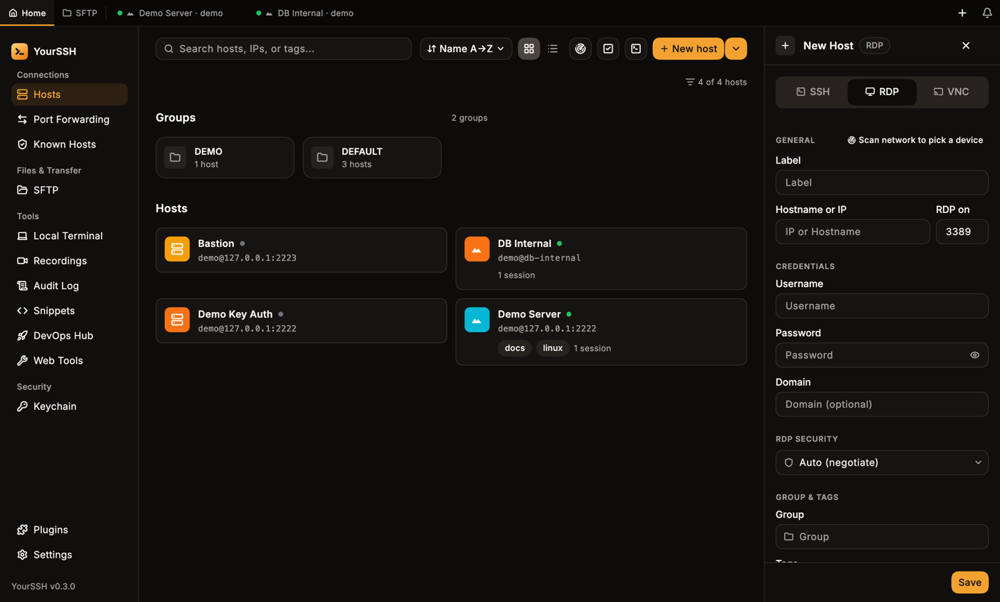
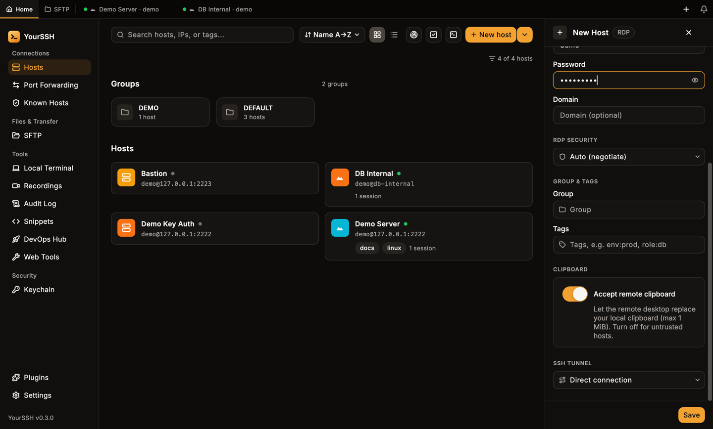
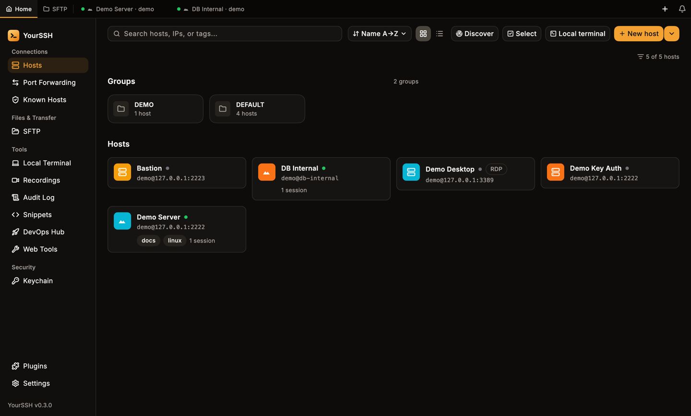
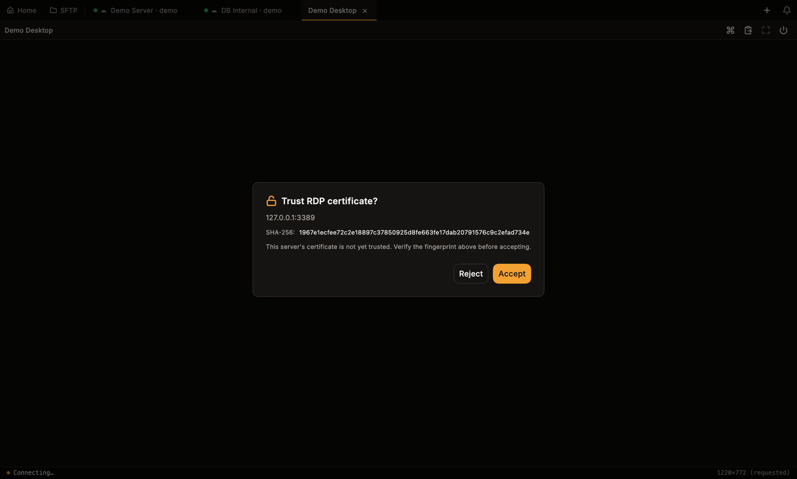
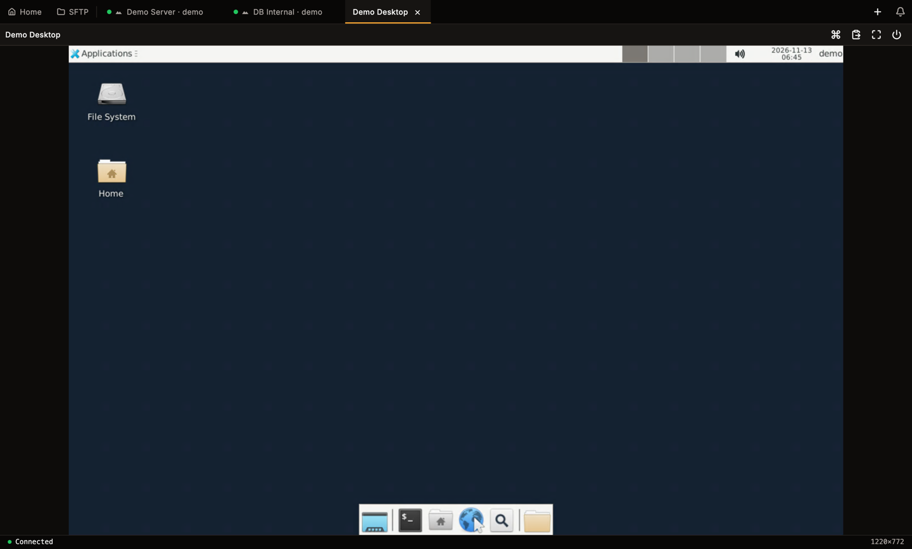
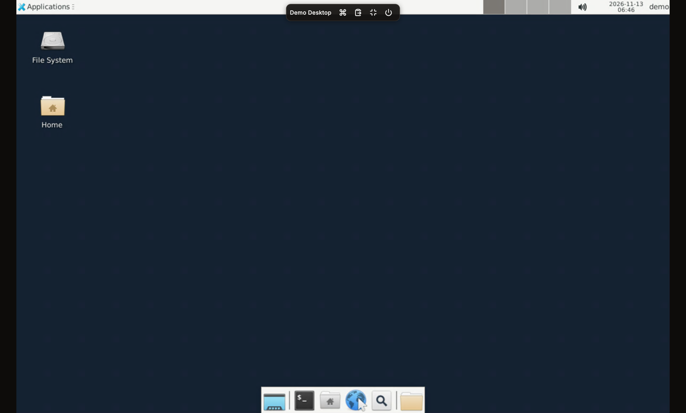
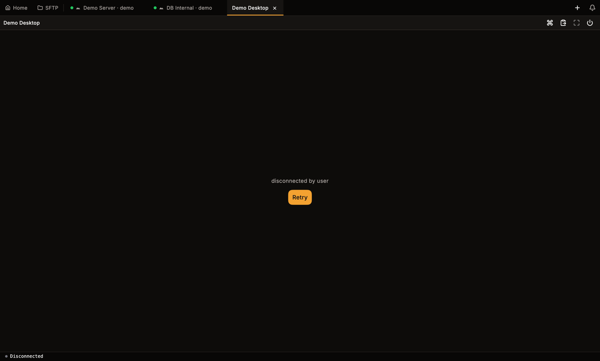

YourSSH has a built-in RDP client. An RDP session opens as a tab next to your SSH sessions, so you don't need a separate remote desktop app.

## Add an RDP host

<Steps>
  <Step title="Open the host editor">
    On the hosts dashboard, click **New host**, or open an existing host and click **Edit**.
  </Step>
  <Step title="Switch to RDP">
    At the top of the editor, select **RDP** in the **SSH / RDP / VNC** switch. The port changes to `3389`. A custom port you already typed is kept.
  </Step>
  <Step title="Fill in the connection">
    Enter the hostname or IP, **Username** and **Password**. **Domain** is optional and only needed for Windows domain accounts.
  </Step>
  <Step title="Choose the RDP options">
    Set **RDP SECURITY**, **CLIPBOARD** and **SSH TUNNEL** as described below, then click **Save**.
  </Step>
</Steps>

<Frame caption="The host editor in RDP mode: port 3389, credentials, domain and RDP security.">
  
</Frame>

### RDP security

| Option | Meaning |
|---|---|
| **Auto (negotiate)** | Let the client and server agree. Use this unless you have a reason not to. |
| **NLA (CredSSP)** | Network Level Authentication. |
| **TLS only** | Skip NLA and use TLS only. |

### Clipboard

**Accept remote clipboard** controls whether the remote desktop may replace your local clipboard. It is on by default. The remote text is capped at 1 MiB. Turn it off for hosts you don't trust.

### SSH tunnel

**SSH TUNNEL** routes the RDP connection through one of your saved SSH hosts. Choose **Direct connection** (the default) or **via** a host. The selector only appears when you have at least one other SSH host saved. The list only shows SSH hosts. See [Hosts](/user-guide/hosts) for connection chains.

<Frame caption="RDP-only options: RDP security, remote clipboard and the SSH tunnel.">
  
</Frame>

RDP hosts carry an **RDP** badge on the hosts dashboard, in list rows and in the host panel header.

<Frame caption="The RDP host card shows an RDP badge.">
  
</Frame>

## Connect and trust the certificate

Click the host card to connect. The first time you connect to a server, YourSSH stops before it sends any credentials and shows **Trust RDP certificate?** with the server address and the certificate's SHA-256 fingerprint.

<Frame caption="The first connect asks you to verify the server certificate.">
  
</Frame>

- Click **Accept** to pin the certificate and continue. YourSSH reconnects and signs in.
- Click **Reject** to cancel. Nothing was sent to the server.

Compare the fingerprint with one you trust before you accept.

<Warning>
If the server's certificate changes later, YourSSH aborts the connection before authentication and shows **RDP certificate changed**. Your password is never sent. Click **Trust new cert** only if you know the certificate was replaced. Otherwise click **Reject**, because a changed certificate can mean someone is intercepting the connection.
</Warning>

## Use the session

<Frame caption="A connected RDP session with the toolbar on the right.">
  
</Frame>

The toolbar at the top right has four buttons:

| Button | What it does |
|---|---|
| **Send Ctrl+Alt+Del** | Sends the key combination to the remote desktop. |
| **Push clipboard to remote** | Sends your local clipboard text to the remote desktop. |
| **Fullscreen** | Hides the app chrome. Available while connected. |
| **Disconnect** | Ends the session. |

- **Keyboard and mouse.** Keys, left, right and middle clicks and scrolling go to the remote desktop. App shortcuts are not typed into it.
- **Clipboard.** Text copied on the remote desktop lands in your local clipboard, if **Accept remote clipboard** is on. YourSSH also sends your local clipboard when the RDP view gains focus, but only if the text changed since the last push.
- **Size.** The desktop size follows your window when you connect. The status bar shows the negotiated size.

Rename, color tag and pin work on RDP tabs like on SSH tabs. See [Terminal](/user-guide/terminal).

## Fullscreen

Click **Fullscreen** in the toolbar. The tab bar and sidebar disappear and the remote desktop fills the screen.

A small pill with the host name and the toolbar buttons shows for a moment and then hides. Move the mouse to the top edge of the screen to bring it back. Use its exit button to leave fullscreen.

<Frame caption="Hover the top edge in fullscreen to show the pill. It carries Ctrl+Alt+Del, clipboard, exit fullscreen and disconnect.">
  
</Frame>

YourSSH leaves fullscreen on its own if the session disconnects or you switch to another tab.

## Disconnects and Retry

When the session ends, the tab shows the reason and a **Retry** button. This happens when you click **Disconnect**, when the server ends the session, or when the connection drops. Click **Retry** to connect again.

<Frame caption="After you disconnect, the tab keeps the reason and offers Retry.">
  
</Frame>

Unexpected drops also appear in the notification bell. Connects and disconnects are written to the [audit log](/user-guide/audit-log).

## Not supported

- Audio redirection.
- Drive and printer redirection.
- Changing the desktop size while connected. Reconnect to apply a new window size.
- Recording, split view, the input bar and snippets. These are SSH-only and hidden on RDP tabs.

## Related pages

<CardGroup cols={2}>
  <Card title="VNC remote desktop" icon="cast" href="/user-guide/vnc">
    Connect to Linux VNC servers.
  </Card>
  <Card title="Hosts" icon="server" href="/user-guide/hosts">
    Add, group and tag hosts.
  </Card>
</CardGroup>
