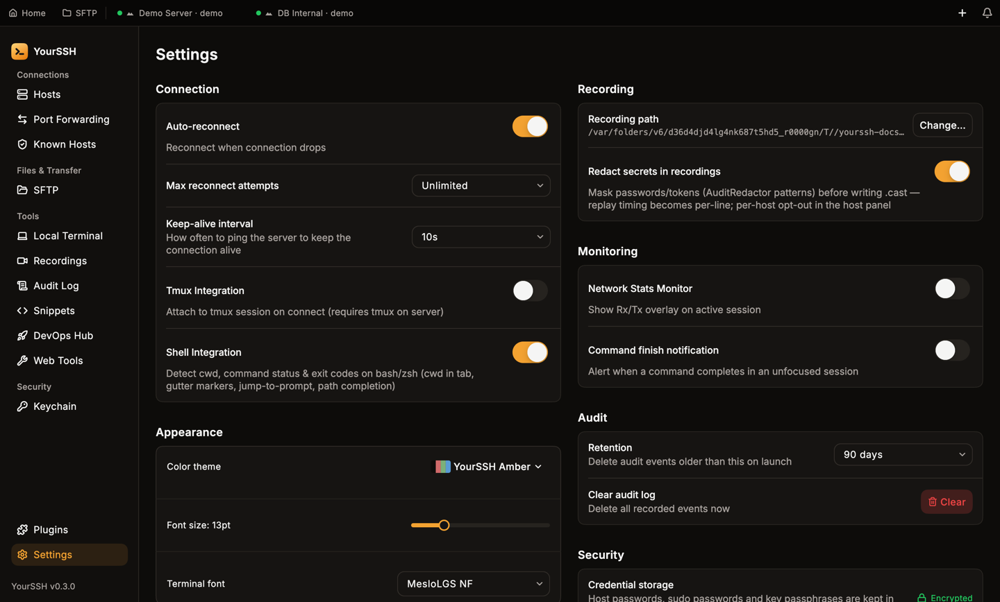
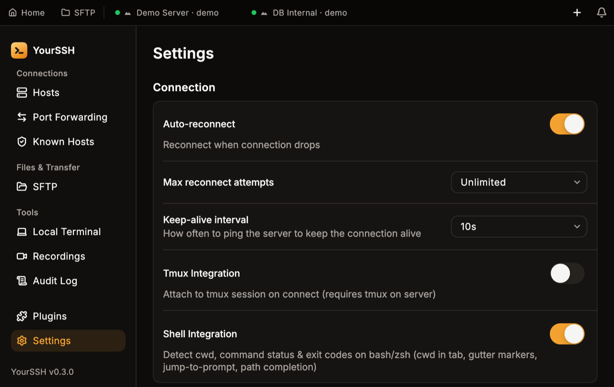
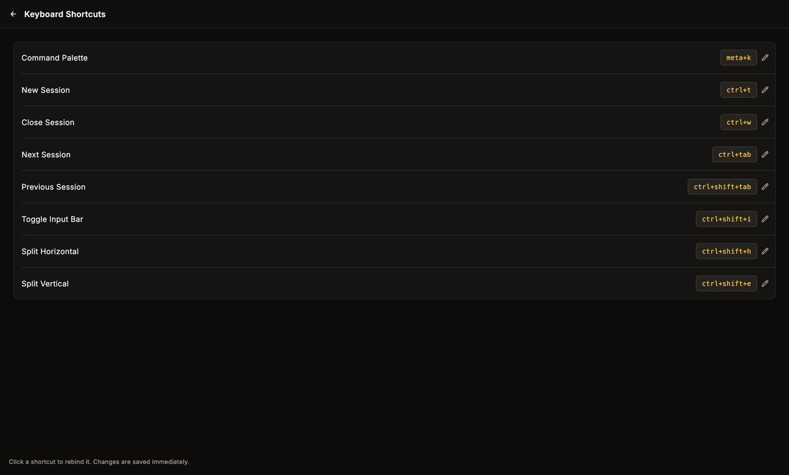
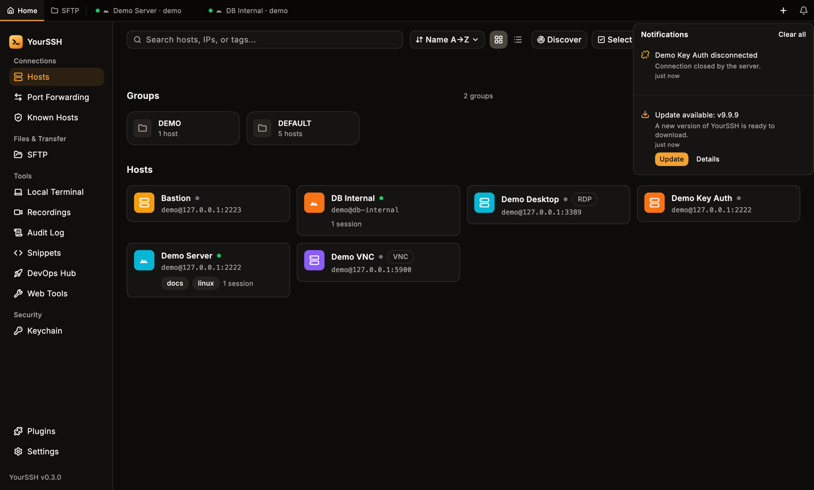

Open **Settings** from the sidebar. All sections sit on one scrolling page, in two columns on a wide window and in a single column on a narrow one. Changes apply immediately.

<Frame caption="Settings in a wide window: Connection, Appearance and Terminal on the left; Recording, Monitoring, Audit and Security on the right.">
  
</Frame>

<Frame caption="At the 900x600 minimum window size, Settings collapses to a single column.">
  
</Frame>

## Connection

| Setting | What it does |
|---|---|
| **Auto-reconnect** | Reconnect when a connection drops. On by default. |
| **Max reconnect attempts** | `Unlimited` (the default), `1 times`, `3 times`, `5 times` or `10 times`. With `Unlimited`, the tab shows a countdown whose delay grows between attempts. |
| **Keep-alive interval** | How often YourSSH pings the server to keep the connection alive: `Off`, `10s` (the default), `30s` or `60s`. |
| **Tmux Integration** | Attach to a tmux session on connect. Needs tmux on the server. |
| **Shell Integration** | Detect the working directory, command status and exit codes on bash and zsh. This powers the directory in the tab, gutter markers, jump-to-prompt and path completion. On by default. |

## Appearance

- **Color theme**: pick a terminal theme from the built-in list.
- **Font size**: a slider, 13pt by default.
- **Terminal font**: choose the terminal font.

The same three controls are in the terminal's side panel, so you can change them without leaving a session. See [Terminal](/user-guide/terminal).

## Terminal

- **Terminal emulation type**: the `TERM` value reported to servers, `xterm-256color` by default. It applies to new SSH connections.
- **Default local shell**: the shell new local terminals use. **Platform default** picks your system's shell.
- **Add custom shell...** adds your own entry. Enter a **Display name**, an **Executable path** and optional **Arguments** (space-separated, no quoting).

## Keyword highlighting

Tints matching text in every terminal session. Turn the whole feature on or off with **Enable keyword highlighting**.

The list ships with rules for words such as `error`, `fail`, `warning`, `success`, `done` and `OK`, each with its own on/off toggle. Use the pencil icon to edit a rule, the trash icon to delete it, and **Add rule** to create one with a label, a pattern and a color. A rule can match literal text or a regular expression. You can have up to 20 rules.

## Recording

- **Recording path**: the folder for `.cast` files. Click **Change...** to pick another folder.
- **Redact secrets in recordings**: mask passwords and tokens before they're written. On by default.

See [Session recording](/user-guide/recording).

## Monitoring

- **Network Stats Monitor**: show a Rx/Tx overlay on the active session.
- **Command finish notification**: alert you when a command finishes in a session that isn't focused.

## Audit

- **Retention**: delete audit events older than this on launch. Choose `30 days`, `90 days` (the default), `365 days` or **Keep forever**.
- **Clear audit log**: click **Clear** to delete all events now, after a confirmation.

See [Audit log](/user-guide/audit-log).

## Security

**Credential storage** shows where YourSSH keeps host passwords, sudo passwords and key passphrases: the macOS Keychain, the Windows Credential Manager or the system keyring on Linux.

- **Encrypted** means the system credential store holds every credential. This is the normal state.
- **Plain text** means the store refused one or more credentials, so YourSSH saved them as readable text in its preferences file. The row shows how many, and **Retry** tries to move them back into the store.

See [Keychain and credentials](/user-guide/keychain#how-credentials-are-stored) for the full behaviour.

## Sync

Choose between two tabs: **Cloud Sync** (your own Supabase project) and **P2P Transfer** (a one-time transfer over your network). Both are covered in [Sync](/user-guide/sync).

## AI providers

Enter an API key and choose a **Model** for each provider: **Anthropic**, **OpenAI** and **Google Gemini**. A check mark shows when a key is configured, and the eye icon reveals or hides a key while you type. YourSSH stores the keys in the system credential store. See [AI chat](/user-guide/ai-chat).

## Keyboard

Click **Configure** next to **Keyboard Shortcuts** to open the shortcuts screen. Click a shortcut, or its pencil icon, then press the new key combination. Press `Esc` to cancel. Changes are saved immediately.

<Frame caption="The Keyboard Shortcuts screen. Shortcuts are shown as stored; `meta` is Cmd on macOS.">
  
</Frame>

| Action | Default |
|---|---|
| Command Palette | `Ctrl+K` (`Cmd+K` on macOS) |
| New Session | `Ctrl+T` |
| Close Session | `Ctrl+W` |
| Next Session | `Ctrl+Tab` |
| Previous Session | `Ctrl+Shift+Tab` |
| Toggle Input Bar | `Ctrl+Shift+I` |
| Split Horizontal | `Ctrl+Shift+H` |
| Split Vertical | `Ctrl+Shift+E` |

### Command palette

Press `Cmd+K` / `Ctrl+K` anywhere in the app to open the command palette. It searches your hosts, sections of the app, snippets and app actions, so you can jump to a host or screen from the keyboard.

## Updates

Shows the **Current version** and a **Status** line. YourSSH checks GitHub for a newer stable release at launch and periodically while it runs. Click **Check for updates** to check right now. When a newer version exists, **Download & install** appears.

Updates are never silent. YourSSH downloads the build for your operating system and hands it to the system installer, and you finish the install yourself:

- **macOS**: opens the disk image. Drag the app to Applications.
- **Windows**: launches the installer.
- **Linux**: opens the package or archive with your default handler.

If no build matches your platform, the releases page opens in your browser.

## Notifications

The bell at the top right of the window collects things that need your attention:

- A new YourSSH version, with **Update** and **Details** buttons.
- A session that dropped unexpectedly, such as **Connection closed by the server.**
- A warning when a credential had to be stored without encryption.

Opening the panel marks items as read. Dismiss items one by one, or click **Clear all**.

<Frame caption="The notification panel with a disconnected session and an available update.">
  
</Frame>

## Related pages

- [Sync](/user-guide/sync)
- [AI chat](/user-guide/ai-chat)
- [Keychain and credentials](/user-guide/keychain)
