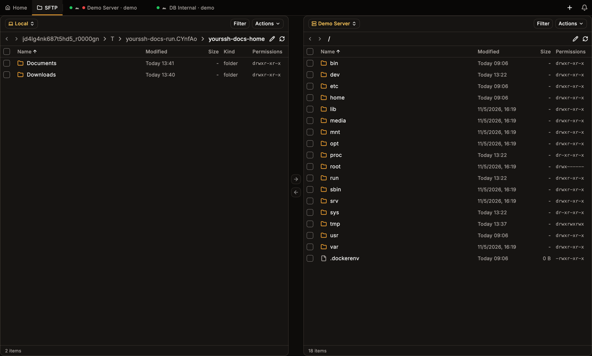
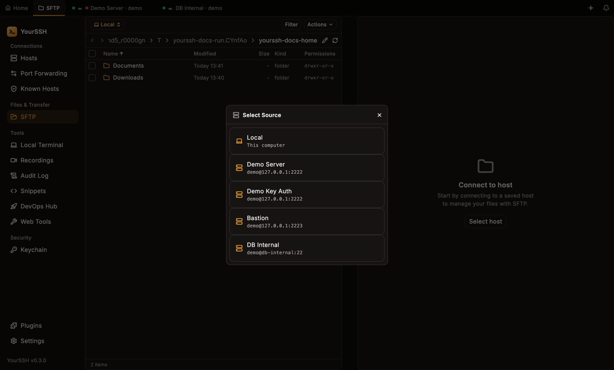
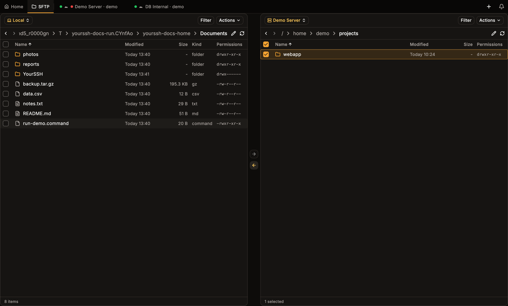
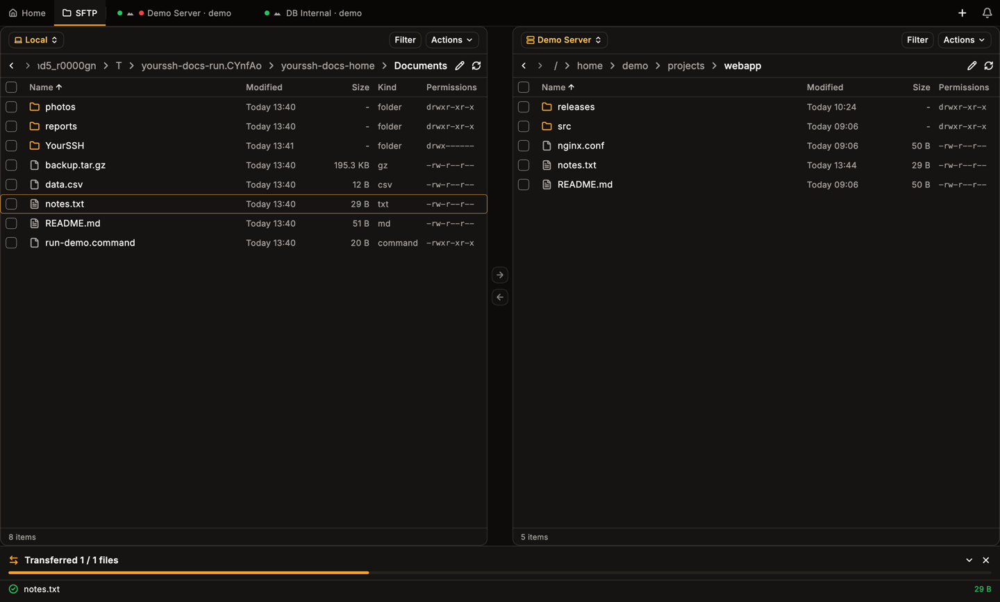
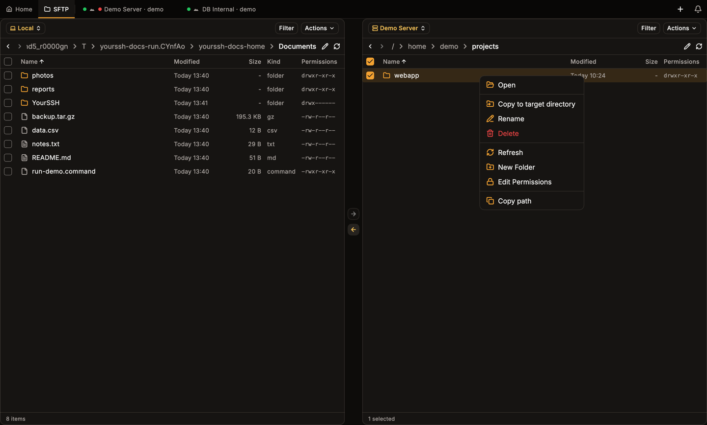
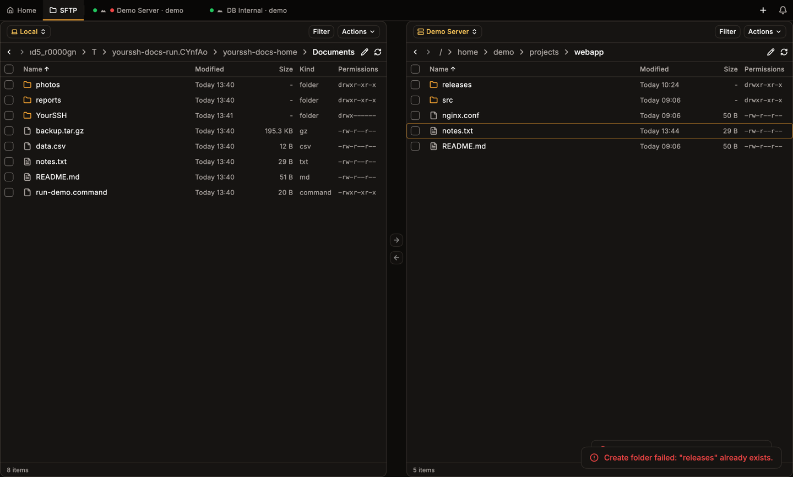
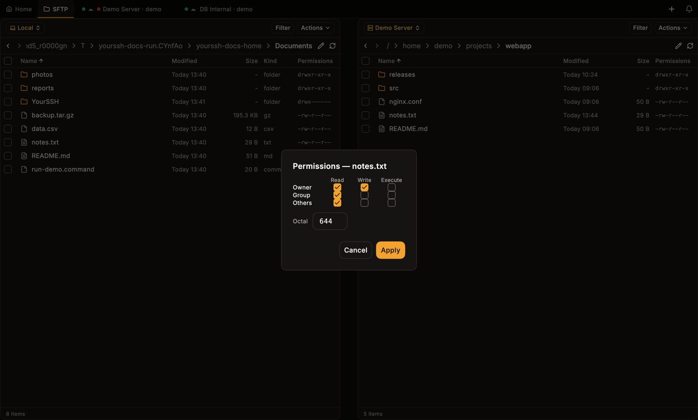
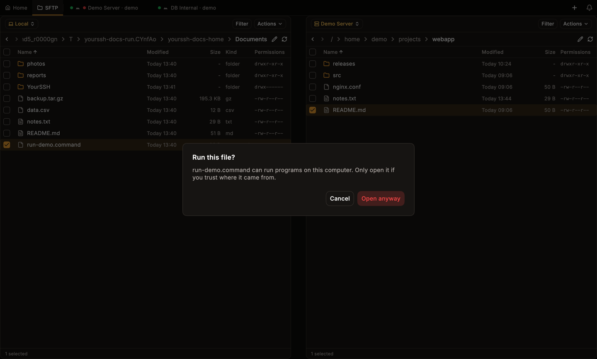
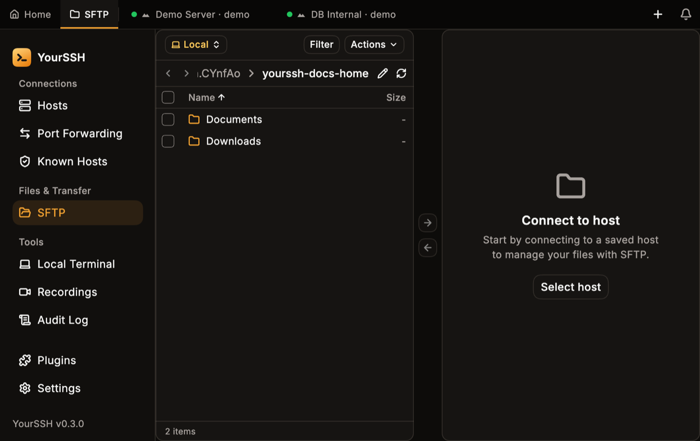

The **SFTP** screen shows two file panels side by side. Each panel can show your local files or any saved host, so you can copy local to remote, remote to local, or between two hosts.

<Frame caption="Dual-panel SFTP: local files on the left, a remote host on the right.">

</Frame>

## Open SFTP

Click the **SFTP** tab at the top, or **SFTP** in the sidebar. You can also choose **SFTP** from a host card menu.

Each panel has a **source chip** at the top left. It starts as **Local** on the left. Click it to switch a panel to **Local** or to any saved host. A panel with no host shows **Connect to host** and a **Select host** button.

<Frame caption="Choosing a host for the remote panel.">

</Frame>

SFTP uses the same stored credentials, [host key checks](/user-guide/host-keys) and [connection chain](/user-guide/hosts) as the terminal. Connections, paths and running transfers survive switching to other tabs. When you return to SFTP, it resumes where you left off.

## Navigate

- Click a row to select it. Double-click it, or press `Enter`, to open a folder or a file.
- Click a segment of the breadcrumb to jump to that folder.
- Click the pencil icon next to the breadcrumb to type or paste a path, then press `Enter`. Press `Esc` to cancel.
- Use the back and forward arrows to move through your visited folders, and the refresh icon to reload the listing.
- **Filter** narrows the current listing as you type.
- Click a column header (**Name**, **Modified**, **Size**, **Permissions**; the local panel also has **Kind**) to sort.

<Frame caption="A single click selects a row and does not open it.">

</Frame>

## Select files

Use the checkbox on each row, or click rows with `Cmd` / `Ctrl` to add to the selection, or `Shift` to select a range. The header checkbox selects every entry that matches the current filter. The footer shows the item count or `1 selected`.

## Transfer files

Select entries in one panel, then:

| Action | How |
|---|---|
| Upload | Select local files and click the arrow pointing right (**Copy →**), or drag them to the remote panel |
| Download | Select remote files and click the arrow pointing left (**Copy ←**), or drag them to the local panel |
| Copy to the other panel | Right-click and choose **Copy to target directory** |

**Copy to target directory** is disabled, with a reason in the menu, when it can't run: no target panel, folders between two remote hosts, or both panels showing the same folder. Uploading or downloading a single file replaces a file with the same name. Uploading a folder skips remote files that already exist, and copying between two local folders skips existing files and reports how many.

### Transfer queue

A panel docked at the bottom shows progress per file. Transfers run in the background, so the panels stay usable, and starting another transfer queues it on the same panel.

<Frame caption="The transfer queue at the bottom after an upload starts.">

</Frame>

- Click **Minimize** to shrink the panel to a slim strip, and **Expand** to bring it back.
- A successful batch closes itself after a few seconds. A batch with errors stays until you close it.
- Click **Cancel** to stop everything still pending. After a batch finishes the button becomes **Close**.

Large transfers keep running while you work in a terminal tab.

## File menu

Right-click an entry for its menu. The same menu serves the local and the remote panel.

<Frame caption="The context menu on a remote folder.">

</Frame>

| Item | What it does |
|---|---|
| **Open** | Opens a folder, or opens a file in the built-in editor or your default app |
| **View** | Read-only preview in the editor, with no save. Safe for logs and configuration |
| **Edit** | Opens the file in the built-in editor |
| **Open with** | Lists installed apps that can open the file type, plus **Choose…** for any app |
| **Copy to target directory** | Sends the entry to the folder shown in the other panel |
| **Rename** | Renames in place |
| **Delete** | Deletes permanently. There is no trash |
| **Refresh** | Reloads the current folder |
| **New Folder** | Creates a folder |
| **Edit Permissions** | Opens the permissions dialog (see below) |
| **Copy path** | Copies the entry's full path |

**View**, **Edit** and **Open with** appear for files. The **Actions** menu in each panel header also offers **New Folder**, **Rename** and **Delete**, plus **New File** on a remote panel.

### Rename, new folder and delete

**Rename**, **New Folder** and **New File** open a small dialog where you type a name and confirm with **Rename** or **Create**. **Delete** asks you to confirm and names the entries: `Delete "…"? This cannot be undone.`

If an operation fails, YourSSH shows a readable message instead of a raw error code. For example, creating a folder whose name exists shows `Create folder failed: "releases" already exists.` Other messages cover missing entries (`"x" no longer exists.`), `Permission denied for "x".`, and a lost connection.

<Frame caption="Creating a folder that already exists shows a clear error.">

</Frame>

## Edit permissions

**Edit Permissions** opens a dialog titled **Permissions — name**. It has a grid of **Read**, **Write** and **Execute** checkboxes for **Owner**, **Group** and **Others**, kept in sync with an **Octal** field such as `644`, `0755` or `4755`. Special bits survive when you only change checkboxes.

- The octal field accepts three or four octal digits. **Apply** stays disabled while the value is incomplete or invalid.
- For folders, **Apply recursively** runs `chmod -R`. The walk never follows symbolic links, so a link can't change files outside the tree.
- If the server doesn't report the current permissions and a stat also fails, the dialog warns **Current permissions unknown** and keeps **Apply** disabled until you set a mode.
- On the local panel, permissions use the system `chmod` and aren't available on Windows.

<Frame caption="The permissions dialog for a remote file.">

</Frame>

## Edit files

Double-clicking a text file, or choosing **Edit**, opens the built-in editor. On macOS it is the Monaco code editor with syntax highlighting for the file type. On Windows and Linux it is a plain text editor. Use the back button to return, and save to upload your changes. **View** opens the same editor read-only.

The editor refuses files it can't edit safely: files with a binary extension, files larger than 5 MB, and files with a null byte near the start. YourSSH then offers **Cannot edit in-app** with an **Open externally** button.

### Open with an external app

**Open with** and **Open externally** download the file to a temporary folder and open it in the app you choose. YourSSH watches that local copy and uploads it back each time you save. A message confirms `Opened … — watching for changes`.

For safety, YourSSH refuses to open executables from a server externally (for example `.exe`, `.bat`, `.lnk`, `.command` and `.desktop` files) and points you to download them instead. In the local panel, opening such a file asks first.

<Frame caption="Opening an executable from the local panel asks for confirmation.">

</Frame>

## Sudo mode (root transfers)

Each host has an **SFTP MODE** setting in the host editor: **Default**, **Sudo (root)** or **Custom command**.

- **Sudo (root)** starts the remote SFTP server through `sudo`, so browsing, uploads, downloads, rename and delete all run as root. YourSSH finds the server's path across common distributions.
- With a `NOPASSWD` sudoers entry it works silently. Otherwise YourSSH asks for the **Sudo password** and can remember it with **Remember in system keychain**.
- **Custom command** runs a command you provide, for example `sudo /usr/lib/openssh/sftp-server`. The field is required in this mode.
- A panel running elevated shows a root badge with the tooltip **SFTP runs elevated on this host**.

<Warning>
In sudo mode every file operation has root rights on that host. Use it only when you need it.
</Warning>

## Small windows

Down to the 800 × 600 minimum window size, both panels stay usable and the layout adapts.

<Frame caption="SFTP in a 900 × 600 window.">

</Frame>

## Related pages

- [Port forwarding](/user-guide/port-forwarding) to reach services behind a host.
- [Hosts](/user-guide/hosts) for credentials and connection chains used by SFTP.
- [Bulk actions](/user-guide/bulk-actions) to push files to many hosts at once.
