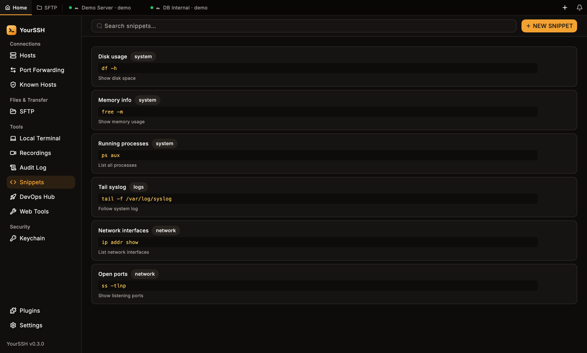
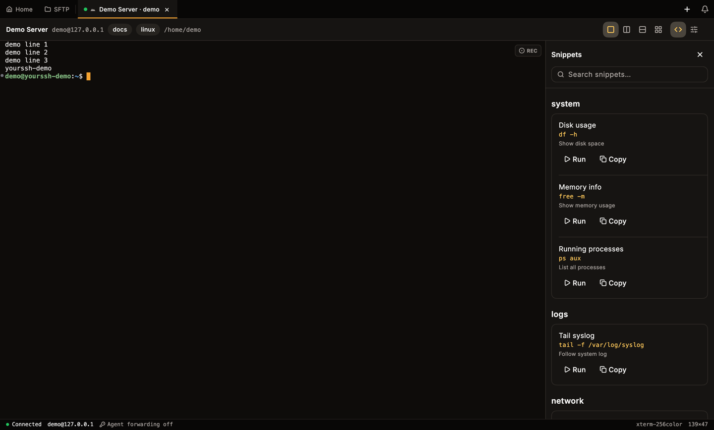
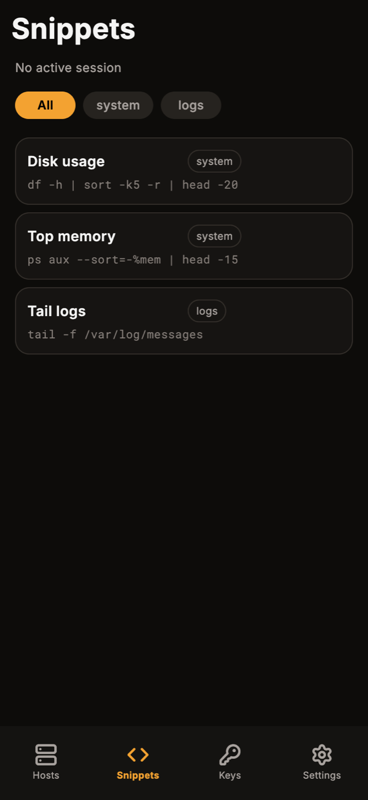

Snippets is a built-in plugin. It stores reusable shell commands and runs them in the terminal you are working in. The plugin is off until you turn it on in **Plugins** (sidebar). While it is off, the **Snippets** sidebar item and the terminal panel button are hidden.

## The Snippets screen

Once the plugin is on, click **Snippets** in the sidebar under **Tools**. The list shows each snippet with its label, a tag, the command and an optional description. The first time the plugin loads, it adds a few examples such as **Disk usage** (`df -h`) and **Open ports** (`ss -tlnp`).

<Frame caption="The Snippets screen with the built-in examples.">
  
</Frame>

Type in **Search snippets…** to filter the list.

### Add a snippet

<Steps>
  <Step title="Open the form">
    Click **NEW SNIPPET**.
  </Step>
  <Step title="Fill in the fields">
    Enter a **Label** and a **Command**. Both are required. **Description (optional)** and **Tag (optional)** are for your own organization. Snippets with the same tag are grouped together in the terminal panel.
  </Step>
  <Step title="Save">
    Click **Add Snippet**.
  </Step>
</Steps>

### Work with a snippet

Hover a snippet to show its buttons:

| Button | What it does |
|---|---|
| **Run in terminal** | Sends the command to the active session and presses Enter. |
| **Copy** | Copies the command to the clipboard. |
| **Delete** | Removes the snippet. |

If no SSH session is active, YourSSH shows a notice and sends nothing.

<Note>
The Snippets screen can add and delete snippets but has no edit form. To change a snippet, delete it and add a new one.
</Note>

## The terminal side panel

You don't have to leave the terminal to use snippets. In a connected session, click **Toggle Snippets Panel** in the terminal header. The panel opens beside the terminal without resizing the session.

<Frame caption="The Snippets panel beside a terminal. Snippets are grouped by tag.">
  
</Frame>

- Use **Search snippets…** to filter.
- Click **Run** to type the command into the focused session and press Enter. The panel shows **No active SSH pane selected** when there is no running session to receive it.
- Click **Copy** to copy the command instead.
- Click the close button to hide the panel.

The panel works in SSH sessions and local terminals. It is hidden for RDP and VNC tabs.

<Warning>
**Run** executes the command immediately. Check what a snippet does before you run it on a production host.
</Warning>

## Snippets on mobile

The **Snippets** tab in the Android app lists the same kind of snippets. Chips at the top filter by tag, with **All** showing everything. Tap a snippet to run it in the active session. The header shows which host receives it, or **No active session**.

<Frame caption="The Snippets tab in the Android app.">
  
</Frame>

See [Mobile](/user-guide/mobile) for the rest of the Android app.

## Related pages

<CardGroup cols={2}>
  <Card title="Terminal" icon="terminal" href="/user-guide/terminal">
    Sessions, split view and the header.
  </Card>
  <Card title="Bulk actions" icon="layers" href="/user-guide/bulk-actions">
    Run a command on many hosts at once.
  </Card>
</CardGroup>
