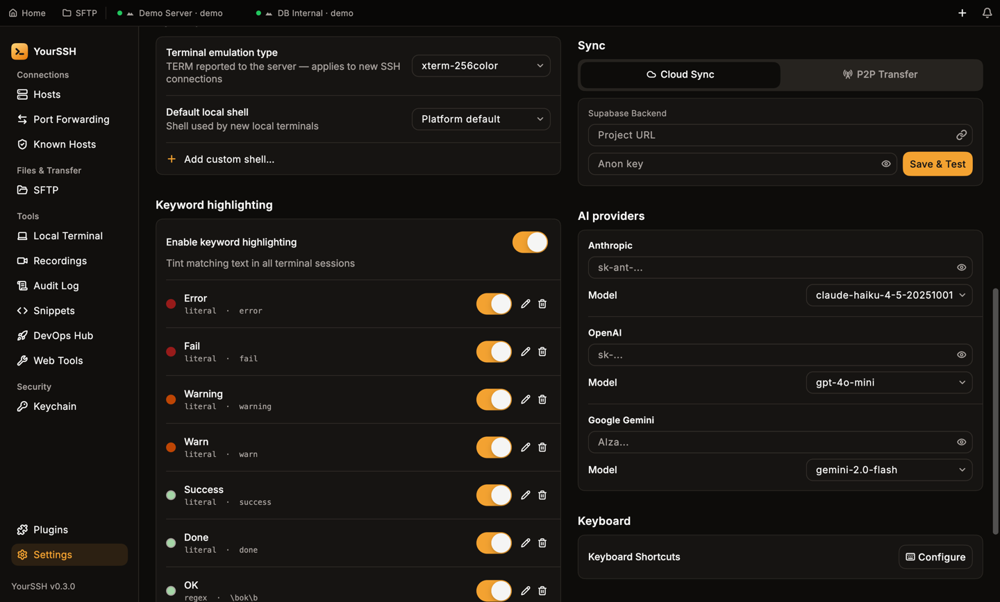
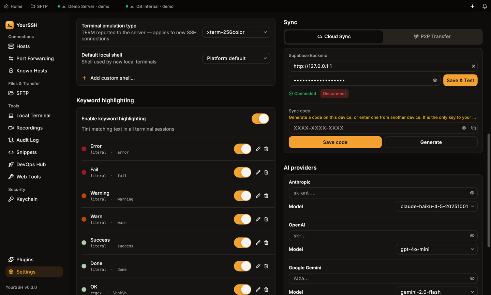
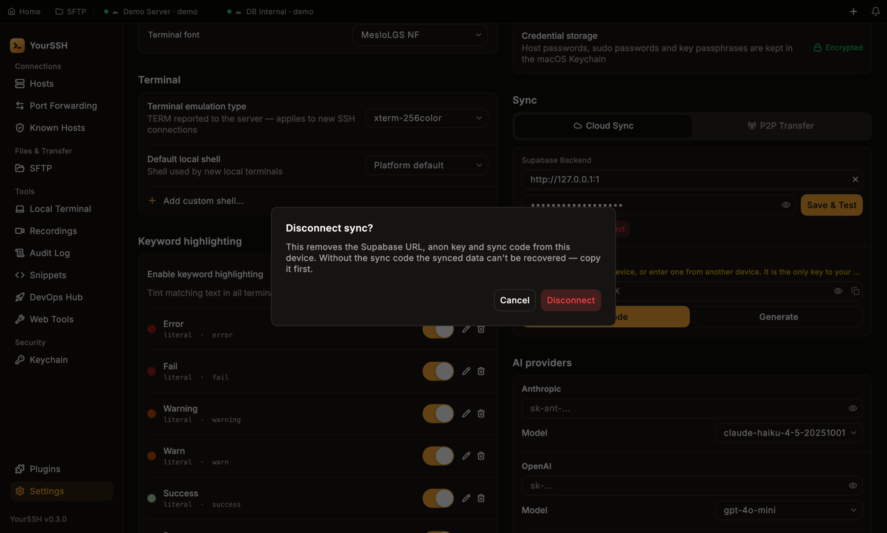
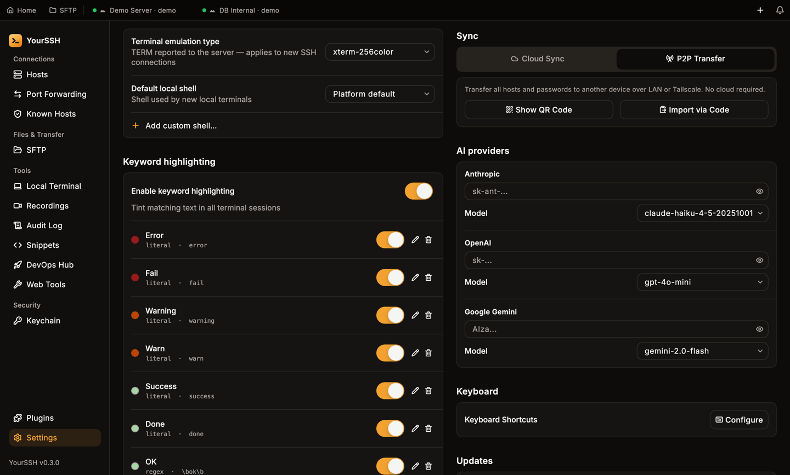
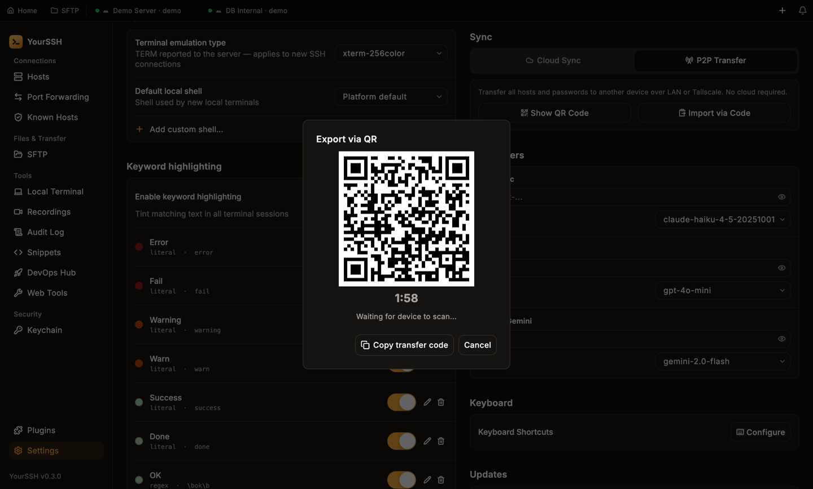
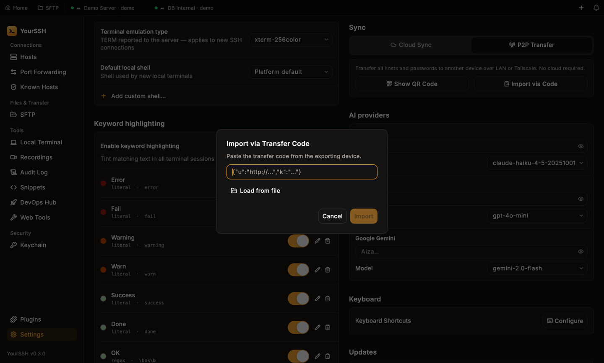

YourSSH offers two ways to get your hosts onto another device. Both live in **Settings → Sync**.

<CardGroup cols={2}>
  <Card title="Cloud Sync" icon="cloud">
    Continuous sync through a free Supabase project that you own. Everything is encrypted on your device before it's uploaded.
  </Card>
  <Card title="P2P Transfer" icon="radio-tower">
    A one-time transfer between two devices on the same network, using a QR code. No account needed.
  </Card>
</CardGroup>

<Frame caption="Settings → Sync before any setup. Choose Cloud Sync or P2P Transfer.">
  
</Frame>

## Cloud Sync

### What syncs

Cloud Sync uploads your **host list together with host passwords**. Nothing else goes into the payload: private key files, snippets, AI provider keys, known hosts and settings are not uploaded.

<Warning>
When newer data arrives from the cloud, it **replaces** the host list on the receiving device. A host that exists only on that device is removed, together with its saved secrets.
</Warning>

### How it's protected

- YourSSH encrypts the data on your device with AES-256-GCM before upload. Supabase only ever stores ciphertext.
- The encryption key comes from a **12-character sync code** that YourSSH generates for you. The code never leaves your devices.
- The sync code is the only secret that protects your data. The Supabase **anon key** is just an API credential, and on its own it can't decrypt anything.
- The row that holds your data is named with a one-way hash of the sync code, not the code itself.
- YourSSH rejects older data that someone replays from the server, so a stale copy can't overwrite your newer hosts.

<Warning>
If you lose the sync code, the synced data can't be decrypted or recovered. Copy it somewhere safe. Someone who holds your anon key can still delete or overwrite the cloud row (you'd see this as a decrypt failure), so don't share the key publicly.
</Warning>

### Set it up

<Steps>
  <Step title="Create a Supabase project">
    Sign up at [supabase.com](https://supabase.com), click **New project**, choose a region close to you and set a database password.
  </Step>
  <Step title="Copy the project URL and anon key">
    In Supabase, open **Project Settings → API**. Copy the **Project URL** (`https://<project-ref>.supabase.co`) and the anon (publishable) key.
  </Step>
  <Step title="Enter them in YourSSH">
    In **Settings → Sync → Cloud Sync**, paste the URL into **Project URL** and the key into **Anon key**, then click **Save & Test**.
  </Step>
  <Step title="Create the table, if asked">
    If the `sync_data` table doesn't exist, YourSSH says **Table not found** and shows the SQL to run. Click **Copy SQL**, then **Open SQL Editor**, paste the SQL and run it. Click **Save & Test** again.

    ```sql
    create table if not exists sync_data (
      sync_id    text        primary key,
      payload    text        not null,
      updated_at timestamptz not null default now()
    );
    alter table sync_data drop constraint if exists sync_data_sync_id_check;
    alter table sync_data enable row level security;
    drop policy if exists "anon_rw" on sync_data;
    create policy "anon_rw" on sync_data
      for all
      to anon
      using (true)
      with check (true);
    ```

    The policy lets anyone with your anon key read and write the table. That is safe for confidentiality because the data is encrypted with your sync code, which Supabase never sees.
  </Step>
  <Step title="Generate your sync code">
    When the status shows **Connected**, click **Generate** in the **Sync code** area. YourSSH shows a code like `XXXX-XXXX-XXXX`. Click the copy button and store it safely.
  </Step>
</Steps>

<Frame caption="A connected Supabase project. The Sync code area is below the Connected status.">
  
</Frame>

Sync turns on as soon as the project URL, anon key and sync code are all set. There's no separate switch.

### Add another device

On the new device, enter the **same Project URL and Anon key** and click **Save & Test**. Then type your existing sync code into the **Sync code** box and click **Save code**. The device downloads and decrypts your hosts and joins automatically. The code is case-insensitive and ignores dashes, so `abcd-2345-efgh` and `ABCD2345EFGH` are the same.

### When it syncs

- YourSSH pushes your changes each time you add, edit or delete a host. If a push fails, it retries every 30 seconds.
- It checks for newer data from other devices when the window regains focus.
- The status line below the controls reads **Syncing…**, **Synced**, or **Sync error:** followed by the reason.

### Regenerate the code

Click **Regenerate** (the **Generate** button after a code exists) to create a new code. YourSSH asks **Regenerate sync code?** first. A new code starts a new cloud record, and data tied to the old code is unreachable until you enter the old code again.

### Disconnect

Click **Disconnect** next to **Connected**. YourSSH asks **Disconnect sync?** and warns that it removes the Supabase URL, anon key and sync code from this device. Without the sync code, the synced data can't be recovered, so copy it first.

<Frame caption="Disconnect removes the project URL, anon key and sync code from this device.">
  
</Frame>

### Troubleshooting

| Message | What to do |
|---|---|
| **Table not found** | Run the SQL shown in the app in the Supabase SQL Editor. |
| An error from Supabase about an invalid API key | Re-copy the anon key from **Project Settings → API**. |
| **URL and Anon key are required** | Fill in both fields before **Save & Test**. |
| **Enter a valid 12-character sync code.** | Check the code. It must be exactly 12 characters (dashes are optional). |
| A decrypt error | Every device must use the same sync code. |

## P2P Transfer over your network

Use P2P Transfer to move your hosts to another device once, without any cloud account. It transfers **all hosts and their saved passwords**, the same payload as Cloud Sync, and nothing else. It isn't continuous sync.

<Frame caption="The P2P Transfer tab: Show QR Code on the sending device, Import via Code on the receiving one.">
  
</Frame>

### Send from a desktop

<Steps>
  <Step title="Show the QR code">
    On the device that has your hosts, open **Settings → Sync → P2P Transfer** and click **Show QR Code**. The **Export via QR** dialog opens.
  </Step>
  <Step title="Pick a network interface">
    If the computer has more than one network connection (Wi-Fi, Ethernet, VPN), a **Network interface** list appears. Choose the one the other device can reach. Changing it restarts the timer.
  </Step>
  <Step title="Scan before the timer ends">
    The QR code is valid for 2 minutes, and a countdown shows the time left. The dialog says **Waiting for device to scan...**. When time runs out it says **Session expired.** Click **Cancel**, then **Show QR Code** again for a new code.
  </Step>
</Steps>

<Frame caption="The Export via QR dialog. The address in the QR is a documentation example, not a real network address.">
  
</Frame>

While the dialog is open, YourSSH runs a small server on a random port on your computer. The data is encrypted with a fresh random key that travels inside the QR code, so keep the QR visible only to the person receiving it. The server shuts down automatically after one successful transfer.

### Receive

- **On Android**, open the **Pair device** screen and tap **Scan QR code**. See [YourSSH for Android](/user-guide/mobile). An Android phone can also be the sender: its **Pair device** screen shows a QR code for another device to scan.
- **On desktop**, click **Import via Code**, paste the transfer code into **Import via Transfer Code** (or click **Load from file**), then click **Import**. On the sending device, click **Copy transfer code** in the **Export via QR** dialog to get the code.

<Frame caption="Import via Transfer Code: paste the code from the sending device.">
  
</Frame>

The receiving device downloads the encrypted data, decrypts it and imports the hosts. The import **replaces** every host on the receiving device. YourSSH says **All previous hosts replaced.** when it finishes, and it refuses a transfer that contains no hosts.

<Note>
Both devices must be on the same network, or at least the sending computer's address must be reachable from the receiver. If the transfer can't connect, pick a different **Network interface** on the sender.
</Note>
