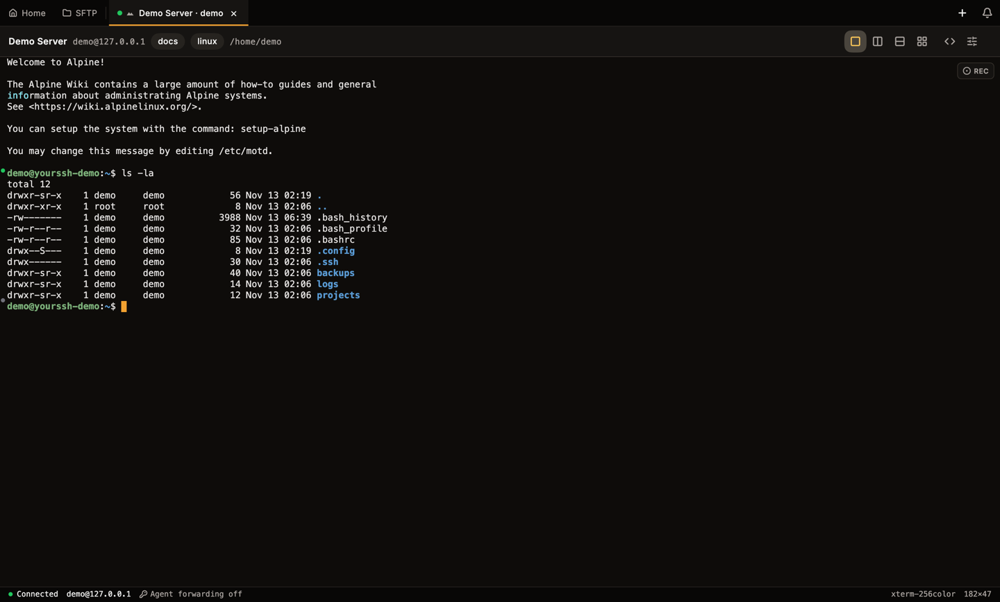
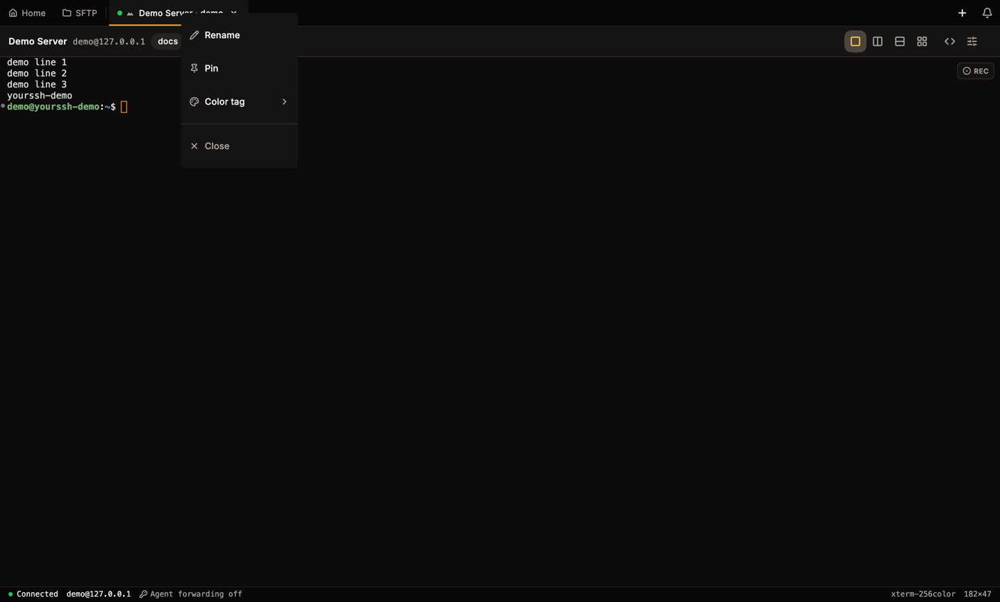
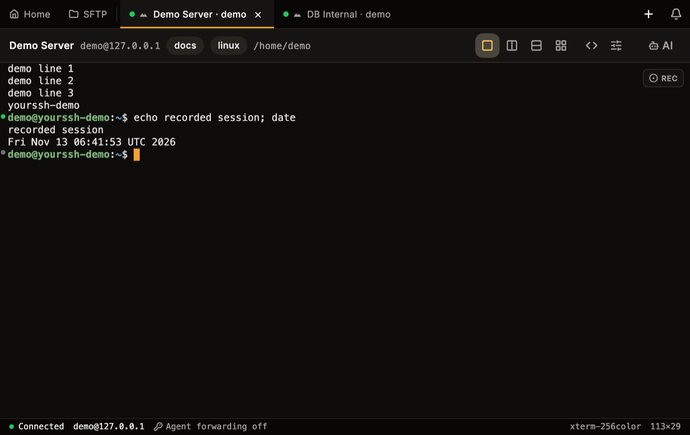
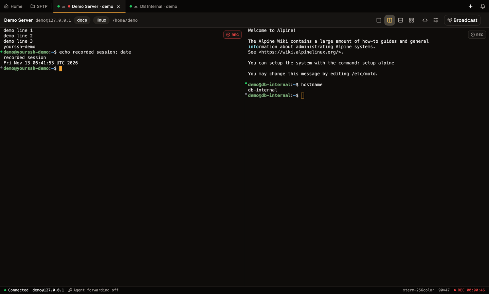
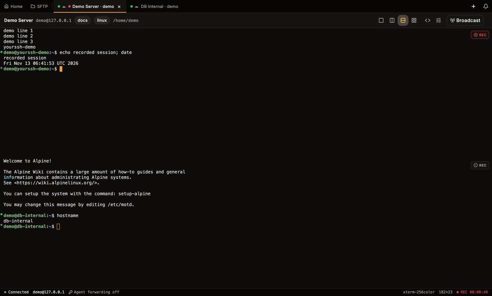
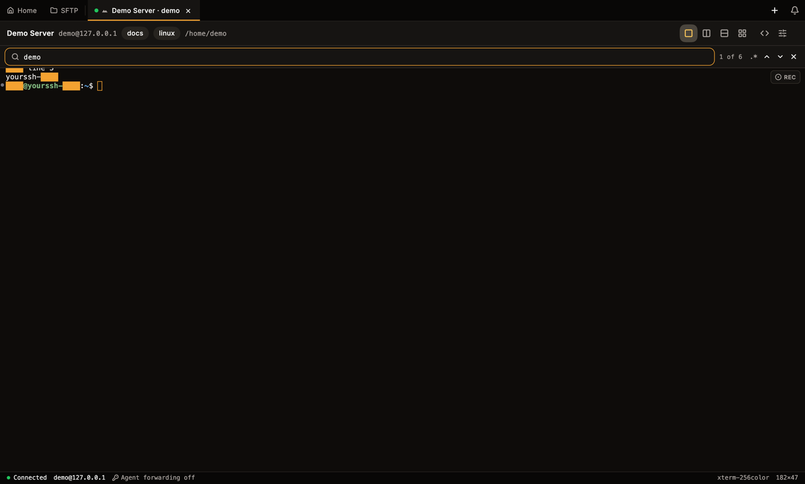
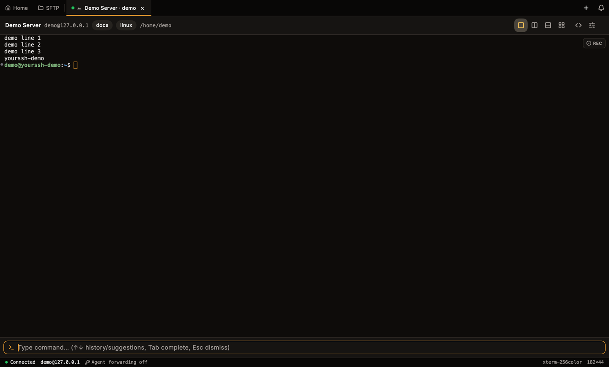
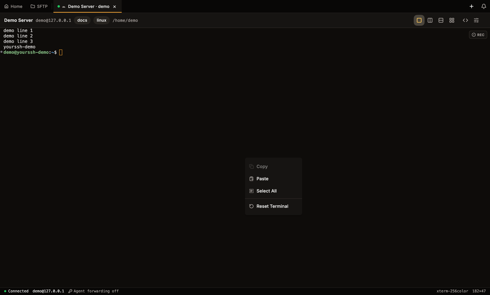
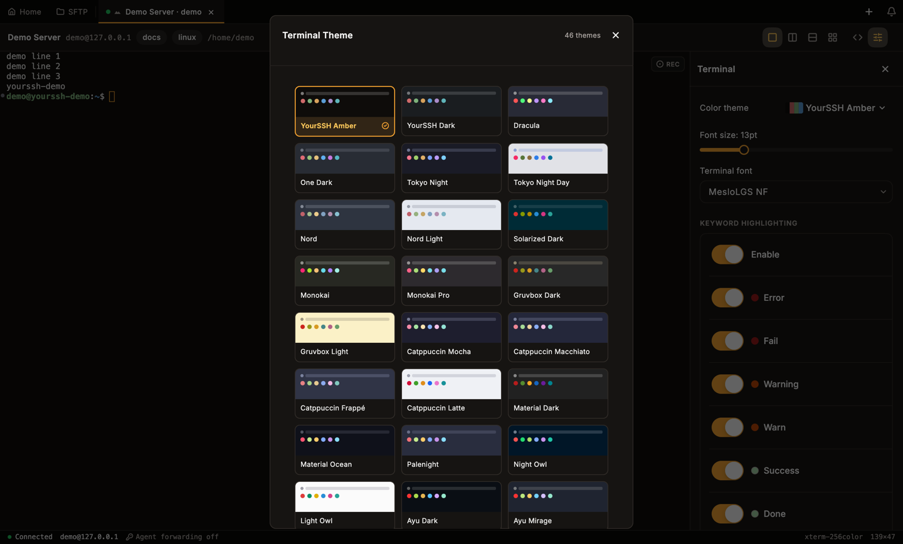
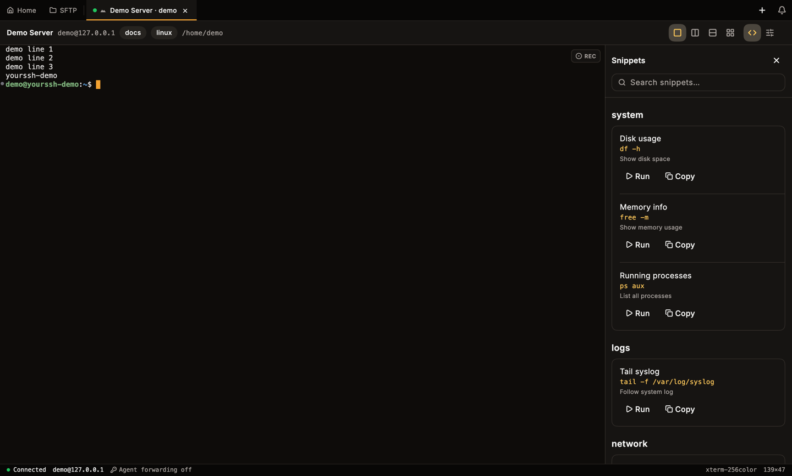

YourSSH runs an `xterm-256color` terminal for every SSH session and local shell, and adds tabs, split panes, search, a command input bar and shell integration on top.

<Frame caption="A connected session: tab bar, host chips and layout buttons in the header, and the status bar at the bottom.">

</Frame>

## Open a session

Click a host card on the **Hosts** dashboard, or open the card menu and choose **Connect**. A new tab opens and the connection starts. See [Hosts](/user-guide/hosts) for adding and editing hosts.

You can also use the **+** button at the right end of the tab bar:

- **New SSH session** opens the host picker.
- **New local terminal** opens a shell on your own machine (see [Local terminal](#local-terminal)). Below it, **Platform default shell** and each detected shell open that shell directly.

## Tabs

Each session is a tab in the top bar, next to the pinned **Home** and **SFTP** tabs. A tab shows:

- A **health dot** (see below).
- An **OS glyph** for the detected remote system.
- The tab name, plus small dots for a colour tag and for an active recording.

### Connection health dot

The dot comes from a latency ping sent over the live SSH connection on the keep-alive interval (**Settings → Connection → Keep-alive interval**).

| Dot | Meaning |
|---|---|
| Green | Healthy: latency under 150 ms |
| Amber | Degraded: latency 150–500 ms |
| Red | Unreachable: latency over 500 ms, ping timed out, or error |
| Grey | Disconnected, or no reading yet |
| Pulsing amber | Connecting or reconnecting |

The ping uses the open connection instead of a new one, so a 5-second timeout also catches half-open drops, where the network is gone but the shell has not closed yet. Hover the dot to see latency, uptime and how many times the session reconnected.

### Manage tabs

| Action | How |
|---|---|
| Rename | Double-click the tab, or right-click and choose **Rename** |
| Colour tag | Right-click, then **Color tag**, and pick one of eight colours |
| Pin | Right-click and choose **Pin**. Pinned tabs move to the front, hide their close button and ignore middle-click. Use **Close** in the menu to close one |
| Reorder | Drag a tab left or right. Pinned and unpinned tabs stay in their own zones |
| Close | Click the close button on the tab, middle-click it, or right-click and choose **Close** |

<Frame caption="The tab context menu: Rename, Pin, Color tag and Close.">

</Frame>

Tab names, colours and pin state are kept per host across reconnects and app restarts.

### Notification bell

The bell at the right end of the tab bar collects in-app notifications behind an unread badge: sessions that drop unexpectedly (closing a tab yourself never notifies), new releases with inline **Update** and **Details** buttons, and alerts about agent forwarding, insecure credential storage and refused `yourssh://` links. Opening the panel marks everything read. Dismiss items one by one or use **Clear all**. Notifications live in memory and reset when you restart the app.

## Terminal header and status bar

The header above the terminal has two sides:

- **Left:** chips for the host name, `user@host`, the first two tags and the current directory. The directory appears when [shell integration](#shell-integration) is active.
- **Right:** layout buttons (**Single**, **Split Horizontal**, **Split Vertical**, **Quad**), the **Toggle Snippets Panel** button (only while the Snippets plugin is on), the **Toggle Terminal Settings** button, and **Broadcast** when more than one pane is open. Depending on your setup you also see the network stats widget, **Share** (see [Terminal sharing](/user-guide/terminal-sharing)) and **AI** (see [AI chat](/user-guide/ai-chat)).

The status bar at the bottom shows the connection state (**Connected**, **Connecting…**, **Disconnected**, **Error**), `user@host`, the jump chain (`via …`) when the host uses a [connection chain](/user-guide/hosts), the agent forwarding state, the requested `TERM`, the size in columns × rows, and `REC` with an elapsed timer while you record.

<Frame caption="The terminal in a 900 × 600 window. The header and status bar still fit.">

</Frame>

## Split panes

Use the layout buttons in the header, or the shortcuts, to show more than one session at once:

| Layout | Button | Shortcut |
|---|---|---|
| Single pane | **Single** | |
| Two panes side by side | **Split Horizontal** | `Ctrl+Shift+H` |
| Two panes stacked | **Split Vertical** | `Ctrl+Shift+E` |
| Four panes | **Quad** | |

Each pane shows one of your open sessions. A pane without a session shows **No session in this pane**. Open another session with **+** in the tab bar and it appears there. Click a pane to make it the active one.

<Frame caption="Split horizontal with two live sessions: Demo Server on the left, DB Internal on the right.">

</Frame>

<Frame caption="Split vertical with the same two sessions.">

</Frame>

### Broadcast

When two or more panes are open, **Broadcast** appears in the header. Turn it on, open the [input bar](#input-bar), and every command you submit there goes to all panes. Each target gets its own entry in the [audit log](/user-guide/audit-log). Broadcast only affects the input bar. Keystrokes typed straight into a terminal still go to that pane alone.

<Warning>
Broadcast runs the same command on every pane. Check which sessions are open before you submit.
</Warning>

To run a command on many saved hosts without opening tabs, use [Bulk actions](/user-guide/bulk-actions).

## Search

Press `Cmd+F` / `Ctrl+F` to open the search bar over the scrollback. Type text to highlight every match and see a counter such as **1 of 6**. Press `Enter` for the next match and `Shift+Enter` for the previous one. The `.*` button switches to regular expressions. Press `Esc` or click the close button to leave search.

<Frame caption="Search with six matches highlighted and the regex toggle at the right.">

</Frame>

## Input bar

The input bar is a command line at the bottom of the terminal with its own history and completion. Toggle it with `Ctrl+Shift+I`.

<Frame caption="The input bar toggled on.">

</Frame>

- Press `Enter` to send the line to the session.
- Press `↑` and `↓` to move through the command history of the session.
- Press `Tab` to accept the highlighted suggestion. Use `↑` and `↓` to pick one while suggestions are showing.
- Press `Esc` to close the input bar.
- With [shell integration](#shell-integration) active, a path typed after `cd`, `cat`, `ls` and similar commands completes against the real remote directory, merged with your history. YourSSH reads that directory over SFTP.

## Copy, paste and mouse

Select text by dragging. Double-click selects a word.

| Action | macOS | Windows and Linux |
|---|---|---|
| Copy | `Cmd+C` | `Ctrl+C` with a selection, or `Ctrl+Shift+C` |
| Paste | `Cmd+V` | `Ctrl+V` or `Ctrl+Shift+V` |
| Paste with the mouse | Middle-click | Middle-click |
| Context menu | Right-click | Right-click |

On Windows and Linux, `Ctrl+C` copies only while text is selected, then clears the selection. Press it again to send `Ctrl+C` (SIGINT) to the running program as usual.

Right-click opens a menu with **Copy**, **Paste**, **Select All** and **Reset Terminal**. **Copy** is disabled when nothing is selected. If a full-screen program crashes and leaves the terminal looking frozen, choose **Reset Terminal**. It is the local equivalent of running `reset`.

<Frame caption="The terminal context menu.">

</Frame>

Programs that capture the mouse (vim with `mouse=a`, htop, tmux with `mouse on`) keep receiving clicks instead of starting a selection or paste.

### Scrolling

The scrollback holds 10 000 lines per session. While you are scrolled up, new output does not pull the view back down. Typing or pressing `Enter` returns to the bottom. Use `Shift+PageUp` and `Shift+PageDown` to page through the scrollback from the keyboard. In full-screen programs that use the alternate screen, these keys go to the program instead.

Inside full-screen programs that use the mouse, the wheel scrolls the program's own view. Programs without mouse support, such as `less` and `man`, receive arrow keys instead.

## Shell integration

On bash and zsh hosts, YourSSH installs a small prompt hook when you connect, so it can follow the remote shell through OSC 7 (working directory) and OSC 133 (command boundaries and exit status). The hook lives only in the live session. YourSSH never edits your `.bashrc` or `.zshrc`.

The setup is silent. YourSSH waits until the shell is at a prompt, then sends the hook through a hidden handshake, so nothing appears in your terminal or recordings. If YourSSH can't confirm the shell is ready (an unusual shell, a full-screen program, or you started typing at once), it skips the hook for that session.

Shell integration gives you:

- **Working directory** in the header and in path completion.
- **Command gutter.** A thin strip at the left edge shows a dot beside each prompt: green for exit code 0, red for non-zero, grey for running or unknown. Click a dot to jump to that command.
- **Jump to prompt.** `Cmd+↑` / `Ctrl+↑` and `Cmd+↓` / `Ctrl+↓` scroll to the previous and next prompt.
- **Path completion** in the input bar.

Shell integration is on by default. To turn it off:

- For every host: **Settings → Connection → Shell Integration**.
- For one host: the **Shell integration** switch in the host editor.

Sessions where a multiplexer strips the markers, such as some tmux setups, run without these features.

## Keyword highlighting

Keyword highlighting tints matching text in every terminal session, for example **Error**, **Fail** or **Warning**. Turn it on or off with the **Enable** switch under **KEYWORD HIGHLIGHTING** in the terminal settings panel, or with **Enable keyword highlighting** in **Settings → Keyword highlighting**.

In **Settings → Keyword highlighting** you can add, edit and delete rules. A rule has a **Label**, a **Pattern**, **Regex** and **Case-sensitive** options, and a **Foreground** and **Background** colour (pick at least one).

## Appearance and themes

Click the **Toggle Terminal Settings** button (sliders icon) in the header to open the appearance panel beside the terminal. It holds the **Color theme**, the **Font size** (it previews live while you drag) and the **Terminal font**, plus the keyword highlighting switches. The same controls exist in **Settings**.

Click the colour theme to open **Terminal Theme**, a grid of 46 themes with previews. **YourSSH Amber** is the default. Others include YourSSH Dark, Dracula, Tokyo Night, Nord, Solarized, Gruvbox, Catppuccin and Monokai, in dark and light variants.

<Frame caption="The theme picker opened from the terminal settings panel.">

</Frame>

## Snippets panel

Click the **Toggle Snippets Panel** button (the `<>` icon) in the header to open your saved snippets beside the terminal. The button appears while the Snippets plugin is enabled. You can browse and search them, and run one against the active pane without leaving the terminal. Only one side panel is open at a time, so opening Snippets closes the appearance panel. Create and manage snippets in [Snippets](/user-guide/snippets).

<Frame caption="The snippets panel next to a session.">

</Frame>

## Recording

Click **REC** at the top right of a terminal to record the session as an asciicast file. The status bar then shows the elapsed time. Click again to stop. See [Session recording](/user-guide/recording) for the library, playback and secret masking.

## Auto-reconnect and tmux

Set these in **Settings → Connection**:

- **Auto-reconnect** reconnects when a connection drops. **Max reconnect attempts** accepts 1, 3, 5, 10 or **Unlimited**.
- **Keep-alive interval** sets how often YourSSH pings the server (10 s, 30 s, 60 s or **Off**). It also drives the health dot.
- **Tmux Integration** attaches to a tmux session on connect. It needs tmux on the server. A host can override the global value with **tmux: follow global**, **always on** or **always off** in the host editor.

A session that drops without a pending reconnect adds an entry to the notification bell.

## Local terminal

Open **Local Terminal** in the sidebar, or choose **New local terminal** from the **+** menu, to start a shell on your own machine. Local shells are normal tabs. You can split them, record them and place them next to SSH panes. If the shell exits, the pane offers **Restart shell**, which relaunches the shell the tab started with.

YourSSH detects the shells you have installed:

- **Windows:** PowerShell, Command Prompt, PowerShell 7 (`pwsh`), Git Bash and one entry per WSL distribution.
- **macOS and Linux:** your `$SHELL` and everything listed in `/etc/shells`.

Pick the default in **Settings → Terminal → Default local shell**, or choose another shell for one tab from the **+** menu. **Add custom shell…** in the same section accepts any executable with arguments.

## Command palette

Press `Cmd+K` / `Ctrl+K` to open the command palette. It searches saved hosts, navigation sections and app actions such as **New Host**, **Import SSH Config** and **Join Shared Session** (when sharing is available). Type to filter and press `Enter` to run the selected item.

## Keyboard shortcuts

The defaults below can be changed in **Settings → Keyboard → Configure**.

| Action | Default |
|---|---|
| Command Palette | `Cmd+K` (macOS), `Ctrl+K` (Windows, Linux) |
| New Session | `Ctrl+T` |
| Close Session | `Ctrl+W` |
| Next Session | `Ctrl+Tab` |
| Previous Session | `Ctrl+Shift+Tab` |
| Toggle Input Bar | `Ctrl+Shift+I` |
| Split Horizontal | `Ctrl+Shift+H` |
| Split Vertical | `Ctrl+Shift+E` |

Other keys in the terminal:

| Action | Keys |
|---|---|
| Search the scrollback | `Cmd+F` / `Ctrl+F` |
| Previous or next command prompt | `Cmd+↑` `Cmd+↓` / `Ctrl+↑` `Ctrl+↓` |
| Page through the scrollback | `Shift+PageUp`, `Shift+PageDown` |

When a key combination is a registered shortcut, YourSSH keeps it from reaching the shell.

## Related pages

<CardGroup cols={2}>
  <Card title="Terminal sharing" icon="screen-share" href="/user-guide/terminal-sharing">
    Let teammates watch a live session.
  </Card>
  <Card title="Recording" icon="circle-dot" href="/user-guide/recording">
    Record sessions to asciicast files.
  </Card>
  <Card title="Snippets" icon="code" href="/user-guide/snippets">
    Save and run reusable commands.
  </Card>
  <Card title="SFTP" icon="folder" href="/user-guide/sftp">
    Move files next to your terminal.
  </Card>
</CardGroup>
