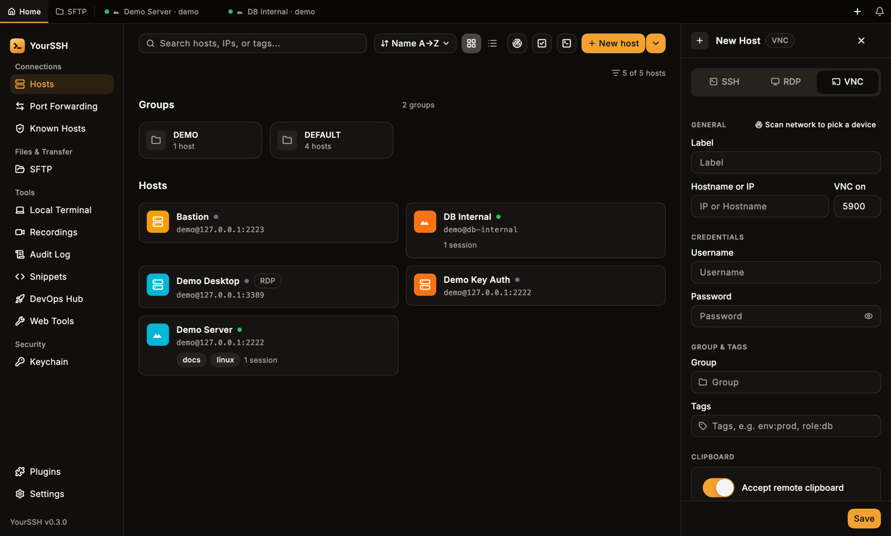
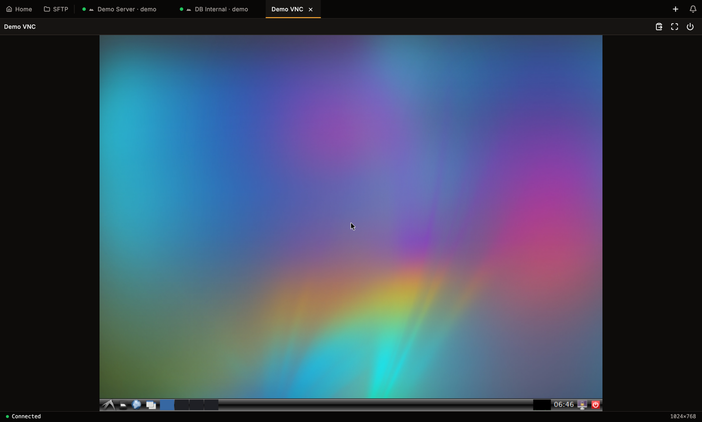

YourSSH has a built-in VNC client for servers such as TigerVNC, x11vnc and TightVNC. A VNC session opens as a tab next to your SSH and RDP sessions.

## Add a VNC host

<Steps>
  <Step title="Open the host editor">
    Click **New host** on the hosts dashboard, or **Edit** on an existing host.
  </Step>
  <Step title="Switch to VNC">
    Select **VNC** in the **SSH / RDP / VNC** switch at the top. The port changes to `5900`. A custom port is kept.
  </Step>
  <Step title="Fill in the connection">
    Enter the hostname or IP and the **Password**. The password is the VNC server password. A username is accepted, but most VNC servers ignore it.
  </Step>
  <Step title="Choose clipboard and tunnel">
    Set **Accept remote clipboard** and, if you want, **SSH TUNNEL**, then click **Save**.
  </Step>
</Steps>

<Frame caption="The host editor in VNC mode: port 5900, password and the clipboard switch.">
  
</Frame>

**Accept remote clipboard** lets the remote desktop replace your local clipboard. It is on by default and capped at 1 MiB. Turn it off for hosts you don't trust.

**SSH TUNNEL** routes the VNC connection through one of your saved SSH hosts. Choose **Direct connection** (the default) or **via** a host. The selector only appears when you have at least one other SSH host saved. See [Hosts](/user-guide/hosts).

VNC hosts carry a **VNC** badge on the hosts dashboard, in list rows and in the host panel header.

## Connect

Click the host card to connect.

<Warning>
Plain VNC has no encryption. There is no certificate dialog because there is no certificate, and the password exchange and the screen content travel unencrypted. Outside a trusted LAN, set an **SSH TUNNEL** so the session runs inside an encrypted SSH connection.
</Warning>

## Use the session

<Frame caption="A connected VNC session. The toolbar has push clipboard, fullscreen and disconnect.">
  
</Frame>

The toolbar at the top right has three buttons:

| Button | What it does |
|---|---|
| **Push clipboard to remote** | Sends your local clipboard text to the remote desktop. |
| **Fullscreen** | Hides the app chrome. Available while connected. |
| **Disconnect** | Ends the session. |

- **Keyboard and mouse.** Keys, clicks and scrolling go to the remote desktop. App shortcuts are not typed into it.
- **Clipboard.** Text copied on the remote desktop lands in your local clipboard, if **Accept remote clipboard** is on. YourSSH also sends your local clipboard when the VNC view gains focus, but only if the text changed since the last push.
- **Size.** The desktop uses the server's screen size and follows the server if it resizes.

## Fullscreen

Click **Fullscreen**. Move the mouse to the top edge to show a pill with **Push clipboard to remote** and **Exit fullscreen**. YourSSH leaves fullscreen on its own if the session disconnects or you switch tabs.

## Disconnects and Retry

If the server closes the connection or it drops, the tab shows a message and a **Retry** button. Unexpected drops also appear in the notification bell, and connects and disconnects are written to the [audit log](/user-guide/audit-log).

Rename, color tag and pin work on VNC tabs like on SSH tabs.

## Not supported

- TLS or VeNCrypt, macOS Screen Sharing, RealVNC and UltraVNC logins. YourSSH supports servers with no authentication or a VNC password.
- Audio and file transfer.
- Recording, split view, the input bar and snippets. These are SSH-only and hidden on VNC tabs.

## Related pages

<CardGroup cols={2}>
  <Card title="RDP remote desktop" icon="monitor" href="/user-guide/rdp">
    Connect to Windows and xrdp.
  </Card>
  <Card title="Hosts" icon="server" href="/user-guide/hosts">
    Add, group and tag hosts.
  </Card>
</CardGroup>
