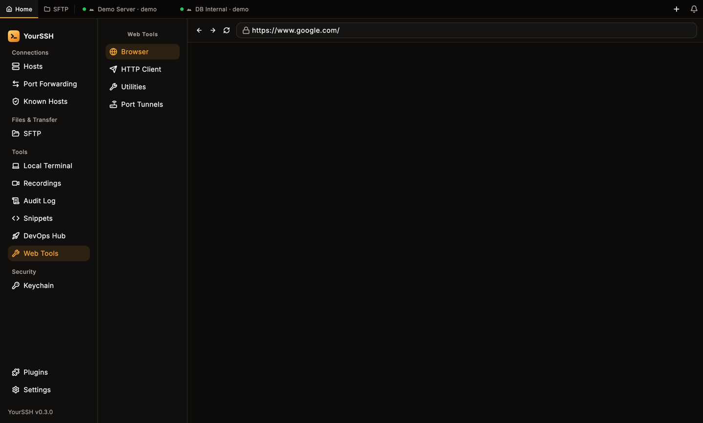
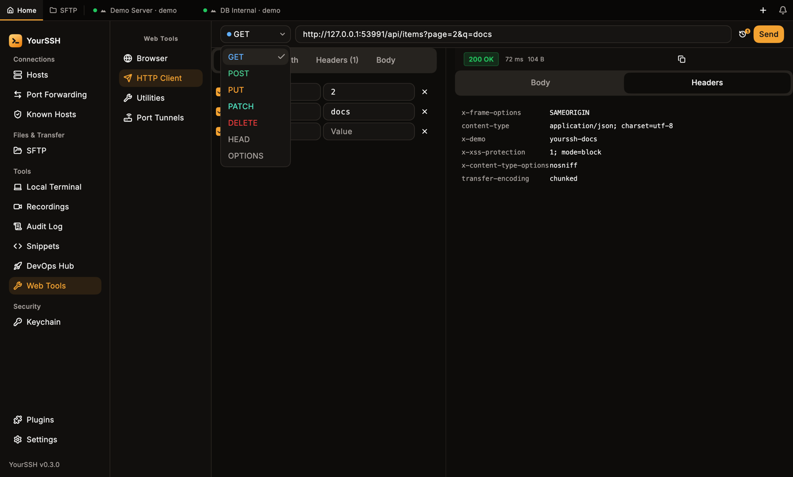
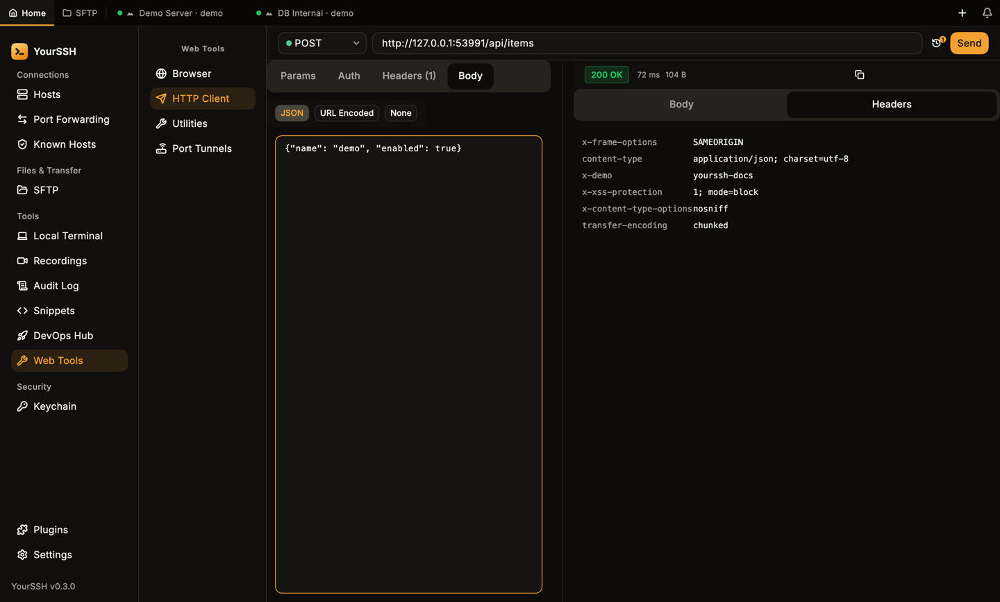
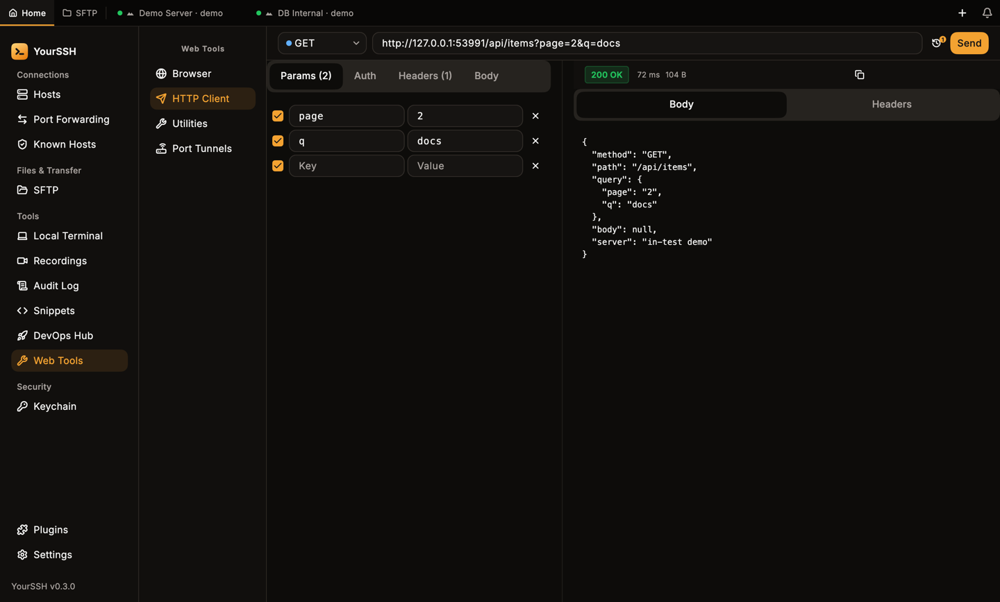
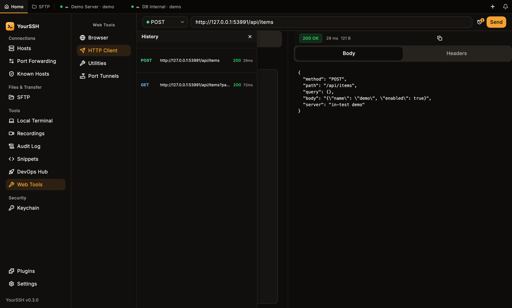
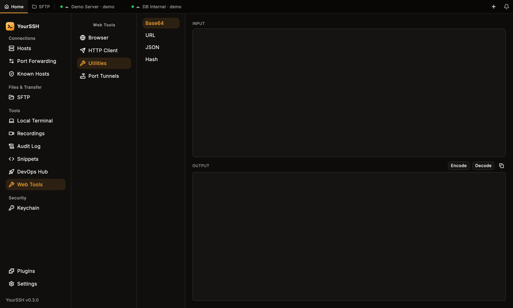
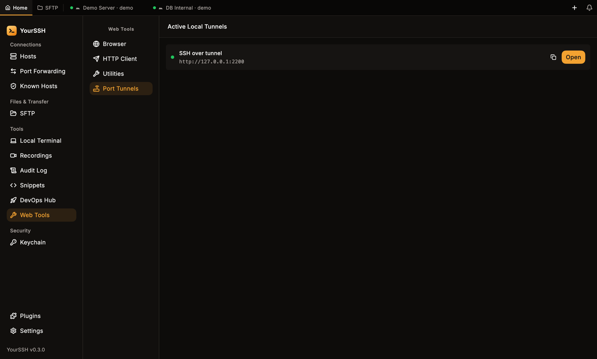

Web Tools is a built-in plugin with four tools: **Browser**, **HTTP Client**, **Utilities** and **Port Tunnels**. Click **Web Tools** in the sidebar under **Tools** to open it. If it is missing, turn it on in **Plugins**.

<Frame caption="Web Tools with its four tools in the list on the left.">
  
</Frame>

## HTTP Client

**HTTP Client** is a small request builder, similar to Postman or Insomnia. The request runs from your computer.

<Steps>
  <Step title="Choose a method and URL">
    Pick the method from the list at the left of the URL bar: `GET`, `POST`, `PUT`, `PATCH`, `DELETE`, `HEAD` or `OPTIONS`. Enter the URL.
  </Step>
  <Step title="Fill in the request">
    Use the tabs under the URL bar: **Params**, **Auth**, **Headers** and **Body**. A tab shows a count or dot when it has content.
  </Step>
  <Step title="Send">
    Click **Send**.
  </Step>
</Steps>

<Frame caption="The method list in the URL bar.">
  
</Frame>

### Request tabs

| Tab | What you set |
|---|---|
| **Params** | Query parameters as key and value rows. They are added to the URL. |
| **Auth** | **Auth Type**: **No Auth**, **Bearer Token**, **Basic Auth** or **API Key** (a **Key Name** and **Key Value**, sent in a **Header** or as a **Query Param** according to **Add to**). |
| **Headers** | Extra request headers as **Header** and **Value** rows. |
| **Body** | **JSON**, **URL Encoded** (key and value rows) or **None**. Methods that don't take a body show **Body not applicable for this method**. |

<Frame caption="A POST request with a JSON body. The response status, time and size show above the response.">
  
</Frame>

### Response

The right side shows the status code, time and size. Switch between **Body** and **Headers**. JSON bodies are pretty-printed. Use the copy button to copy the body.

<Frame caption="A GET response with the pretty-printed JSON body.">
  
</Frame>

### History

Click the history button in the URL bar to open **History**. It lists earlier requests with method, URL and status (`ERR` when the request failed). Click one to load it again. Use the close button to hide the panel.

<Frame caption="The History panel.">
  
</Frame>

<Note>
Auth values and headers you type may contain secrets. They stay on your computer and are sent only to the URL you request.
</Note>

## Utilities

**Utilities** has four text tools. Type in **INPUT**, click a button and read **OUTPUT** (**HASH OUTPUT** on the Hash tool). The copy button copies the result.

| Tool | Buttons |
|---|---|
| **Base64** | **Encode**, **Decode** |
| **URL** | **Encode**, **Decode** |
| **JSON** | **Format**, **Minify** |
| **Hash** | **SHA-256**, **SHA-512**, **SHA-1** |

Bad input shows an error such as **Invalid JSON** or **Invalid Base64**.

<Frame caption="Utilities. The tool list is on the left, input at the top and output below.">
  
</Frame>

## Port tunnels and the browser

**Port Tunnels** (the list is titled **Active Local Tunnels**) shows your active local port forwards as `http://127.0.0.1:<port>` addresses. Click **Open** to load one in **Browser**, or the copy button to copy the address. This is a quick way to reach a web UI on a remote host. Set up the forward first in [Port forwarding](/user-guide/port-forwarding).

<Frame caption="Active local tunnels. Open loads the address in the Browser tool.">
  
</Frame>

**Browser** is a simple built-in web view with back, forward and reload buttons and an address bar. It starts on `https://www.google.com`. It only loads `http` and `https` pages. Type a bare domain such as `example.com` and it adds `https://`. Any other text, including `file:` or `javascript:` addresses, becomes a Google search instead.

## Related pages

<CardGroup cols={2}>
  <Card title="Port forwarding" icon="arrow-left-right" href="/user-guide/port-forwarding">
    Create the tunnels that Web Tools can open.
  </Card>
  <Card title="DevOps Hub" icon="rocket" href="/user-guide/devops">
    Network tools, containers and more.
  </Card>
</CardGroup>
